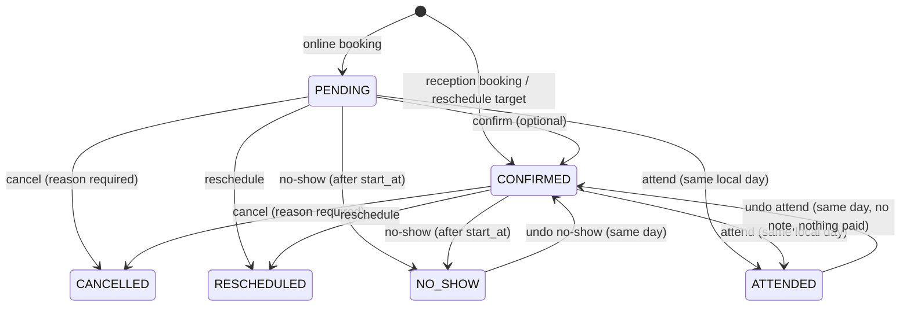
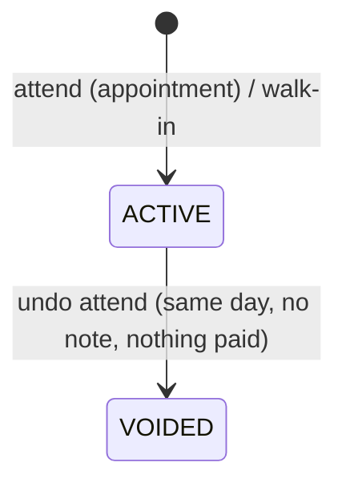
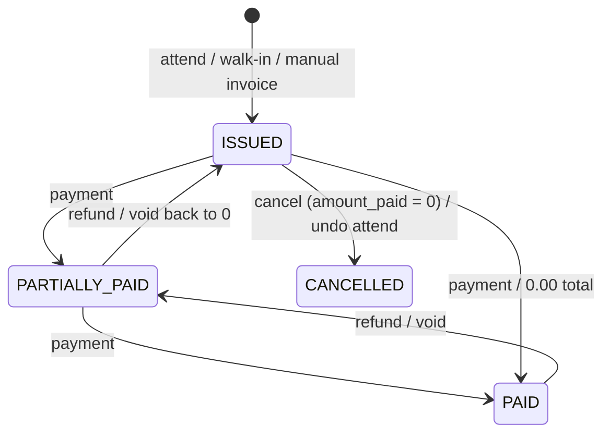

# Rehab Clinic — Backend

NestJS + PostgreSQL backend for a physiotherapy/medical clinic. It covers auth, staff users, the audit trail, patients, doctors, the services catalog, doctor schedules, availability, appointments (online and reception booking), visits (attend, walk-ins, undo, the day list), billing (invoices, discounts, payments, refunds, cash-desk summary), clinic expenses, clinical records (medical info, session notes, addenda, attachments), the patient history (overview and timeline) and the owner reports. Packages will come later as a new module.

- **Who logs in:** `OWNER`, `DOCTOR` and `RECEPTIONIST` staff.
- **Patients never log in.** A patient is identified only by their phone number, which is unique.
- **No payment gateway, no online payments.** Every payment is a manual record the receptionist enters after receiving the money at the desk.
- **Every sensitive change is audited:** who did it, what changed (old and new values), when, and from which IP.

## Stack

| Concern | Choice |
|---|---|
| Framework | NestJS 12 (ESM, TypeScript strict) |
| Database | PostgreSQL 16 + TypeORM 1.x, migrations only (`synchronize: false` everywhere) |
| Naming | `snake_case` in the DB (`SnakeNamingStrategy`), camelCase in TS |
| Auth | argon2id passwords, 15 min JWT access token, 7 day rotating opaque refresh token |
| Validation | `class-validator` DTOs + global `ValidationPipe` (whitelist, forbid unknown, transform) |
| Config | `@nestjs/config` + Joi schema (`src/config/env.validation.ts`) |
| Logging | `nestjs-pino`, one request id per request (`X-Request-Id` in and out) |
| Rate limiting | `@nestjs/throttler`: per user when authenticated, per email + IP on login, per IP on public endpoints |
| Docs | Swagger UI at `/api/docs`, JSON at `/api/docs-json` |
| Tests | Vitest (Jest-compatible API) + supertest e2e against a real PostgreSQL |

## Run everything with Docker

From the repo root, after `cp backend/.env.example backend/.env` (set `JWT_ACCESS_SECRET` and `SEED_OWNER_*`):

```bash
docker compose up -d --build     # db + backend + demo seed + playground
```

| Service | What it does |
|---|---|
| `db` | PostgreSQL 16, its own volume (host port 5433, so it doesn't clash with the dev database) |
| `backend` | API on <http://localhost:3000/api/v1>. On every start it runs the migrations and the OWNER seed (both idempotent) |
| `demo-seed` | One-shot: demo staff, services, schedules and a sample day. Skipped when doctors already exist |
| `playground` | Throwaway UI on <http://localhost:5173> (quick-login buttons for the demo accounts) |

The containers take `backend/.env`, with the `DB_*` values overridden to point at `db` and `NODE_ENV=production`.
Seeding happens when the containers start, not at image build time (there is no database during the build).

- Logs: `docker compose logs -f backend` (or `demo-seed`).
- Stop: `docker compose down`. Start again later: `docker compose up -d`.
- Fresh database and demo data again: `docker compose down -v && docker compose up -d --build` (**deletes the Docker database and uploaded files**).
- After code changes: `docker compose up -d --build`.

## Getting started

Prerequisites: Node 24+, Docker.

```bash
npm install
cp .env.example .env          # then edit secrets (JWT_ACCESS_SECRET, DB_PASSWORD, SEED_OWNER_*)
docker compose up -d          # PostgreSQL 16 on localhost:5432
npm run migration:run         # create the schema
npm run seed                  # create the first OWNER from SEED_OWNER_* (safe to re-run)
npm run start:dev             # http://localhost:3000/api/v1
```

- Swagger: <http://localhost:3000/api/docs>. Log in with `POST /auth/login`, then click **Authorize** and paste the `accessToken`.
- Health check: `GET /api/v1/health` returns `{ "status": "ok", "database": "up" }`, or 503 when the database is unreachable.
- pgAdmin (optional): `docker compose --profile tools up -d`, then open <http://localhost:5050>.

## Environment variables

All variables are validated at startup; the app refuses to start on invalid config. See [.env.example](.env.example).

| Variable | Default | Description |
|---|---|---|
| `NODE_ENV` | `development` | `development` \| `production` \| `test` |
| `PORT` | `3000` | HTTP port |
| `LOG_LEVEL` | `info` | pino level (`silent` in e2e) |
| `CORS_ORIGINS` | *(empty)* | Comma separated allowed origins; empty disables CORS |
| `TRUST_PROXY` | `false` | Set `true` behind a reverse proxy so the audit log records the real client IP |
| `SWAGGER_ENABLED` | `true` | Serve `/api/docs` |
| `DB_HOST` / `DB_PORT` / `DB_USERNAME` / `DB_PASSWORD` / `DB_DATABASE` | — | PostgreSQL connection (also used by `docker-compose.yml`) |
| `DB_LOGGING` | `false` | Log SQL |
| `DB_TEST_DATABASE` | `<DB_DATABASE>_test` | Database used by e2e tests. **It is wiped on every run** and must differ from `DB_DATABASE` |
| `JWT_ACCESS_SECRET` | — | At least 32 characters |
| `THROTTLE_ENABLED` | `true` | Global switch (off in e2e). Fixed limits: 120/min by default, counted **per user** on authenticated routes (the whole clinic usually shares one IP) and per IP on public ones; login 5/min **per email + IP**; refresh 20/min; public reads 30/min; public booking 5 per 15 min (per IP) |
| `CLINIC_TIMEZONE` | `Africa/Cairo` | IANA zone of the clinic. Schedules are in this zone's wall-clock time; offsets (DST) are resolved per date |
| `SLOT_INTERVAL_MINUTES` | `15` | Candidate slot starts every N minutes inside a schedule range |
| `BOOKING_MIN_LEAD_MINUTES` | `60` | Earliest bookable start = now + N minutes (schedule-checked bookings) |
| `BOOKING_MAX_DAYS_AHEAD` | `30` | Latest bookable local date = today + N days |
| `BOOKING_MAX_ACTIVE_PER_PHONE` | `3` | Max active future appointments one phone can hold through public booking |
| `BACKDATE_MAX_DAYS` | `7` | With `allowOutsideSchedule`, a RECEPTIONIST may book up to N local days in the past; older is OWNER only |
| `RECEPTIONIST_MAX_DISCOUNT_PERCENT` | `100` | Highest effective discount (% of the subtotal) a RECEPTIONIST may give; OWNER has no limit. `100` means no cap, which is intended for now (the clinic didn't ask for one); the owner can lower it later |
| `BILLING_OVERDUE_DAYS` | `7` | Invoices with a balance issued more than N days ago appear in `GET /billing/attention` |
| `CLINIC_NAME` / `CLINIC_PHONE` | `Rehab Clinic` / *(empty)* | Printed on receipts |
| `STORAGE_LOCAL_PATH` | `./storage` | Root folder of the local-disk file storage (expense receipts). Private: never served statically |
| `SEED_OWNER_NAME` / `SEED_OWNER_EMAIL` / `SEED_OWNER_PASSWORD` | — | First OWNER created by `npm run seed` |

## Scripts

| Script | What it does |
|---|---|
| `npm run start:dev` | Run with watch mode |
| `npm run build` / `npm run start:prod` | Compile to `dist/` and run it |
| `npm run lint` | oxlint, warnings are errors |
| `npm run typecheck` | `tsc --noEmit` over source **and** tests |
| `npm test` | Unit tests (`src/**/*.spec.ts`) |
| `npm run test:e2e` | e2e tests (`test/**/*.e2e-spec.ts`). Creates or wipes the test DB, runs the real migrations, then runs the suites one after another |
| `npm run migration:generate -- src/database/migrations/<Name>` | Diff the entities against the DB and write a migration |
| `npm run migration:create -- src/database/migrations/<Name>` | Empty migration for hand-written SQL |
| `npm run migration:run` / `migration:revert` / `migration:show` | Apply, undo the last, or list migrations |
| `npm run seed` | Run seeds (currently: first OWNER). Idempotent |

The migration scripts build first, because the TypeORM CLI loads the compiled `dist/database/data-source.js`.

### Migration workflow

1. Change or add an entity.
2. `npm run migration:generate -- src/database/migrations/DescribeTheChange`.
3. Review the SQL. Add anything TypeORM can't express by hand:
   - The `pg_trgm` GIN index on `patients.name` is declared with `@Index({ synchronize: false })` so that the generator ignores it.
   - Extensions are created by hand (`btree_gist`, needed by the exclusion constraints).
   - A Postgres enum shared by two tables (`appointment_status`) is emitted twice by the generator; remove the duplicate `CREATE TYPE`/`DROP TYPE`.
4. `npm run migration:run`, and check that `migration:revert` works.

## API overview

Every route is under `/api/v1` and needs `Authorization: Bearer <accessToken>` unless it is marked public.

| Group | OWNER | RECEPTIONIST | DOCTOR | Public |
|---|---|---|---|---|
| `/users` | RW | – | – | – |
| `/audit-logs` | R | – | – | – |
| `/patients` | RW | RW | R | – |
| `/doctors` | RW | R | R | – |
| `/clinic-services` | RW | R | R | – |
| `/public/doctors`, `/public/services` | – | – | – | R |
| `/doctors/:id/schedules`, `/doctors/:id/time-off` | RW | RW | R (own) | – |
| `/appointments/availability`, `/public/doctors/:id/slots` | R | R | R (own) | R |
| `/appointments` create / confirm / cancel / no-show / undo no-show / reschedule | W | W | – | create only (`POST /public/appointments`, PENDING) |
| `/appointments` list / view / history, `/patients/:id/appointments` | R | R | R (own only) | – |
| `/appointments/day` | R | R | R (own, no billing) | – |
| attend, undo attend, walk-in | W | W | – | – |
| `/visits/queue`, `/visits`, `/visits/:id`, `/visits/:id/history` | R | R | R (own) | – |
| `/patients/:id/visits` | R | R | R | – |
| invoices: create, edit items, cancel, view, `/patients/:id/invoices`, `/patients/:id/balance` | RW | RW | – | – |
| discounts: apply / repeat / remove, `/patients/:id/last-discount` | W | W (limit) | – | – |
| payments: record, list, receipt | W | W | – | – |
| payments: void | W | W (own, same day) | – | – |
| refunds | W | – | – | – |
| `/billing/attention` | R | R | – | – |
| `/billing/daily-summary` | R | R (today only) | – | – |
| expenses: create / edit / void / receipt upload | W | W (own, same day) | – | – |
| expenses: view, receipt file | R | R | – | – |
| `/expense-categories` | RW | R | – | – |
| clinical: medical info, notes, history, attachments (read) | R | – | R (patients they treat) | – |
| `/clinical-notes/needs-attention` | R | – | R (own) | – |
| clinical: `PUT …/medical-info`, notes (write, sign), addenda | – | – | W (notes: own visits) | – |
| clinical: attachment upload | W | – | W (patients they treat) | – |
| `/patients/:id/overview`, `/patients/:id/timeline` | R | R (no clinical data) | R (patients they treat, no billing) | – |
| `/reports/*` | R | – | – | – |
| `/packages` (catalog) | RW | R | – | – |
| `/public/packages` | – | – | – | R |
| sell (`POST /patients/:id/packages`), restore a no-show session | W | W | – | – |
| `/patients/:id/packages`, `/patient-packages/:id` | R | R | R (patients they treat, no prices) | – |
| cancel a sold package | W | – | – | – |

Doctors have no access to billing or expenses. Receptionists have no access to clinical records.

"Own" means a doctor sees only their own data. Asking for another doctor's schedule or appointment returns **404**, not 403, so the response doesn't reveal that it exists.

Errors always have this shape:

```json
{ "statusCode": 409, "error": "Conflict", "message": "A patient with this phone number already exists",
  "details": { "patientId": "…" }, "path": "/api/v1/patients", "timestamp": "2026-10-29T10:00:00.000Z" }
```

Validation errors have `message: "Validation failed"` and `details: [{ field, errors[] }]`.

**Conventions every client can rely on:**
- *Who did it* is always `{ id, name }` (`receivedBy`, `appliedBy`, `createdBy`, `voidedBy`, `issuedBy`, `cancelledBy`, `attendedBy`, `bookedBy`, `updatedBy`, `uploadedBy`, `changedBy`; audit rows have `user: { id, name, role }`), so a RECEPTIONIST can show names without `/users`. Optional ones are `null` (online bookings, public or system actions, not voided yet).
- List date filters are clinic local dates: `from=YYYY-MM-DD&to=YYYY-MM-DD`, both inclusive (`CLINIC_TIMEZONE`, DST-aware). Single-day endpoints take `date=YYYY-MM-DD`.
- Every state-changing action is a `POST`.
- Optional text fields are trimmed, and a blank string becomes `null` (`TrimOrNull`), so clearing a textarea clears the field.
- A normal "nothing found" that clients branch on is either `200` with `null` (`GET /visits/:id/note`, `GET /patients/:id/last-discount`, `{ patient: null }` for `GET /patients/lookup`) or a 404 with a `code` (`REFERENCE_NOT_FOUND`, `NOTE_NOT_VISIBLE`).

Business errors also carry a stable machine-readable `code`:

| Code | Status | Meaning |
|---|---|---|
| `REFRESH_RACE` | 401 | `POST /auth/refresh` with a token rotated less than 30 s ago: re-read the newest tokens and retry (the session is kept) |
| `SLOT_UNAVAILABLE` | 409 | The doctor already has an active appointment overlapping that time |
| `PATIENT_OVERLAP` | 409 | The patient already has an active appointment overlapping that time |
| `BOOKING_LIMIT_REACHED` | 409 | The phone already holds `BOOKING_MAX_ACTIVE_PER_PHONE` upcoming appointments (public booking) |
| `REFERENCE_NOT_FOUND` | 404 | No appointment with this reference code (or another doctor's) |
| `SCHEDULE_OVERLAP` | 409 | A schedule range overlaps another active range of the same doctor and day |
| `OUTSIDE_SCHEDULE` | 422 | The start is not a slot in the doctor's schedule: outside the ranges, off the slot grid, in time off, or inside the lead time |
| `DATE_OUT_OF_RANGE` | 422 | The date is before today or beyond `BOOKING_MAX_DAYS_AHEAD` |
| `SERVICE_NOT_OFFERED` | 422 | The doctor doesn't offer the service, or it is inactive |
| `INVALID_STATUS_TRANSITION` | 422 | The state machine doesn't allow the transition |
| `NO_SHOW_TOO_EARLY` | 422 | NO_SHOW before the appointment's start time |
| `ATTEND_WRONG_DAY` | 422 | Attend outside the appointment's local date |
| `ALREADY_ATTENDED` | 409 | The appointment already has an ACTIVE visit |
| `UNDO_WRONG_DAY` | 422 | Undo attend / undo no-show on another local day |
| `VISIT_HAS_NOTE` | 422 | Undo attend refused: the doctor has written a note for the visit |
| `VISIT_VOIDED` | 422 | The visit is already voided |
| `INVOICE_LOCKED` | 422 | Items/discount can't change: the invoice has (had) payments or is cancelled |
| `INVOICE_HAS_PAYMENTS` | 422 | Cancel or undo attend refused: money is still on the invoice (void or refund it first) |
| `INVOICE_CANCELLED` | 422 | The invoice is cancelled (no payments, no second cancel) |
| `INVOICE_NEEDS_ITEMS` | 422 | Removing the last item (cancel the invoice instead) |
| `DISCOUNT_EXCEEDS_SUBTOTAL` | 422 | The discount would exceed the subtotal (also when items change) |
| `DISCOUNT_LIMIT_EXCEEDED` | 422 | RECEPTIONIST above `RECEPTIONIST_MAX_DISCOUNT_PERCENT` |
| `DISCOUNT_PATIENT_MISMATCH` | 422 | Repeating another patient's discount |
| `OVERPAYMENT` | 422 | The payment is more than the remaining balance |
| `VOID_NOT_ALLOWED` | 422 | Not the same local day, not your payment (RECEPTIONIST), already voided, refunds exist, or the invoice is cancelled |
| `REFUND_NOT_ALLOWED` | 422 | Refunding a voided payment or a refund |
| `REFUND_EXCEEDS_PAYMENT` | 422 | Refunds would exceed the payment (`details.refundable`) |
| `EXPENSE_DATE_IN_FUTURE` | 422 | Expense dated after today |
| `EXPENSE_EDIT_NOT_ALLOWED` | 422 | Not the creator on the same local day (and not OWNER), or the expense is voided |
| `CATEGORY_INACTIVE` / `CATEGORY_NAME_TAKEN` | 422 / 409 | Expense category inactive / name already used |
| `NOTE_NOT_ALLOWED` | 422 | A note on a VOIDED visit |
| `NOTE_SIGNED` | 422 | Editing or re-signing a signed note (add an addendum instead) |
| `NOTE_INCOMPLETE` | 422 | Signing without an assessment or the treatment done |
| `NOTE_NOT_SIGNED` | 422 | An addendum on a draft |
| `NOTE_NOT_VISIBLE` | 404 | The visit's note is another doctor's draft |
| `ATTACHMENT_VISIT_MISMATCH` | 422 | The attachment's `visitId` belongs to another patient |
| `UNSUPPORTED_FILE_TYPE` | 422 | The upload's content isn't JPG/PNG/WEBP/PDF, or doesn't match its extension (files over 5 MB get 413) |
| `BACKDATE_LIMIT_EXCEEDED` | 422 | A RECEPTIONIST tried to book (or reschedule) more than `BACKDATE_MAX_DAYS` local days in the past |
| `OFFER_EXCEEDS_PRICE` | 422 | A FIXED package offer above the package price |
| `PACKAGE_INACTIVE` | 422 | Selling a deactivated package (or one whose service is inactive) |
| `PACKAGE_NOT_USABLE` | 422 | The chosen `patientPackageId` can't pay this session: cancelled, no sessions left, other service, or the doctor isn't covered |
| `PACKAGE_CANCELLED` | 422 | Cancelling a package twice |
| `PACKAGE_INVOICE` | 422 | Editing the items of a package sale's invoice, or cancelling it while the package isn't cancelled |
| `SERVICE_HAS_PACKAGES` | 422 | Deleting a service that still has packages (delete them first) |
| `RESTORE_NOT_ALLOWED` | 422 | Restoring an ATTENDED usage (undo the attendance instead) or one already restored |

## Modules

### `auth`
- `POST /auth/login` (email + password) returns an access JWT (`{ sub, role }`, 15 min), an opaque refresh token and the user. Inactive users get 403. Wrong credentials get a generic 401, with equalized timing for unknown emails.
- `POST /auth/refresh` **rotates** the refresh token: the old one is revoked and points to its replacement (`replaced_by_id`). Presenting an already revoked token is treated as theft. All of that user's tokens are revoked and the event is audited (`REFRESH_TOKEN_REUSE_DETECTED`), except inside the grace window below.
- `POST /auth/logout` revokes a refresh token and is idempotent. `GET /auth/me` returns the current user.

#### Sessions and staying logged in
- **Lifetimes:** the access token lives 15 minutes. Each refresh returns a *new* refresh token valid for 7 days from that moment (sliding expiry). A user who works every day never has to log in again. After 7 days without any request, the refresh token expires and they log in again.
- **Grace window for races:** a refresh token that was rotated less than **30 s** ago answers `401` with `code: REFRESH_RACE` and **does not** revoke anything. This happens when two requests (or two tabs sharing storage) refresh with the same token at once: one wins, the other gets `REFRESH_RACE`. Reusing a rotated token after 30 s, or a logged-out token, is still treated as theft.
- **What a client must do:**
  - Keep one refresh in flight at a time; other requests that get a 401 wait for it and then resend with the new access token.
  - If a request got a 401 but the stored access token has changed since it was sent, just resend (someone else already refreshed).
  - On `REFRESH_RACE`, re-read the stored tokens (another tab saved newer ones) and retry once. Only a refresh 401 *without* that code means "log in again". A 429 or 5xx on refresh is not a logout.
- Why staff got logged out before this: an expired access token made every parallel request on a page get 401 at once, and each called refresh with the same token. The first rotated it, the second looked like a replay, and reuse detection revoked the whole session (the next requests then failed with 401). Two tabs sharing one token did the same.
- The user in the login response and in `/auth/me` has `doctorId`: the doctor profile id for DOCTOR accounts (for "my schedule" screens), `null` otherwise.
- Only the SHA-256 of a refresh token is stored.
- Global `JwtAuthGuard`: everything is protected unless marked `@Public()`. It re-reads the user from the DB on every request, so deactivations and role changes apply immediately.
- Global `ClinicThrottlerGuard` runs right after it, so limits count per user on authenticated routes and per IP on public ones. Login counts per email + IP: one mistyped password doesn't lock out the colleagues behind the same router.
- Global `RolesGuard` + `@Roles()`. `@Auth(...roles)` combines `@Roles` with the Swagger docs. `@CurrentUser()` and `@CurrentActor()` (user id + IP, for auditing) are the param decorators.

### `users` (OWNER only)
- Create OWNER/RECEPTIONIST accounts, list (paginated; filter by role, active state or name/email), get, update, activate/deactivate, reset password.
- DOCTOR accounts are created and managed through `/doctors`, which keeps the account and the profile in sync. Password reset works for every role.
- **Rules:**
  - You cannot deactivate yourself.
  - At least one active OWNER must always remain. This is enforced with row locks, so two owners deactivating each other at the same time can't both succeed.
  - Deactivation and password reset revoke all of that user's refresh tokens.
- Emails are stored lowercased and protected by a unique constraint (409 on conflict). Responses never include `password_hash`. They are built from response DTOs, and the column is `select: false`.

### `audit`
- `AuditService.log(entry, manager?)` takes the caller's `EntityManager`, so the entry is committed or rolled back together with the change it describes.
- Recorded actions:
  - Login success and failure, logout, and refresh-token reuse.
  - User create, update, (de)activate and password reset.
  - Every patient, doctor, doctor-service and clinic-service mutation.
- Updates store only the fields that changed, in `old_values` and `new_values`.
- `GET /audit-logs` (OWNER) filters by `entityType`, `entityId`, `userId`, `action` and `from`/`to` (local dates), newest first. Each row has `user: { id, name, role }`, or `null` for a public or system action.

### `patients`
- The phone number is the only unique business key. `normalizeEgyptianMobile()` (`src/common/utils/phone.util.ts`):
  - Accepts `01012345678`, `+201012345678`, `00201012345678` and `201012345678`, with spaces, dashes or Arabic-Indic digits.
  - Stores the number as `+201XXXXXXXXX`.
  - Only 010/011/012/015 mobiles are valid.
- Normalization happens in the DTO (before validation) **and again** in the service.
- Uniqueness is enforced by the DB constraint `uq_patients_phone`. A violation becomes `409` with `details.patientId` of the existing patient. This also applies when a PATCH changes the phone.
- `GET /patients?search=` matches part of the name (trigram index) or the phone in any format. `GET /patients/lookup?phone=` finds an exact number: `{ patient }`, with `patient: null` when the phone is unknown (the normal case at the desk). `PATCH` changes are audited with old and new values.
- `PatientsService.findOrCreateByPhone({ name, phone, source, createdBy? }, manager?)` is used by public booking, reception booking and walk-ins:
  - Race-safe: `INSERT … ON CONFLICT (phone) DO NOTHING`, then `SELECT`.
  - Never renames an existing patient. It returns `nameMismatch: true` instead.
- There is **no public patient endpoint**. `notes` is for administrative notes only, never medical information.

### `doctors`
- `POST /doctors` (OWNER) creates the DOCTOR user and the doctor profile in **one transaction**.
- `PATCH` updates profile and account fields. Activate/deactivate changes both the profile and the login account, and deactivation signs the doctor out.
- `PUT/DELETE /doctors/:id/services/:serviceId` assigns or unassigns a service, with an optional `priceOverride`.
- Public endpoints:
  - `GET /public/doctors` and `GET /public/doctors/:id` return only active, public doctors whose account is active.
  - They expose only `id, name, specialty, bio, photoUrl, services[{id, name, description, durationMinutes, price}]`.

### `clinic-services`
- OWNER can create, update, activate and deactivate services. Staff can read them.
- **Deactivate vs delete:** `PATCH /clinic-services/:id/deactivate` hides a service for a while (not bookable, not public) and `activate` brings it back. `DELETE /clinic-services/:id` (204) removes it **for good**: `deleted_at` is set, it is out of every list, and GET / PATCH / activate answer 404. Its doctor assignments are removed (audited). The row itself stays, because visits and invoices point at it (CHECK: a deleted service is never active). Refused with 422 `SERVICE_HAS_PACKAGES` while it still has packages that aren't deleted.
- **Doctors offering a service:** `POST /clinic-services` and `PATCH /clinic-services/:id` accept `doctorIds: uuid[]` **or** `allDoctors: true` (every doctor active at that moment; doctors added later are not included). `PUT /clinic-services/:id/doctors { doctorIds | allDoctors }` replaces the list (exactly one of the two, 400 otherwise). These write the same `doctor_services` rows as `PUT/DELETE /doctors/:id/services/:serviceId`: doctors that stay keep their `priceOverride`, new ones get none, and each added or removed doctor is audited (`DOCTOR_SERVICE_ASSIGNED` / `_UNASSIGNED`). An unknown doctor id is 404, adding doctors to an inactive service is 409.
- Every service response has `doctors: [{ id, name }]` (doctor id, sorted by name).
- `GET /public/services` returns active services only.
- Prices are `numeric(12,2)` and travel as decimal strings (`"350.00"`) end to end, so there is no float math. These are **current** prices: future invoices must snapshot the price at billing time.

### Time-zone rules (`common/time`)
- Every timestamp is stored as `timestamptz` (UTC). APIs accept and return **ISO 8601 with an offset**, e.g. `2026-11-05T17:00:00+02:00`. Input without an offset is rejected; `Z` is accepted.
- List filters take clinic local dates instead (`from=2026-11-01&to=2026-11-30`, inclusive); `ClinicTimeService.dateRange` turns them into instants (start of `from`, start of the day after `to`).
- Responses are rendered in `CLINIC_TIMEZONE`. Egypt observes DST, so the same wall time is `+02:00` in winter and `+03:00` in summer. **Never hardcode an offset.**
- Doctor schedules are local wall-clock `time` values plus `day_of_week` (0 = Sunday), converted to UTC **per concrete date** with Luxon (`localToUtc`).
- **Spring forward** (last Friday of April, 00:00 → 01:00): a wall time inside the skipped hour moves forward with the clock (00:30 → 01:30 +03:00). A 00:00–02:00 range is therefore one real hour long.
- **Fall back** (last Thursday of October, 24:00 → 23:00): 23:00–23:59 happens twice. A range start uses the earlier occurrence and a range end the later one, so the repeated hour gets slots in both occurrences.
- Unit tests in `clinic-time.util.spec.ts` and `slot-generator.spec.ts` cover both 2026 transitions.
- "Now" comes from an injectable `CLOCK` (`ClinicTimeService`), so tests can freeze time.

### `schedules`
- `doctor_schedules` holds weekly ranges in clinic local time. A day can have several ranges (morning + evening) that must not overlap; touching ranges (09–13, 13–15) are allowed.
- Overlaps are decided by a `btree_gist` exclusion constraint on active rows (409 `SCHEDULE_OVERLAP`), which also holds under races. Deactivated ranges don't count.
- `doctor_time_off` holds absolute periods. Creating or updating time off that overlaps active appointments **still succeeds** and returns `conflictingAppointments`. Appointments are never cancelled automatically.
- OWNER and RECEPTIONIST manage schedules for every doctor; a DOCTOR can read only their own. Every change is audited.

### `appointments`

**Availability.** `AvailabilityService.getSlots(doctorId, serviceId, date)`:
- The slot length is the service duration. Candidate starts fall every `SLOT_INTERVAL_MINUTES` from each range start, and a slot must fit entirely inside one range.
- Slots that overlap time off or active appointments are excluded, as are past slots and slots within `BOOKING_MIN_LEAD_MINUTES`.
- Dates outside today..today+`BOOKING_MAX_DAYS_AHEAD` return 422.
- The doctor must be active and offer the service (otherwise 404/422).
- Reception can pass `includeOutsideSchedule` to see the whole local day, which ignores the schedule, time off and lead time but still excludes booked slots. It also allows past dates and times, to record an appointment that already happened: a RECEPTIONIST back to `BACKDATE_MAX_DAYS` local days, the OWNER any date.
- Availability is only a hint. **The exclusion constraints are the real guarantee.**

**Double-booking guarantee.** Two exclusion constraints cover the *active* statuses (PENDING, CONFIRMED, ATTENDED): one on `(doctor_id, tstzrange(start_at, end_at, '[)'))` and one on `(patient_id, …)`. A violation (Postgres `23P01`) becomes 409 `SLOT_UNAVAILABLE` or `PATIENT_OVERLAP`. Back-to-back appointments are fine, and CANCELLED, NO_SHOW and RESCHEDULED free the slot. `end_at` is always computed from the service duration; clients can't send it.

**Online booking** (`POST /public/appointments`, `@Public`). In one transaction:
1. Load the doctor (must be active and public) and the service (must be offered).
2. Check the start is a real slot: schedule, slot grid, time off, lead time, max days ahead. Otherwise 422.
3. `findOrCreateByPhone` (source ONLINE). An existing phone links to the existing patient, who is **never renamed**.
4. Lock the patient row and enforce `BOOKING_MAX_ACTIVE_PER_PHONE` (409 `BOOKING_LIMIT_REACHED`). A new phone simply has 0, so the response never reveals whether the phone existed.
5. Insert a **PENDING / ONLINE** appointment with `booked_name` = the submitted name and `booked_by` = NULL. A status-history row and an audit entry are written in the same transaction.

The response is exactly `{ referenceCode, doctorName, serviceName, startAt, endAt, status }`: no patient id or patient data.

Abuse protection:
- Throttling at 5 requests per 15 minutes per IP.
- A honeypot field `website` that must stay empty.
- The per-phone limit.

There is no public cancel or lookup endpoint: reception handles changes by phone, using the reference code.

**Reception booking** (`POST /appointments`):
- Identify the patient with `patientId`, or with `name` + `phone` (find-or-create, source RECEPTION). The appointment is created **CONFIRMED** with `booked_by` = the receptionist.
- `allowOutsideSchedule` skips the schedule, time-off and lead-time checks and writes an extra `APPOINTMENT_SCHEDULE_OVERRIDE` audit entry. It **never** skips the overlap constraints.
- It also allows recording past appointments. A RECEPTIONIST may go back at most `BACKDATE_MAX_DAYS` local days; anything older needs the OWNER (422 `BACKDATE_LIMIT_EXCEEDED`). The same rule applies to reschedule.

**How the desk works.** Online bookings start PENDING. Reception *may* call the patient and confirm, but it is optional: PENDING bookings show up everywhere CONFIRMED ones do and can be rescheduled, attended or marked no-show directly. Reception does everything about attendance; doctors never start or complete anything, they only write and sign the visit's note.

**Status machine.** The only definition is `appointment-state-machine.ts`; any other transition gets 422 `INVALID_STATUS_TRANSITION`.



Each transition also records **which operation** may perform it (the `AppointmentTrigger`): `ATTENDED → CONFIRMED` is only reachable through undo attend, and `NO_SHOW → CONFIRMED` only through undo no-show, so `POST /appointments/:id/confirm` returns 422 on both. CANCELLED and RESCHEDULED are final.

The time and undo rules on top of the transitions live in `appointment-actions.ts`. The same table answers the day list's `allowedActions` and rejects requests, so the two never disagree:

| Action (`allowedActions`) | Endpoint | From | Extra rule |
|---|---|---|---|
| `confirm` | `POST /appointments/:id/confirm` | PENDING | – |
| `cancel` | `POST /appointments/:id/cancel { reason }` | PENDING, CONFIRMED | – |
| `reschedule` | `POST /appointments/:id/reschedule` | PENDING, CONFIRMED | the new appointment is CONFIRMED |
| `noShow` | `POST /appointments/:id/no-show` | PENDING, CONFIRMED | start time passed (`NO_SHOW_TOO_EARLY`); uses a package session if one is usable |
| `undoNoShow` | `POST /appointments/:id/undo-no-show` | NO_SHOW | same local day (`UNDO_WRONG_DAY`); 409 if the freed slot was booked meanwhile; restores the session |
| `attend` | `POST /appointments/:id/attend` | PENDING, CONFIRMED | appointment's local day (`ATTEND_WRONG_DAY`) |
| `undoAttend` | `POST /appointments/:id/undo-attend { reason }` | ATTENDED | same local day, no note (`VISIT_HAS_NOTE`), invoice unpaid (`INVOICE_HAS_PAYMENTS`) |

- Each change locks the row, validates it, updates the status, appends `appointment_status_history` (from, to, changed_by, reason) and writes `audit_logs`, all in **one transaction**.
- **Reschedule** is one transaction. The old appointment becomes RESCHEDULED first, so it stops blocking. Then a new CONFIRMED appointment is inserted with `rescheduled_from_id`: same patient and service, optionally another doctor. If the new slot is taken, everything rolls back.

**Reading:**
- `GET /appointments` filters by local date range (`from`/`to`), doctor, patient, status and source; it is paginated and sorted by start time.
- `GET /appointments/day?date=&status=&doctorId=` is the day list: every appointment of the local day with its visit (if attended) plus the day's walk-ins (`isWalkIn: true`, appointment fields null), ordered by start time (attended time for walk-ins). Each row has patient name + phone, doctor, service, status, `bookedName`, a computed `nameMismatch`, `visitId`, `visitStatus`, `attendedAt`, `noteStatus` and **`allowedActions`**.
  - `status` takes several values (`?status=PENDING&status=CONFIRMED` or `?status=PENDING,CONFIRMED`); walk-ins count as ATTENDED.
  - OWNER / RECEPTIONIST rows also carry the billing columns (see Cashier views). A walk-in row's only action is `undoAttend`, done with `POST /visits/:visitId/undo-attend`.
  - Every row has `package: { usageId, patientPackageId, name, used, total }` when its visit (or, for a NO_SHOW row, its no-show) used a package session, else `null`. A NO_SHOW row with a session also gets `restoreSession` in `allowedActions` (`POST /package-usages/:usageId/restore`; no time limit, not a status change).
  - A DOCTOR gets only their own rows (PENDING included; `doctorId` is ignored), **without** billing fields, and `allowedActions` is `writeNote` (ACTIVE visit whose note isn't signed) or `viewNote` (signed note).
- `GET /appointments/:id`, `GET /appointments/by-reference/:code` (case-insensitive, e.g. `APT-7K3Q9X`; 404 `REFERENCE_NOT_FOUND`) and `GET /appointments/:id/history`.
- `GET /patients/:id/appointments` lists a patient's appointments across all doctors.

### `visits`

An **appointment** is a booking; a **visit** is the patient actually attending. Reception creates visits; doctors only write the note.



**Attend** (`POST /appointments/:id/attend`, OWNER/RECEPTIONIST): "the patient entered the doctor".
- Only on the appointment's local date (`CLINIC_TIMEZONE`); late arrival the same day is fine. Otherwise 422 `ATTEND_WRONG_DAY`. Works from PENDING or CONFIRMED (one history row).
- One transaction locks the appointment, moves it to ATTENDED, inserts the ACTIVE visit (patient, doctor and service copied from the appointment), **creates the invoice**, and writes the histories and audit entries. The response is the visit plus `invoiceId`. If anything fails (the invoice included), nothing is written.
- A second attend returns 409 `ALREADY_ATTENDED`. The guarantee is the partial unique index `uq_visits_appointment_active` on `appointment_id WHERE status = 'ACTIVE'`; it is partial so that after an undo, the same appointment can attend again.
- **Packages:** the optional body `{ patientPackageId }` or `{ usePackage: false }` (not both, 400) chooses who pays. By default the patient's oldest usable package pays one session (see `packages`) and the response's `package` is `{ usageId, patientPackageId, name, used, total }` (null when billed normally). Walk-ins take the same two fields.

**Walk-ins** (`POST /visits/walk-in`):
- A visit with `appointment_id = NULL`, attended now, with its invoice in the same transaction (`invoiceId` in the response). The patient is identified by `patientId` or `name` + `phone` (find-or-create, source RECEPTION) and never renamed.
- The doctor must be active and offer the (active) service.
- Walk-ins **do not block booking slots**.

**Undo attend** (same local day only, OWNER/RECEPTIONIST, `{ reason }` required):
- `POST /appointments/:id/undo-attend`: the appointment goes back to CONFIRMED.
- `POST /visits/:id/undo-attend`: the way to undo a walk-in (for an appointment's visit it does the same as the appointment route).
- Refused while the doctor has a note for the visit (422 `VISIT_HAS_NOTE`) or the invoice holds money (422 `INVOICE_HAS_PAYMENTS`: void the payments first).
- Otherwise, in one transaction: the visit becomes VOIDED (`voided_at`, `voided_by`, `void_reason`; CHECK `chk_visits_voided`), its invoice is CANCELLED with the same reason, its package session (if any) is restored, and the appointment returns to CONFIRMED.

**Notes** are written by the visit's doctor on ACTIVE visits only, any day after the visit (see `clinical`).

**Reading:**
- `GET /visits/queue?date=&doctorId=`: the day's ACTIVE visits in the order they attended, with patient, service, booked start time (null for walk-ins), `attendedAt`, `hasNote` and `noteStatus` (`DRAFT` / `SIGNED` / null). Doctors always get their own queue.
- `GET /visits` filters by local attended date range (`from`/`to`), doctor, patient, status and `walkIn`; it is paginated, newest first. Doctors see only their own.
- `GET /visits/:id` and `/visits/:id/history`.
- `GET /patients/:id/visits` lists every doctor's visits for the patient: metadata only, no clinical data.

### `billing`

#### Money rules (everywhere)
- Columns are `numeric(12,2)`. In TypeScript money is a string, and all arithmetic goes through `decimal.js` (`common/utils/money.util.ts`), never JS number math.
- The API accepts and returns money as strings; responses always have 2 decimals (`"320.00"`).
- Percent discount amount = `round_half_up(subtotal × percent / 100, 2)`. For example, 12.5% of 99.99 = 12.50.
- All totals are computed by the server; clients never send totals (unknown fields are rejected).
- DB CHECKs (they also reject hand-written SQL):
  - all amounts ≥ 0;
  - `total = subtotal − discount_total` and `amount_paid ≤ total`;
  - the status matches the amounts;
  - `line_total = unit_price × quantity`;
  - discount value ranges per type;
  - payment shape (refunds point to a payment and have a reason; voids are complete).
- Document numbers are gapless per year in clinic local time: `INV-2026-000123`, `RCP-…`, `EXP-…`. They come from `document_counters`, incremented inside the same transaction as the document, so a rollback releases the number.

#### Invoice lifecycle



- **Status is derived from the amounts**: nothing paid → ISSUED, part → PARTIALLY_PAID, everything (or a 0.00 total) → PAID. It is stored for querying.
- **Invoice per visit.**
  - Created by attend and walk-in **in the same transaction as the visit** (`invoiceId` in the response): there is no visit without its invoice.
  - Pricing comes from the `VisitBillingPolicy` hook. The default is `doctor_services.price_override ?? clinic_services.base_price`, snapshotted into the item, so later catalog changes never touch it.
  - A partial unique index on `visit_id` (non-cancelled) allows one live invoice per visit.
- **Undo attend** cancels the visit's invoice with the same reason, and is refused while it holds money.
- **Manual invoices** (`POST /invoices`): service items take name and base price from the catalog (any client price is ignored); free-text items need a description and a price.
- **Locking.** Items and the discount change only while the invoice has never had a valid payment (`INVOICE_LOCKED`). `GET /invoices/:id` says so in `isLocked`, and `canCancel` is true while it is not cancelled and nothing is paid. Percent discounts are recalculated when items change. An invoice keeps at least one item.
- **Cancel** requires `amount_paid = 0`. After a full refund, a locked invoice can still be cancelled.
- **Packages:** `BillingModule` binds `PackageVisitBillingPolicy` to `VISIT_BILLING_POLICY`. A visit paid by a package session gets one 0.00 line `"<service> — package <name> (session 3/10)"` (total 0.00, so PAID); any other visit falls back to the default pricing. A package sale's invoice (no visit) can get a discount, but its items are fixed and it can be cancelled only after the package is cancelled (422 `PACKAGE_INVOICE`).

#### Discounts and repeat
- `POST /invoices/:id/discount` takes `{ type, value, reason }` or `{ repeatFromDiscountId }`. Only one discount is active per invoice. Replacing or removing (`POST /invoices/:id/discount/remove { reason }`) keeps the old row, with `removed_at` and `removal_reason`.
- PERCENT: `0 < value ≤ 100`. FIXED: `0 < value ≤ subtotal` (`DISCOUNT_EXCEEDS_SUBTOTAL`).
- RECEPTIONIST cap: the effective percentage (the percent value, or fixed amount ÷ subtotal) must be ≤ `RECEPTIONIST_MAX_DISCOUNT_PERCENT`. The OWNER has no cap.
- **Repeat flow:**
  1. `GET /patients/:id/last-discount?excludeInvoiceId=` returns the patient's most recent discount that is still applied, on a non-cancelled invoice other than `excludeInvoiceId` (the invoice being edited), or `200 null` when there is none.
  2. `POST /invoices/:new/discount { repeatFromDiscountId }` copies type, value and reason, recomputes the amount on the new subtotal and sets `repeated_from_id`.
  - The source must belong to the same patient (`DISCOUNT_PATIENT_MISMATCH`), and the cap still applies. The old invoice never changes.

#### Payments: void vs refund
- `POST /invoices/:id/payments { amount, method, reference? }`. Partial payments are allowed; paying more than the balance gives `OVERPAYMENT` (there is no credit balance). Payments are manual desk records (there is no payment gateway): `reference` is optional free text for any method and is never validated against anything.
- Every payment, refund and void **locks the invoice row** (`SELECT … FOR UPDATE`), recomputes `amount_paid` (valid payments − valid refunds) and the status, and writes the audit entry in one transaction. Parallel payments can never overpay.
- A payment recorded twice by mistake is fixed with a **void** (same day).
- **VOID = a mistake.** Only on the local day it was recorded. A RECEPTIONIST can void only their own payments; the OWNER any. A reason is required. The row stays with status VOIDED.
- **REFUND = money returned.** OWNER only, as a new row pointing at a VALID payment of the invoice. Total refunds per payment are capped (`REFUND_EXCEEDS_PAYMENT`). The method defaults to the original payment's.
- Paid money is never edited or deleted.
- `GET /payments/:id/receipt` returns the printable data as JSON: clinic name and phone, receipt and invoice numbers, patient, items, discount with reason, total, this payment, total paid, remaining balance, received by, time.

#### Cashier views
- `GET /appointments/day` rows (OWNER / RECEPTIONIST) include `invoiceId`, `invoiceTotal`, `amountPaid`, `balance` and `paymentStatus` (`NOT_INVOICED | UNPAID | PARTIAL | PAID`).
- `GET /billing/attention` lists invoices of voided visits that still hold money (`voidedVisitsWithPayments`; only data from before undo attend required an unpaid invoice), and invoices with a balance issued before the local day `BILLING_OVERDUE_DAYS` ago.
- `GET /billing/daily-summary?date=` covers one clinic local day (23, 24 or 25 hours with DST): valid payments and refunds by method, voids made that day, active discounts applied that day (by user), and valid expenses dated that day by method. The OWNER can query any date; a RECEPTIONIST today only.

  ```
  expectedCash = cash payments − cash refunds − cash expenses
  ```

### `expenses`
- Clinic purchases (tea, supplies, maintenance) are **expenses, not patient invoices**. Six default categories are seeded by the migration.
- `POST /expenses`: the date can't be in the future (`EXPENSE_DATE_IN_FUTURE`). A RECEPTIONIST can backdate at most `BACKDATE_MAX_DAYS`.
- `PATCH /expenses/:id` and `POST /expenses/:id/void { reason }`: allowed for the creator on the same local day, or the OWNER any time (`EXPENSE_EDIT_NOT_ALLOWED`). Old and new values are audited, and there is no hard delete.
- `GET /expenses` filters by local date range (`from`/`to`), category, method, status and creator. It is paginated and returns `totalAmount`, the sum of VALID expenses across all pages.
- **Receipt files:**
  - `POST /expenses/:id/receipt` takes a multipart upload in the `file` field: JPG, PNG, WEBP or PDF, at most 5 MB (413 above that).
  - The type is decided by the file's **magic bytes**, and the name's extension must match (`UNSUPPORTED_FILE_TYPE`).
  - `GET /expenses/:id/receipt` streams the file to authorized users only.
  - Files are stored by `FileStorage` (`common/storage/file-storage.service.ts`) under `STORAGE_LOCAL_PATH`, with server-generated keys and path-traversal checks, and **nothing is served statically**. Add `FileStorage` to a module's providers to reuse it.
- Categories: the OWNER creates, renames and (de)activates them; the RECEPTIONIST can read them.

### `clinical` (clinical records)

Doctors record what happened in each session. Any doctor treating a patient sees that patient's full clinical history, across all doctors.

**Access rules:**

| Who | Read | Write |
|---|---|---|
| RECEPTIONIST | nothing (403 on every clinical endpoint) | nothing |
| DOCTOR | patients they have **at least one appointment or visit** with (any status, any date); otherwise **404** | notes on **their own** visits; medical info, addenda and attachments for patients they can read |
| OWNER | everything | attachment upload only (read-only otherwise, 403) |
| Anonymous | nothing (401) | nothing |

A DRAFT note is visible **only to its author**: everyone else (other doctors, the OWNER) gets 404 until it is signed.

**Medical info** (`patient_medical_info`, one row per patient, created on the first save):
- `GET /patients/:id/medical-info` returns empty fields with `updatedAt: null` before the first save.
- `PUT /patients/:id/medical-info { allergies, chronicConditions, pastSurgeries, currentMedications, notes }` replaces the record: a field left out (or blank) becomes null. Any doctor with access may update it, and old and new values are audited (`PATIENT_MEDICAL_INFO_UPDATED`).

**Session notes** (`clinical_notes`, at most one per visit, enforced by `uq_clinical_notes_visit`):
- `PUT /visits/:id/note` saves the DRAFT: created on the first save (on an ACTIVE visit, any day after it; `NOTE_NOT_ALLOWED` on a VOIDED one), replaced after (a field left out or blank becomes null). Only the visit's doctor may do this (others get 404). The visit row lock makes parallel first saves create one note.
- Fields: `chiefComplaint`, `assessment`, `treatmentDone`, `progress`, `plan` (next steps and home exercises) and `painScore` (0–10, DB CHECK).
- `POST /visits/:id/note/sign` needs an assessment or the treatment done (`NOTE_INCOMPLETE`). Fields sent with it are saved first (like `PUT`), in the same transaction, so a client can save and sign in one call. A SIGNED note is **locked forever** (`NOTE_SIGNED`); the DB CHECK `chk_clinical_notes_signed` requires `signed_at`.
- `GET /visits/:id/note` returns the note with its addenda, or `200 null` when the visit has none yet. Another doctor's draft is 404 `NOTE_NOT_VISIBLE`.
- `GET /clinical-notes/needs-attention?doctorId=&page=&limit=` lists ACTIVE visits without a SIGNED note (no note yet, or a DRAFT), oldest first, with patient, service, doctor, visit date and `noteStatus` (`DRAFT` or null). A DOCTOR sees only their own; the OWNER sees all, optionally filtered by `doctorId`.

**Addenda** (`clinical_note_addenda`, never edited or deleted):
- `POST /clinical-notes/:id/addenda { content }` adds to a SIGNED note (`NOTE_NOT_SIGNED` on a draft). Any doctor with access to the patient may add one, and the author is recorded.

**History:**
- `GET /patients/:id/clinical-history?page=&limit=` returns `{ medicalInfo, notes, attachments }`.
  - `notes` holds the patient's **SIGNED** notes from every doctor, newest visit first, paginated. Each has the doctor's name, visit date, service and addenda.
  - `attachments` lists all of the patient's attachments, newest first; each has its `visitId`.

**Attachments** (`patient_attachments`):
- `POST /patients/:id/attachments` (multipart: `file`, `title`, optional `visitId` of one of the patient's visits) is allowed for doctors with access and the OWNER.
- Files follow the same rules as expense receipts: JPG, PNG, WEBP or PDF, at most 5 MB (413), and the type is checked by magic bytes (`UNSUPPORTED_FILE_TYPE`). They are stored by `FileStorage` and never served publicly.
- `GET /patients/:id/attachments` lists them, and `GET /attachments/:id/file` streams one. Both follow the read rule above.

Every write is audited in the same transaction (`CLINICAL_NOTE_*`, `PATIENT_MEDICAL_INFO_UPDATED`, `PATIENT_ATTACHMENT_UPLOADED`).

### `patient-history` (patient page)

Read-only views over the other modules' tables (no tables of its own). Access is checked by `ClinicalAccessService`: an unknown patient is 404 for everyone, and a DOCTOR without an appointment or visit with the patient also gets **404**.

**`GET /patients/:id/overview`** is everything the patient page needs, in one request:

| Field | Meaning | OWNER | RECEPTIONIST | DOCTOR |
|---|---|---|---|---|
| `patient` | `id, name, phone, createdSource, createdAt` | ✓ | ✓ | ✓ |
| `nextAppointment` | earliest PENDING/CONFIRMED appointment starting from now (any doctor), or `null` | ✓ | ✓ | ✓ |
| `lastVisit` | most recent ACTIVE visit (walk-ins included), or `null` | ✓ | ✓ | ✓ |
| `counts` | `attended` (ACTIVE visits), `noShow` and `cancelled` (appointments in that status now) | ✓ | ✓ | ✓ |
| `doctors` | doctors with an ACTIVE visit: `{ id, name, lastVisitAt }`, most recent first | ✓ | ✓ | ✓ |
| `balance` | `{ totalInvoiced, totalPaid, balance }` over non-cancelled invoices (same as `/patients/:id/balance`) | ✓ | ✓ | `null` |
| `notesNeedingAttention` | ACTIVE visits without a signed note (`noteStatus` `DRAFT` or `null`), oldest first | all doctors' | `null` | their own |

**`GET /patients/:id/timeline?from=&to=&types=&cursor=&limit=`** lists everything that happened with the patient, newest first, across all modules. Every event has the same shape:

```json
{ "id": "PAYMENT_RECORDED:3f0c…", "type": "PAYMENT_RECORDED", "at": "2026-11-03T10:15:00+02:00",
  "actor": { "id": "…", "name": "Mona Adel" }, "doctor": { "id": "…", "name": "Dr. Sara" },
  "refs": { "visitId": "…", "invoiceId": "…", "paymentId": "…" },
  "data": { "receiptNumber": "RCP-2026-000045", "amount": "100.00", "method": "CASH", "reference": null } }
```

- `id` is the type plus the source row id: stable and unique (one payment row can give `PAYMENT_RECORDED` and `PAYMENT_VOIDED`).
- `actor` is who did it (`null` for an online booking). `doctor` is the doctor the event is about (`null` when there is none, e.g. a manual invoice). `refs` holds only the ids that apply.
- In `data`, money is a decimal string and every `…At` field is ISO with offset.

| Type | Source | `data` |
|---|---|---|
| `PATIENT_CREATED` | patients | `source` |
| `PATIENT_UPDATED` | audit log, only when the name or phone changed | `oldValues`, `newValues` (`name` and/or `phone`) |
| `APPOINTMENT_BOOKED` | appointments (not the new appointment of a reschedule) | `source`, `service`, `startAt`, `bookedName`, `referenceCode` |
| `APPOINTMENT_CONFIRMED` | status history PENDING → CONFIRMED | `startAt` |
| `APPOINTMENT_RESCHEDULED` | status history → RESCHEDULED; `refs.appointmentId` is the new appointment | `previousAppointmentId`, `oldStartAt`, `newStartAt`, `reason` |
| `APPOINTMENT_CANCELLED` | status history → CANCELLED | `startAt`, `reason` |
| `APPOINTMENT_NO_SHOW` | status history → NO_SHOW | `startAt` |
| `NO_SHOW_UNDONE` | status history NO_SHOW → CONFIRMED | `startAt` |
| `VISIT_ATTENDED` | visits (voided ones too) | `isWalkIn`, `service` |
| `ATTEND_UNDONE` | visits, `voided_at` | `isWalkIn`, `service`, `reason` |
| `INVOICE_ISSUED` | invoices; the actor of a visit's invoice is who attended the visit | `invoiceNumber`, `total` (current) |
| `INVOICE_CANCELLED` | invoices, `cancelled_at` | `invoiceNumber`, `reason` |
| `DISCOUNT_APPLIED` | invoice discounts | `invoiceNumber`, `type`, `value`, `amount`, `reason`, `isRepeat` |
| `DISCOUNT_REMOVED` | invoice discounts, `removed_at` (also when replaced) | `invoiceNumber`, `amount`, `reason` |
| `PAYMENT_RECORDED` | payments of type PAYMENT (voided ones too) | `receiptNumber`, `amount`, `method`, `reference` |
| `PAYMENT_VOIDED` | payments, `voided_at` (a payment or a refund) | `receiptNumber`, `paymentType`, `amount`, `method`, `reason` |
| `PAYMENT_REFUNDED` | payments of type REFUND | `receiptNumber`, `amount`, `method`, `reason`, `refundOfPaymentId` |
| `NOTE_SIGNED` | clinical notes, SIGNED only | `assessment` (first 200 characters) |
| `ADDENDUM_ADDED` | addenda | `content` (first 200 characters) |
| `MEDICAL_INFO_UPDATED` | audit log | `fields` (names of the changed fields) |
| `ATTACHMENT_UPLOADED` | attachments; `doctor` is the uploader when a doctor uploaded it | `attachmentId`, `title`, `mimeType` |
| `PACKAGE_SOLD` | patient packages, `sold_at` (`refs.invoiceId`) | `patientPackageId`, `name`, `service`, `totalSessions`, `listPrice`, `offerAmount`, `price` |
| `PACKAGE_SESSION_USED` | package usages (restored ones too); `doctor` is the visit's / appointment's doctor | `patientPackageId`, `name`, `reason` (ATTENDED / NO_SHOW), `totalSessions`, `restored` |
| `PACKAGE_SESSION_RESTORED` | package usages, `restored_at` | `patientPackageId`, `name`, `reason`, `totalSessions`, `restoreReason` |
| `PACKAGE_CANCELLED` | patient packages, `cancelled_at` | `patientPackageId`, `name`, `reason`, `usedSessions`, `totalSessions` |

**Visibility** is part of the query: only the event types the role may see are queried at all.

| Role | Sees |
|---|---|
| OWNER | everything |
| RECEPTIONIST | everything except `NOTE_SIGNED`, `ADDENDUM_ADDED`, `MEDICAL_INFO_UPDATED`, `ATTACHMENT_UPLOADED` |
| DOCTOR (with access) | everything except `INVOICE_*`, `DISCOUNT_*`, `PAYMENT_*` and `PACKAGE_SOLD` (the session and cancel events carry no prices) |

Draft notes never appear, for anyone (not even their author): a note shows up when it is signed.

**Filters and paging:**
- `types` takes several values (`?types=A&types=B` or `?types=A,B`). Types the role can't see are ignored (asking only for those gives an empty page).
- `from`/`to` are clinic local dates, inclusive, applied to `at`.
- Keyset pagination on `(at, id)`: `limit` defaults to 50 (max 200), and the response is `{ items, nextCursor }`. Pass `nextCursor` back as `cursor` for the next (older) page; it is `null` on the last page. The cursor is opaque and keeps the time to the microsecond, so events written in the same millisecond are never skipped or repeated. A malformed cursor is 400.
- It is one `UNION ALL` query, one branch per event type, each filtered by the patient through existing indexes. No index was added.

### `packages`

A package is **N sessions of one service for a total price**. Patients pay at the desk like any invoice (manual records; no online payments).

**Catalog** (`packages`, `package_doctors`; OWNER writes, RECEPTIONIST reads):
- `POST /packages { name, serviceId, sessionsCount, price, doctorIds | allDoctors: true, offer?, isPublic? }`, `PATCH /packages/:id` (same fields, all optional; `offer: null` removes it), `PATCH /packages/:id/activate|deactivate`, `DELETE /packages/:id`. Every change is audited (`PACKAGE_*`).
- **Deactivate vs delete:** deactivate stops sales for a while (and hides it from `/public/packages`); activate re-checks the package (service active, doctors offer it). `DELETE` (204) removes it **for good**: out of every list, never sold or activated again (404). Patients who bought it keep their sessions, and its doctor list keeps applying to them.
- **Doctors:** `allDoctors: true` means every doctor, including doctors added later. Otherwise every listed doctor must offer the package's service (422 `SERVICE_NOT_OFFERED`, `details.doctorIds`). The service must be active.
- **Offer:** `{ type: PERCENT | FIXED, value, startsOn?, endsOn? }` (local dates, inclusive, open-ended when null). While it is active, selling price = price − offer. PERCENT is at most 100 (400), FIXED at most the price (422 `OFFER_EXCEEDS_PRICE`); CHECK `chk_packages_offer` guards both.
- `GET /packages` (paginated, `isActive` filter) and `GET /packages/:id` return the doctors, the offer, `offerActive` and today's `sellingPrice`.
- `GET /public/packages`: active, public packages of an active service, with only `id, name, service { id, name }, sessionsCount, price, sellingPrice, offerEndsOn` (null without an active offer), `allDoctors` and `doctors [{ id, name }]` (only doctors the website shows), so the booking page can offer the packages of the chosen doctor and service. Packages are bought at the desk; there is no online sale.

**Selling** (`POST /patients/:id/packages { packageId }`, OWNER/RECEPTIONIST): one transaction creates the `patient_packages` row and its invoice (no visit, one line at today's selling price). Name, service, sessions, list price, offer amount and price are **snapshots**. The allowed doctors are **not**: a sold package follows the package's current doctor list. A deactivated package can't be sold (422 `PACKAGE_INACTIVE`).
- The patient pays all or part with the normal payments; the rest is their balance. Reception can add a normal invoice discount. The line itself is fixed, and the invoice can be cancelled only after the package is (`PACKAGE_INVOICE`).
- Sessions are usable before the package is paid. There is no expiry.

**Using sessions** (all in the transaction of the desk action):

| Desk action | Session |
|---|---|
| attend, walk-in | uses one (0.00 invoice line), unless `usePackage: false`; `patientPackageId` picks the package |
| no-show | uses one automatically |
| undo attend (appointment or walk-in) | restored |
| undo no-show | restored (reason "No-show undone") |
| `POST /package-usages/:id/restore { reason }` | restores a **no-show** session (422 `RESTORE_NOT_ALLOWED` for an attended one or twice) |
| cancel appointment | never uses one |

- **Usable package:** same service, the visit's doctor allowed by the package, status ACTIVE (sessions left, not cancelled). With several, the **oldest** (by `sold_at`) pays.
- **Concurrency:** using or restoring locks the `patient_packages` row (`FOR UPDATE`), which re-checks the conditions after waiting: of two parallel attends on the last session, one is covered and the other billed normally. CHECKs make the counts impossible to break: `0 ≤ used_sessions ≤ total_sessions`, ACTIVE ⇔ sessions left, FINISHED ⇔ none left, CANCELLED ⇔ `cancelled_*` set. Partial unique indexes allow one live usage per visit and per appointment.
- Used = total → FINISHED; a restore moves it back to ACTIVE. Every use and restore is audited (`PACKAGE_SESSION_USED` / `_RESTORED`).
- `package_usages` keeps the history: `reason` (ATTENDED with `visit_id`, NO_SHOW with `appointment_id`), `used_at/by`, `restored_at/by`, `restore_reason`.

**Cancelling** (`POST /patient-packages/:id/cancel { reason }`, OWNER): remaining sessions can't be used. The invoice is untouched; money goes back, if at all, with `POST /payments/:id/refund`.

**Reading:**
- `GET /patients/:id/packages` (newest first) and `GET /patient-packages/:id` (plus `usages`: date, reason, doctor, who, restored or not). Each has the sessions (`totalSessions`, `usedSessions`, `sessionsLeft`), `status` and the current doctors. OWNER/RECEPTIONIST also get `listPrice`, `offerAmount`, `price`, `invoiceId`, `invoiceTotal`, `amountPaid` and `balance`.
- A DOCTOR sees a patient's packages **without prices**, only for patients they treat (404 otherwise, like clinical data).
- Day list: the `package` column and `restoreSession` (see `appointments`). Timeline: `PACKAGE_*` events (see `patient-history`).

**Not covered on purpose:** removing a doctor from a service (`/clinic-services`) does not edit package doctor lists; that doctor can't be booked for the service any more anyway.

### `reports` (OWNER only)

Read-only aggregate queries; no tables of their own. Every report takes `from=YYYY-MM-DD&to=YYYY-MM-DD` (both **required**, clinic local dates, inclusive, DST-aware; `from` after `to` is 400) and echoes them back. Money is a decimal string.

**Revenue means money actually collected:** valid payments minus valid refunds, by the time they were received. Voided payments and voided refunds never count. Invoiced amounts are shown next to it for comparison.

Which rows count, everywhere:

| Thing | Counted when | Excluded |
|---|---|---|
| Payment / refund | `received_at` in the range | VOIDED |
| Invoice | `issued_at` in the range | CANCELLED (also those of undone visits) |
| Discount | `applied_at` in the range | removed or replaced, or on a cancelled invoice |
| Visit | `attended_at` in the range | VOIDED (undone) |
| Appointment | `start_at` in the range | RESCHEDULED (the new appointment counts instead, if it is in the range) |
| Expense | `expense_date` in the range | VOIDED |
| Patient | `created_at` in the range | – |

**`GET /reports/summary`**

| Field | Definition |
|---|---|
| `collected` | Sum of valid payments |
| `refunded` | Sum of valid refunds (whenever the original payment was made) |
| `netCollected` | `collected − refunded` |
| `expenses` | Sum of valid expenses |
| `netAfterExpenses` | `netCollected − expenses` |
| `invoiced` | Sum of `total` (after discounts) of the invoices issued in the range |
| `outstanding` | Sum of `total − amount_paid` (as of now) of those same invoices |
| `discountsGiven` | Sum of the discount amounts |
| `attendedVisits` | Visits, walk-ins included |
| `noShows` / `cancellations` | Appointments now in NO_SHOW / CANCELLED |
| `newPatients` | Patients created |
| `unsignedNotes` | Visits of the range without a SIGNED note (no note yet, or a draft) |

**`GET /reports/revenue?groupBy=day|month|doctor|service|method`** (default `day`) returns `rows` of `{ key, label, collected, invoiced, visits }` plus `totals` (which match the summary's `netCollected`, `invoiced` and `attendedVisits`).
- `collected` = payments − refunds, `invoiced` = invoice totals, `visits` = visits, each grouped by its own time column.
- `day` (`YYYY-MM-DD`) and `month` (`YYYY-MM`) are clinic local dates, sorted by date. Only days or months with data appear.
- `doctor` and `service`: a payment or invoice belongs to the doctor and service of its invoice's visit. Manual invoices (no visit) are one row with `key: null`, last. The other rows are sorted by `collected`, highest first.
- `method`: `collected` per payment method (a refund counts against its own method). `invoiced` and `visits` are `null`.

**`GET /reports/attendance?doctorId=`** returns one row per doctor with activity in the range (sorted by name), plus `totals`.
- `booked` = appointments (any source, any status except RESCHEDULED). `attended`, `noShow` and `cancelled` are those of them now in that status, and `onlineBookings` + `receptionBookings` = `booked`.
- `noShowRate` = `noShow / (attended + noShow) × 100`, 2 decimals, or `null` when both are 0.
- `walkIns` = walk-in visits.

**`GET /reports/discounts`** returns `count`, `totalAmount` and `repeats` (applied with "repeat last discount"), plus:
- `byUser`: `{ user, count, amount }`, largest amount first.
- `byReason`: the top 10 reasons, `{ reason, count, amount }`, most used first. Case and surrounding spaces are ignored ("Student" = " student ").

**`GET /reports/expenses`** returns `count`, `total`, `byCategory` (`{ category, count, total }`, largest first) and `byMethod` (all four methods).

**`GET /reports/outstanding?page=&limit=`** lists patients with an unpaid balance on invoices issued in the range, largest balance first, paginated like other lists.
- Each row is `{ patient: { id, name, phone }, balance, oldestUnpaidInvoiceDate }` (a clinic local date).
- The balances add up to the summary's `outstanding` for the same range. For everything owed regardless of date, use a wide range.

Tests: `test/reports.e2e-spec.ts` builds one dataset through the API around Egypt's fall-back night (2026-10-29 lasts 25 hours). It has voided payments, a refund, cancelled invoices, an undone walk-in, a replaced discount and a rescheduled appointment, and checks every number.

## Project layout

```
src/
  app.module.ts, app.setup.ts (shared by main.ts and e2e), main.ts
  common/      decorators, guards, filters, pipes, dto, errors, utils (money, phone...), time (clinic time zone), storage, base entity, enums
  config/      env validation (Joi), logger config
  database/    data-source.ts (TypeORM CLI), typeorm.options.ts, migrations/, seeds/
  modules/     auth, users, audit, patients, doctors, clinic-services, schedules, appointments, visits, billing, expenses, clinical, patient-history, reports, health
test/          e2e suites + global setup (test DB reset + migrations) + helpers
```

## Conventions for new modules

The full list (and the testing policy) is in [CLAUDE.md](../CLAUDE.md) at the repo root.

- Entities extend `BaseEntity` (uuid `id`, `created_at` / `updated_at` as `timestamptz`). Business data is never hard deleted: use `is_active` or a status column.
- Name constraints explicitly (`uq_…`, `fk_…`, `chk_…`, `idx_…`). Services catch specific unique violations by name and turn them into 409s.
- Do multi-step writes in `dataSource.transaction(...)`, pass the `manager` to `AuditService.logAction`, and throw 409s from a `catch` **outside** the transaction (a failed transaction is aborted).
- Controllers only route. Business logic lives in services, and every input and output is a DTO.
- Wrap cross-referencing entity relations in `Relation<>` (required for ESM circular imports).
- Business errors that clients branch on: throw `conflict(...)` / `unprocessable(...)` with an `ErrorCode` (`common/errors/app.exception.ts`).
- Dates and times: accept and return ISO with offset; convert through `ClinicTimeService`, never with a fixed offset.
- The appointment state machine lives in one file (`appointment-state-machine.ts`), and the desk rules on top of it in `appointment-actions.ts`. Every status change writes its history row and audit entry in the same transaction.
- Cross-module writes that must succeed together (visit + invoice) run in the same transaction, by passing the `EntityManager`.
- Status-history tables default `changed_at` to `clock_timestamp()` (not `now()`), so several rows written in one transaction keep their order.
- Money: strings + `decimal.js` helpers only; totals computed server-side; DB CHECKs for every amount invariant.
- Listeners of domain events run their own transaction and must be idempotent (events can be replayed).
