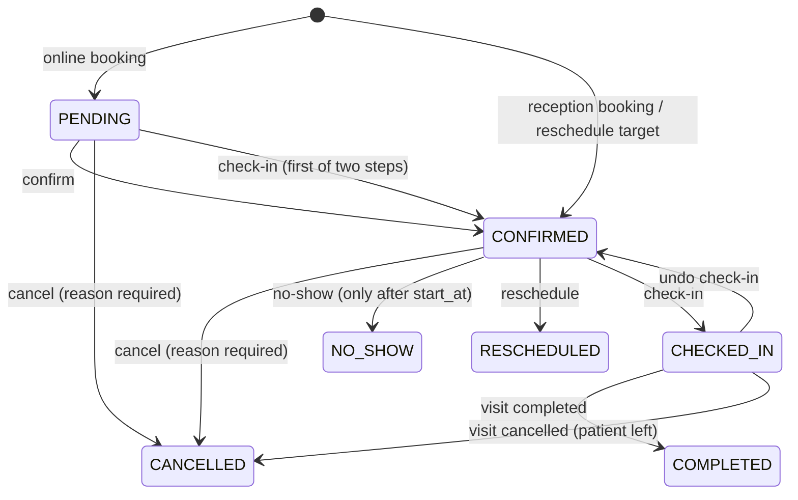
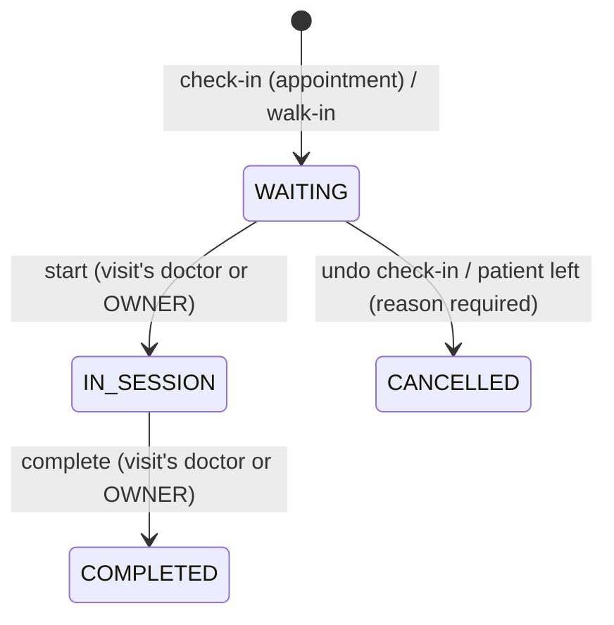
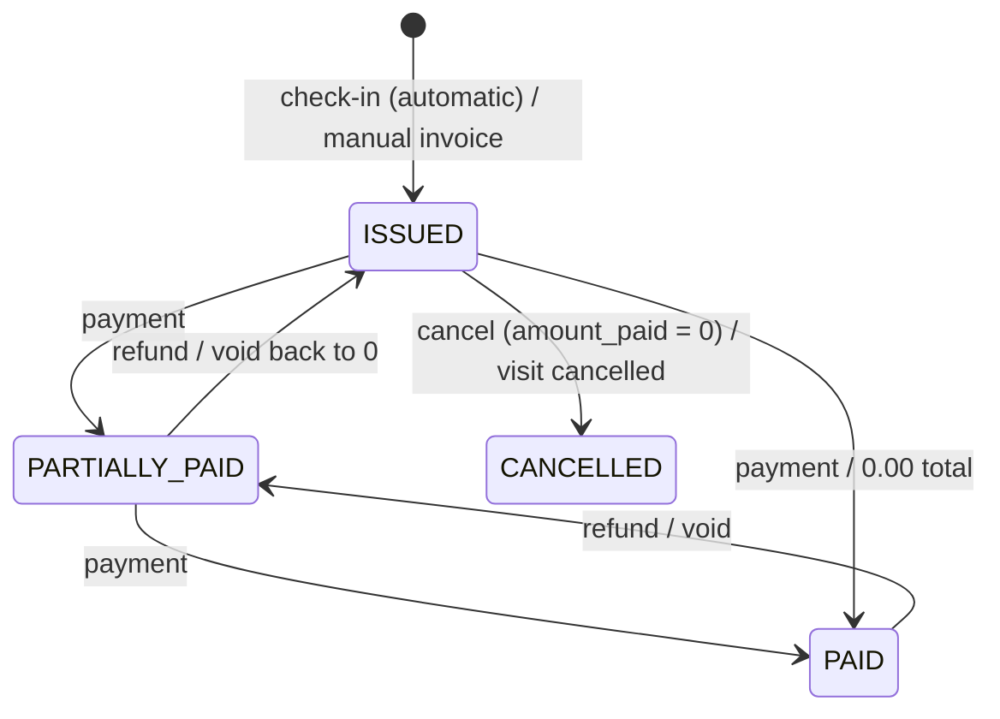

# Rehab Clinic — Backend

NestJS + PostgreSQL backend for a physiotherapy/medical clinic. It covers auth, staff users, the audit trail, patients, doctors, the services catalog, doctor schedules, availability appointments (online and reception booking) visits (check-in, walk-ins, the waiting room, doctor sessions), billing (invoices, discounts, payments, refunds, cash-desk summary) and clinic expenses. Packages, clinical notes and reports will come later as new modules.

- **Who logs in:** `OWNER`, `DOCTOR` and `RECEPTIONIST` staff.
- **Patients never log in.** A patient is identified only by their phone number, which is unique.
- **Every sensitive change is audited:** who did it, what changed (old and new values), when, and from which IP.

## Stack

| Concern | Choice |
|---|---|
| Framework | NestJS 12 (ESM, TypeScript strict) |
| Database | PostgreSQL 16 + TypeORM 1.x, migrations only (`synchronize: false` everywhere) |
| Naming | `snake_case` in the DB (`SnakeNamingStrategy`), camelCase in TS |
| Auth | argon2id passwords, 15 min JWT access token, 7 day rotating opaque refresh token |
| Validation | `class-validator` DTOs + global `ValidationPipe` (whitelist, forbid unknown, transform) |
| Config | `@nestjs/config` + Joi schema (`src/config/env.validation.ts`) |
| Logging | `nestjs-pino`, one request id per request (`X-Request-Id` in and out) |
| Rate limiting | `@nestjs/throttler` (stricter on login and public endpoints) |
| Docs | Swagger UI at `/api/docs`, JSON at `/api/docs-json` |
| Tests | Vitest (Jest-compatible API) + supertest e2e against a real PostgreSQL |

## Getting started

Prerequisites: Node 24+, Docker.

```bash
npm install
cp .env.example .env          # then edit secrets (JWT_ACCESS_SECRET, DB_PASSWORD, SEED_OWNER_*)
docker compose up -d          # PostgreSQL 16 on localhost:5432
npm run migration:run         # create the schema
npm run seed                  # create the first OWNER from SEED_OWNER_* (safe to re-run)
npm run start:dev             # http://localhost:3000/api/v1
```

- Swagger: <http://localhost:3000/api/docs>. Log in with `POST /auth/login`, then click **Authorize** and paste the `accessToken`.
- Health check: `GET /api/v1/health`, which also checks the database connection.
- pgAdmin (optional): `docker compose --profile tools up -d`, then open <http://localhost:5050>.

## Environment variables

All variables are validated at startup; the app refuses to start on invalid config. See [.env.example](.env.example).

| Variable | Default | Description |
|---|---|---|
| `NODE_ENV` | `development` | `development` \| `production` \| `test` |
| `PORT` | `3000` | HTTP port |
| `LOG_LEVEL` | `info` | pino level (`silent` in e2e) |
| `CORS_ORIGINS` | *(empty)* | Comma separated allowed origins; empty disables CORS |
| `TRUST_PROXY` | `false` | Set `true` behind a reverse proxy so the audit log records the real client IP |
| `SWAGGER_ENABLED` | `true` | Serve `/api/docs` |
| `DB_HOST` / `DB_PORT` / `DB_USERNAME` / `DB_PASSWORD` / `DB_DATABASE` | — | PostgreSQL connection (also used by `docker-compose.yml`) |
| `DB_LOGGING` | `false` | Log SQL |
| `DB_TEST_DATABASE` | `<DB_DATABASE>_test` | Database used by e2e tests. **It is wiped on every run** and must differ from `DB_DATABASE` |
| `JWT_ACCESS_SECRET` | — | At least 32 characters |
| `JWT_ACCESS_TTL_SECONDS` | `900` | Access token lifetime |
| `JWT_REFRESH_TTL_DAYS` | `7` | Refresh token lifetime |
| `THROTTLE_ENABLED` | `true` | Global switch (off in e2e) |
| `THROTTLE_TTL_MS` / `THROTTLE_LIMIT` | `60000` / `120` | Default limit per IP. Login: 5/min; refresh: 20/min; public reads: 30/min; public booking: 5 per 15 min |
| `CLINIC_TIMEZONE` | `Africa/Cairo` | IANA zone of the clinic. Schedules are in this zone's wall-clock time; offsets (DST) are resolved per date |
| `SLOT_INTERVAL_MINUTES` | `15` | Candidate slot starts every N minutes inside a schedule range |
| `BOOKING_MIN_LEAD_MINUTES` | `60` | Earliest bookable start = now + N minutes (schedule-checked bookings) |
| `BOOKING_MAX_DAYS_AHEAD` | `30` | Latest bookable local date = today + N days |
| `BOOKING_MAX_ACTIVE_PER_PHONE` | `3` | Max active future appointments one phone can hold through public booking |
| `BACKDATE_MAX_DAYS` | `7` | With `allowOutsideSchedule`, a RECEPTIONIST may book up to N local days in the past; older is OWNER only |
| `RECEPTIONIST_MAX_DISCOUNT_PERCENT` | `100` | Highest effective discount (% of the subtotal) a RECEPTIONIST may give; OWNER has no limit |
| `BILLING_OVERDUE_DAYS` | `7` | Invoices with a balance issued more than N days ago appear in `GET /billing/attention` |
| `CLINIC_NAME` / `CLINIC_PHONE` | `Rehab Clinic` / *(empty)* | Printed on receipts |
| `STORAGE_LOCAL_PATH` | `./storage` | Root folder of the local-disk file storage (expense receipts). Private: never served statically |
| `SEED_OWNER_NAME` / `SEED_OWNER_EMAIL` / `SEED_OWNER_PASSWORD` | — | First OWNER created by `npm run seed` |

## Scripts

| Script | What it does |
|---|---|
| `npm run start:dev` | Run with watch mode |
| `npm run build` / `npm run start:prod` | Compile to `dist/` and run it |
| `npm run lint` | oxlint, warnings are errors |
| `npm run typecheck` | `tsc --noEmit` over source **and** tests |
| `npm test` | Unit tests (`src/**/*.spec.ts`) |
| `npm run test:e2e` | e2e tests (`test/**/*.e2e-spec.ts`). Creates or wipes the test DB, runs the real migrations, then runs the suites one after another |
| `npm run migration:generate -- src/database/migrations/<Name>` | Diff the entities against the DB and write a migration |
| `npm run migration:create -- src/database/migrations/<Name>` | Empty migration for hand-written SQL |
| `npm run migration:run` / `migration:revert` / `migration:show` | Apply, undo the last, or list migrations |
| `npm run seed` | Run seeds (currently: first OWNER). Idempotent |

The migration scripts build first, because the TypeORM CLI loads the compiled `dist/database/data-source.js`.

### Migration workflow

1. Change or add an entity.
2. `npm run migration:generate -- src/database/migrations/DescribeTheChange`.
3. Review the SQL. Add anything TypeORM can't express by hand:
   - The `pg_trgm` GIN index on `patients.name` is declared with `@Index({ synchronize: false })` so that the generator ignores it.
   - Extensions are created by hand (`btree_gist`, needed by the exclusion constraints).
   - A Postgres enum shared by two tables (`appointment_status`) is emitted twice by the generator; remove the duplicate `CREATE TYPE`/`DROP TYPE`.
4. `npm run migration:run`, and check that `migration:revert` works.

## API overview

Every route is under `/api/v1` and needs `Authorization: Bearer <accessToken>` unless it is marked public.

| Group | OWNER | RECEPTIONIST | DOCTOR | Public |
|---|---|---|---|---|
| `/users` | RW | – | – | – |
| `/audit-logs` | R | – | – | – |
| `/patients` | RW | RW | R | – |
| `/doctors` | RW | R | R | – |
| `/clinic-services` | RW | R | R | – |
| `/public/doctors`, `/public/services` | – | – | – | R |
| `/doctors/:id/schedules`, `/doctors/:id/time-off` | RW | RW | R (own) | – |
| `/appointments/availability`, `/public/doctors/:id/slots` | R | R | R (own) | R |
| `/appointments` create / confirm / cancel / no-show / reschedule | W | W | – | create only (`POST /public/appointments`, PENDING) |
| `/appointments` list / view / history, `/patients/:id/appointments` | R | R | R (own only) | – |
| `/appointments/day` | R | R | – | – |
| check-in, walk-in, undo check-in, cancel visit | W | W | – | – |
| start / complete visit | W | – | W (own) | – |
| `/visits/queue`, `/visits`, `/visits/:id`, `/visits/:id/history` | R | R | R (own) | – |
| `/patients/:id/visits` | R | R | R | – |
| `/visits/open` | R | R | – | – |
| invoices: create, edit items, cancel, view, `/patients/:id/invoices`, `/patients/:id/balance` | RW | RW | – | – |
| discounts: apply / repeat / remove, `/patients/:id/last-discount` | W | W (limit) | – | – |
| payments: record, list, receipt | W | W | – | – |
| payments: void | W | W (own, same day) | – | – |
| refunds | W | – | – | – |
| `/billing/attention` | R | R | – | – |
| `/billing/daily-summary` | R | R (today only) | – | – |
| expenses: create / edit / void / receipt upload | W | W (own, same day) | – | – |
| expenses: view, receipt file | R | R | – | – |
| `/expense-categories` | RW | R | – | – |

Doctors have no access to billing or expenses.

"Own" means a doctor sees only their own data. Asking for another doctor's schedule or appointment returns **404**, not 403, so the response doesn't reveal that it exists.

Errors always have this shape:

```json
{ "statusCode": 409, "error": "Conflict", "message": "A patient with this phone number already exists",
  "details": { "patientId": "…" }, "path": "/api/v1/patients", "timestamp": "2026-10-29T10:00:00.000Z" }
```

Validation errors have `message: "Validation failed"` and `details: [{ field, errors[] }]`.

Business errors also carry a stable machine-readable `code`:

| Code | Status | Meaning |
|---|---|---|
| `SLOT_UNAVAILABLE` | 409 | The doctor already has an active appointment overlapping that time |
| `PATIENT_OVERLAP` | 409 | The patient already has an active appointment overlapping that time |
| `BOOKING_LIMIT_REACHED` | 409 | The phone already holds `BOOKING_MAX_ACTIVE_PER_PHONE` upcoming appointments (public booking) |
| `SCHEDULE_OVERLAP` | 409 | A schedule range overlaps another active range of the same doctor and day |
| `OUTSIDE_SCHEDULE` | 422 | The start is not a slot in the doctor's schedule: outside the ranges, off the slot grid, in time off, or inside the lead time |
| `DATE_OUT_OF_RANGE` | 422 | The date is before today or beyond `BOOKING_MAX_DAYS_AHEAD` |
| `SERVICE_NOT_OFFERED` | 422 | The doctor doesn't offer the service, or it is inactive |
| `INVALID_STATUS_TRANSITION` | 422 | The state machine doesn't allow the transition |
| `NO_SHOW_TOO_EARLY` | 422 | NO_SHOW before the appointment's start time |
| `CHECK_IN_WRONG_DAY` | 422 | Check-in outside the appointment's local date |
| `ALREADY_CHECKED_IN` | 409 | The appointment already has a live visit |
| `PATIENT_HAS_OPEN_VISIT` | 409 | The patient already has a WAITING/IN_SESSION visit |
| `DOCTOR_ALREADY_IN_SESSION` | 409 | The doctor already has an IN_SESSION visit |
| `INVALID_VISIT_TRANSITION` | 422 | The visit state machine doesn't allow the transition |
| `VISIT_COMPLETION_BLOCKED` | 422 | The `VisitCompletionPolicy` refused completion (the message gives the reason) |
| `INVOICE_LOCKED` | 422 | Items/discount can't change: the invoice has (had) payments or is cancelled |
| `INVOICE_HAS_PAYMENTS` | 422 | Cancel refused: money is still on the invoice (refund it first) |
| `INVOICE_CANCELLED` | 422 | The invoice is cancelled (no payments, no second cancel) |
| `INVOICE_NEEDS_ITEMS` | 422 | Removing the last item (cancel the invoice instead) |
| `VISIT_CANCELLED` | 422 | No invoice can be created for a cancelled visit |
| `DISCOUNT_EXCEEDS_SUBTOTAL` | 422 | The discount would exceed the subtotal (also when items change) |
| `DISCOUNT_LIMIT_EXCEEDED` | 422 | RECEPTIONIST above `RECEPTIONIST_MAX_DISCOUNT_PERCENT` |
| `DISCOUNT_PATIENT_MISMATCH` | 422 | Repeating another patient's discount |
| `NO_PREVIOUS_DISCOUNT` | 404 | The patient has no active discount to repeat |
| `OVERPAYMENT` | 422 | The payment is more than the remaining balance |
| `IDEMPOTENCY_KEY_REUSED` | 409 | Same `Idempotency-Key` with a different request |
| `VOID_NOT_ALLOWED` | 422 | Not the same local day, not your payment (RECEPTIONIST), already voided, refunds exist, or the invoice is cancelled |
| `REFUND_NOT_ALLOWED` | 422 | Refunding a voided payment or a refund |
| `REFUND_EXCEEDS_PAYMENT` | 422 | Refunds would exceed the payment (`details.refundable`) |
| `EXPENSE_DATE_IN_FUTURE` | 422 | Expense dated after today |
| `EXPENSE_EDIT_NOT_ALLOWED` | 422 | Not the creator on the same local day (and not OWNER), or the expense is voided |
| `CATEGORY_INACTIVE` / `CATEGORY_NAME_TAKEN` | 422 / 409 | Expense category inactive / name already used |
| `UNSUPPORTED_FILE_TYPE` | 422 | The upload's content isn't JPG/PNG/WEBP/PDF, or doesn't match its extension (files over 5 MB get 413) |
| `BACKDATE_LIMIT_EXCEEDED` | 422 | A RECEPTIONIST tried to book (or reschedule) more than `BACKDATE_MAX_DAYS` local days in the past |

## Modules

### `auth`
- `POST /auth/login` (email + password) returns an access JWT (`{ sub, role }`, 15 min), an opaque refresh token and the user. Inactive users get 403. Wrong credentials get a generic 401, with equalized timing for unknown emails.
- `POST /auth/refresh` **rotates** the refresh token: the old one is revoked and points to its replacement (`replaced_by_id`). Presenting an already revoked token is treated as theft. All of that user's tokens are revoked and the event is audited (`REFRESH_TOKEN_REUSE_DETECTED`).
- `POST /auth/logout` revokes a refresh token and is idempotent. `GET /auth/me` returns the current user.
- Only the SHA-256 of a refresh token is stored.
- Global `JwtAuthGuard`: everything is protected unless marked `@Public()`. It re-reads the user from the DB on every request, so deactivations and role changes apply immediately.
- Global `RolesGuard` + `@Roles()`. `@Auth(...roles)` combines `@Roles` with the Swagger docs. `@CurrentUser()` and `@CurrentActor()` (user id + IP, for auditing) are the param decorators.

### `users` (OWNER only)
- Create OWNER/RECEPTIONIST accounts, list (paginated; filter by role, active state or name/email), get, update, activate/deactivate, reset password.
- DOCTOR accounts are created and managed through `/doctors`, which keeps the account and the profile in sync. Password reset works for every role.
- **Rules:**
  - You cannot deactivate yourself.
  - At least one active OWNER must always remain. This is enforced with row locks, so two owners deactivating each other at the same time can't both succeed.
  - Deactivation and password reset revoke all of that user's refresh tokens.
- Emails are stored lowercased and protected by a unique constraint (409 on conflict). Responses never include `password_hash`. They are built from response DTOs, and the column is `select: false`.

### `audit`
- `AuditService.log(entry, manager?)` takes the caller's `EntityManager`, so the entry is committed or rolled back together with the change it describes.
- Recorded actions:
  - Login success and failure, logout, and refresh-token reuse.
  - User create, update, (de)activate and password reset.
  - Every patient, doctor, doctor-service and clinic-service mutation.
- Updates store only the fields that changed, in `old_values` and `new_values`.
- `GET /audit-logs` (OWNER) filters by `entityType`, `entityId`, `userId`, `action` and `from`/`to`, newest first. `user_id = NULL` means a public or system action.

### `patients`
- The phone number is the only unique business key. `normalizeEgyptianMobile()` (`src/common/utils/phone.util.ts`):
  - Accepts `01012345678`, `+201012345678`, `00201012345678` and `201012345678`, with spaces, dashes or Arabic-Indic digits.
  - Stores the number as `+201XXXXXXXXX`.
  - Only 010/011/012/015 mobiles are valid.
- Normalization happens in the DTO (before validation) **and again** in the service.
- Uniqueness is enforced by the DB constraint `uq_patients_phone`. A violation becomes `409` with `details.patientId` of the existing patient. This also applies when a PATCH changes the phone.
- `GET /patients?search=` matches part of the name (trigram index) or the phone in any format. `GET /patients/lookup?phone=` finds an exact number. `PATCH` changes are audited with old and new values.
- `PatientsService.findOrCreateByPhone({ name, phone, source, createdBy? }, manager?)` is for the future public booking flow:
  - Race-safe: `INSERT … ON CONFLICT (phone) DO NOTHING`, then `SELECT`.
  - Never renames an existing patient. It returns `nameMismatch: true` instead.
- There is **no public patient endpoint**. `notes` is for administrative notes only, never medical information.

### `doctors`
- `POST /doctors` (OWNER) creates the DOCTOR user and the doctor profile in **one transaction**.
- `PATCH` updates profile and account fields. Activate/deactivate changes both the profile and the login account, and deactivation signs the doctor out.
- `PUT/DELETE /doctors/:id/services/:serviceId` assigns or unassigns a service, with an optional `priceOverride`.
- Public endpoints:
  - `GET /public/doctors` and `GET /public/doctors/:id` return only active, public doctors whose account is active.
  - They expose only `id, name, specialty, bio, photoUrl, services[{id, name, description, durationMinutes, price}]`.

### `clinic-services`
- OWNER can create, update, activate and deactivate services; there is no hard delete. Staff can read them.
- `GET /public/services` returns active services only.
- Prices are `numeric(12,2)` and travel as decimal strings (`"350.00"`) end to end, so there is no float math. These are **current** prices: future invoices must snapshot the price at billing time.

### Time-zone rules (`common/time`)
- Every timestamp is stored as `timestamptz` (UTC). APIs accept and return **ISO 8601 with an offset**, e.g. `2026-11-05T17:00:00+02:00`. Input without an offset is rejected; `Z` is accepted.
- Responses are rendered in `CLINIC_TIMEZONE`. Egypt observes DST, so the same wall time is `+02:00` in winter and `+03:00` in summer. **Never hardcode an offset.**
- Doctor schedules are local wall-clock `time` values plus `day_of_week` (0 = Sunday), converted to UTC **per concrete date** with Luxon (`localToUtc`).
- **Spring forward** (last Friday of April, 00:00 → 01:00): a wall time inside the skipped hour moves forward with the clock (00:30 → 01:30 +03:00). A 00:00–02:00 range is therefore one real hour long.
- **Fall back** (last Thursday of October, 24:00 → 23:00): 23:00–23:59 happens twice. A range start uses the earlier occurrence and a range end the later one, so the repeated hour gets slots in both occurrences.
- Unit tests in `clinic-time.util.spec.ts` and `slot-generator.spec.ts` cover both 2026 transitions.
- "Now" comes from an injectable `CLOCK` (`ClinicTimeService`), so tests can freeze time.

### `schedules`
- `doctor_schedules` holds weekly ranges in clinic local time. A day can have several ranges (morning + evening) that must not overlap; touching ranges (09–13, 13–15) are allowed.
- Overlaps are checked in the service (409 `SCHEDULE_OVERLAP`) **and** by a `btree_gist` exclusion constraint on active rows. Deactivated ranges don't count.
- `doctor_time_off` holds absolute periods. Creating or updating time off that overlaps active appointments **still succeeds** and returns `conflictingAppointments`. Appointments are never cancelled automatically.
- OWNER and RECEPTIONIST manage schedules for every doctor; a DOCTOR can read only their own. Every change is audited.

### `appointments`

**Availability.** `AvailabilityService.getSlots(doctorId, serviceId, date)`:
- The slot length is the service duration. Candidate starts fall every `SLOT_INTERVAL_MINUTES` from each range start, and a slot must fit entirely inside one range.
- Slots that overlap time off or active appointments are excluded, as are past slots and slots within `BOOKING_MIN_LEAD_MINUTES`.
- Dates outside today..today+`BOOKING_MAX_DAYS_AHEAD` return 422.
- The doctor must be active and offer the service (otherwise 404/422).
- Reception can pass `includeOutsideSchedule` to see the whole local day, which ignores the schedule, time off and lead time but still excludes booked slots.
- Availability is only a hint. **The exclusion constraints are the real guarantee.**

**Double-booking guarantee.** Two exclusion constraints cover the *active* statuses (PENDING, CONFIRMED, CHECKED_IN, COMPLETED): one on `(doctor_id, tstzrange(start_at, end_at, '[)'))` and one on `(patient_id, …)`. A violation (Postgres `23P01`) becomes 409 `SLOT_UNAVAILABLE` or `PATIENT_OVERLAP`. Back-to-back appointments are fine, and CANCELLED, NO_SHOW and RESCHEDULED free the slot. `end_at` is always computed from the service duration; clients can't send it.

**Online booking** (`POST /public/appointments`, `@Public`). In one transaction:
1. Run the booking verifier: the CAPTCHA hook, a no-op for now.
2. Load the doctor (must be active and public) and the service (must be offered).
3. Check the start is a real slot: schedule, slot grid, time off, lead time, max days ahead. Otherwise 422.
4. `findOrCreateByPhone` (source ONLINE). An existing phone links to the existing patient, who is **never renamed**.
5. Lock the patient row and enforce `BOOKING_MAX_ACTIVE_PER_PHONE` (409 `BOOKING_LIMIT_REACHED`). A new phone simply has 0, so the response never reveals whether the phone existed.
6. Insert a **PENDING / ONLINE** appointment with `booked_name` = the submitted name and `booked_by` = NULL. A status-history row and an audit entry are written in the same transaction.

The response is exactly `{ referenceCode, doctorName, serviceName, startAt, endAt, status }`: no patient id or patient data.

Abuse protection:
- Throttling at 5 requests per 15 minutes per IP.
- A honeypot field `website` that must stay empty.
- The per-phone limit.
- `BookingVerifier` (`booking-verifier.ts`), an interface to bind a CAPTCHA implementation to later.

There is no public cancel or lookup endpoint: reception handles changes by phone, using the reference code.

**Reception booking** (`POST /appointments`):
- Identify the patient with `patientId`, or with `name` + `phone` (find-or-create, source RECEPTION). The appointment is created **CONFIRMED** with `booked_by` = the receptionist.
- `allowOutsideSchedule` skips the schedule, time-off and lead-time checks and writes an extra `APPOINTMENT_SCHEDULE_OVERRIDE` audit entry. It **never** skips the overlap constraints.
- It also allows recording past appointments. A RECEPTIONIST may go back at most `BACKDATE_MAX_DAYS` local days; anything older needs the OWNER (422 `BACKDATE_LIMIT_EXCEEDED`). The same rule applies to reschedule.

**Status machine.** The only definition is `appointment-state-machine.ts`; any other transition gets 422 `INVALID_STATUS_TRANSITION`.



Each transition also records **which operation** may perform it (the `AppointmentTrigger`). For example, `CHECKED_IN → CONFIRMED` is only reachable through undo check-in, so `PATCH /appointments/:id/confirm|cancel|no-show` all return 422 on a CHECKED_IN appointment.

- Each change locks the row, validates it with the state machine, updates the status, appends `appointment_status_history` (from, to, changed_by, reason) and writes `audit_logs`, all in **one transaction**.
- **Reschedule** (`POST /appointments/:id/reschedule`) is one transaction. The old appointment becomes RESCHEDULED first, so it stops blocking. Then a new CONFIRMED appointment is inserted with `rescheduled_from_id`: same patient and service, optionally another doctor. If the new slot is taken, everything rolls back.

**Reading:**
- `GET /appointments` filters by date range, doctor, patient, status and source; it is paginated and sorted by start time.
- `GET /appointments/day?date=` is the reception day list: patient name + phone, doctor, service, status, `bookedName` and a computed `nameMismatch`.
- `GET /appointments/:id`, `GET /appointments/by-reference/:code` (case-insensitive, e.g. `APT-7K3Q9X`) and `GET /appointments/:id/history`.
- `GET /patients/:id/appointments` lists a patient's appointments across all doctors.

### `visits`

An **appointment** is a booking; a **visit** is what actually happened when the patient came.



COMPLETED and CANCELLED are final: visits are never reopened. The visit state machine lives only in `visit-state-machine.ts`; anything else returns 422 `INVALID_VISIT_TRANSITION`.

**Check-in** (`POST /appointments/:id/check-in`, OWNER/RECEPTIONIST):
- Only allowed on the appointment's local date (`CLINIC_TIMEZONE`); late arrival the same day is fine. Otherwise 422 `CHECK_IN_WRONG_DAY`.
- A PENDING booking is confirmed on the way: two history rows, PENDING→CONFIRMED and CONFIRMED→CHECKED_IN.
- One transaction locks the appointment, changes its status, inserts the WAITING visit (patient, doctor and service copied from the appointment), and writes both histories and the audit entries.
- A second check-in returns 409 `ALREADY_CHECKED_IN`. The guarantee is the partial unique index `uq_visits_appointment_live` on `appointment_id WHERE status <> 'CANCELLED'`. It is partial so that after an undo check-in, the same appointment can be checked in again.

**Walk-ins** (`POST /visits/walk-in`):
- A visit with `appointment_id = NULL`, identified by `patientId` or `name` + `phone` (find-or-create, source RECEPTION). The patient is never renamed.
- The doctor must be active and offer the (active) service.
- Walk-ins **do not block booking slots**; the doctor sees them when free.

**One open visit per patient, one session per doctor.** These are partial unique indexes, so they also hold under races:
- `uq_visits_patient_open`: `patient_id WHERE status IN ('WAITING','IN_SESSION')` → 409 `PATIENT_HAS_OPEN_VISIT`.
- `uq_visits_doctor_in_session`: `doctor_id WHERE status = 'IN_SESSION'` → 409 `DOCTOR_ALREADY_IN_SESSION`.

CHECK constraints keep the timestamps consistent: IN_SESSION ⇒ `started_at`; COMPLETED ⇒ `started_at`, `completed_at` and `completed_at >= started_at`; CANCELLED ⇒ `cancelled_at` and `cancel_reason`.

**Undo / cancel** (OWNER/RECEPTIONIST, WAITING only):
- `POST /visits/:id/undo-check-in { reason }`: checked in by mistake. The visit becomes CANCELLED and the appointment goes back to CONFIRMED.
- `POST /visits/:id/cancel { reason }`: patient left before being seen. The visit becomes CANCELLED and the appointment CANCELLED with the same reason.

**Doctor actions** (the visit's doctor or OWNER; other doctors get 404, reception 403):
- `POST /visits/:id/start`: WAITING → IN_SESSION.
- `POST /visits/:id/complete`: IN_SESSION → COMPLETED. The linked appointment becomes COMPLETED in the same transaction.

**`VisitCompletionPolicy` hook** (`visit-completion-policy.ts`):
- Consulted inside the completion transaction before anything is written. Returning `{ allowed: false, reason }` answers 422 `VISIT_COMPLETION_BLOCKED` and nothing changes.
- The default `AllowAllVisitCompletionPolicy` allows everything. Stage 7 binds a "signed clinical note required" policy to `VISIT_COMPLETION_POLICY` in `VisitsModule` without touching `VisitsService`.

**Domain events** (`visit.events.ts`, via `@nestjs/event-emitter`):

| Event | When |
|---|---|
| `visit.checked_in` | Check-in or walk-in |
| `visit.started` | Session started |
| `visit.completed` | Visit completed |
| `visit.cancelled` | Undo check-in or patient left |

- The payload is `{ visitId, appointmentId (null for walk-ins), patientId, doctorId, serviceId, at }`.
- Events are emitted **only after the transaction commits**: nothing is emitted when it fails, and listeners always see committed data.
- There are no listeners yet; billing (Stage 6) will subscribe.

**Reading:**
- `GET /visits/queue?date=&doctorId=`: the day's WAITING and IN_SESSION visits ordered by check-in. Each row has patient, service, booked start time (null for walk-ins), `checkedInAt` and `waitingMinutes` (minutes since check-in, or minutes waited before the session started once IN_SESSION). Doctors always get their own queue.
- `GET /appointments/day` now also has `visitId`, `visitStatus` and `checkedInAt` per appointment. It includes the day's walk-ins as rows with `isWalkIn: true` and null appointment fields, ordered by start time (check-in time for walk-ins).
- `GET /visits` filters by check-in date range, doctor, patient, status and `walkIn`; it is paginated, newest first. Doctors see only their own.
- `GET /visits/:id` and `/visits/:id/history`.
- `GET /patients/:id/visits` lists every doctor's visits for the patient: metadata only, no clinical data.
- `GET /visits/open` lists visits still WAITING/IN_SESSION from previous days, i.e. forgotten ones.

### `billing`

#### Money rules (everywhere)
- Columns are `numeric(12,2)`. In TypeScript money is a string, and all arithmetic goes through `decimal.js` (`common/utils/money.util.ts`), never JS number math.
- The API accepts and returns money as strings; responses always have 2 decimals (`"320.00"`).
- Percent discount amount = `round_half_up(subtotal × percent / 100, 2)`. For example, 12.5% of 99.99 = 12.50.
- All totals are computed by the server; clients never send totals (unknown fields are rejected).
- DB CHECKs (they also reject hand-written SQL):
  - all amounts ≥ 0;
  - `total = subtotal − discount_total` and `amount_paid ≤ total`;
  - the status matches the amounts;
  - `line_total = unit_price × quantity`;
  - discount value ranges per type;
  - payment shape (refunds point to a payment and have a reason; non-cash payments have a reference; voids are complete).
- Document numbers are gapless per year in clinic local time: `INV-2026-000123`, `RCP-…`, `EXP-…`. They come from `document_counters`, incremented inside the same transaction as the document, so a rollback releases the number.

#### Invoice lifecycle



- **Status is derived from the amounts**: nothing paid → ISSUED, part → PARTIALLY_PAID, everything (or a 0.00 total) → PAID. It is stored for querying.
- **Automatic invoice per visit.**
  - The `visit.checked_in` event (after commit) creates it in its own transaction.
  - Pricing comes from the `VisitBillingPolicy` hook. The default is `doctor_services.price_override ?? clinic_services.base_price`, snapshotted into the item, so later catalog changes never touch it.
  - It is idempotent: a partial unique index on `visit_id` (non-cancelled) makes a replayed event a no-op.
  - If the listener fails, the visit is untouched and the error is logged with the `visitId`. `POST /visits/:id/invoice` creates the invoice (201) or returns the existing one (200).
- **Visit cancelled** (`visit.cancelled`): an unpaid invoice is cancelled automatically with the visit's reason. A paid one stays and appears in `GET /billing/attention`.
- **Manual invoices** (`POST /invoices`): service items take name and base price from the catalog (any client price is ignored); free-text items need a description and a price.
- **Locking.** Items and the discount change only while the invoice has never had a valid payment (`INVOICE_LOCKED`). Percent discounts are recalculated when items change. An invoice keeps at least one item.
- **Cancel** requires `amount_paid = 0`. After a full refund, a locked invoice can still be cancelled.
- **Hook for packages (Stage 8):** bind a different `VisitBillingPolicy` to `VISIT_BILLING_POLICY` in `BillingModule` (e.g. "covered by package" items at 0.00).

#### Discounts and repeat
- `POST /invoices/:id/discount` takes `{ type, value, reason }` or `{ repeatFromDiscountId }`. Only one discount is active per invoice. Replacing or removing (`DELETE … { reason }`) keeps the old row, with `removed_at` and `removal_reason`.
- PERCENT: `0 < value ≤ 100`. FIXED: `0 < value ≤ subtotal` (`DISCOUNT_EXCEEDS_SUBTOTAL`).
- RECEPTIONIST cap: the effective percentage (the percent value, or fixed amount ÷ subtotal) must be ≤ `RECEPTIONIST_MAX_DISCOUNT_PERCENT`. The OWNER has no cap.
- **Repeat flow:**
  1. `GET /patients/:id/last-discount` returns the patient's most recent discount that is still applied, on a non-cancelled invoice (or 404 `NO_PREVIOUS_DISCOUNT`).
  2. `POST /invoices/:new/discount { repeatFromDiscountId }` copies type, value and reason, recomputes the amount on the new subtotal and sets `repeated_from_id`.
  - The source must belong to the same patient (`DISCOUNT_PATIENT_MISMATCH`), and the cap still applies. The old invoice never changes.

#### Payments: void vs refund
- `POST /invoices/:id/payments { amount, method, reference? }`. Partial payments are allowed; paying more than the balance gives `OVERPAYMENT` (there is no credit balance). A reference is required for CARD, WALLET and INSTAPAY.
- Every payment, refund and void **locks the invoice row** (`SELECT … FOR UPDATE`), recomputes `amount_paid` (valid payments − valid refunds) and the status, and writes the audit entry in one transaction. Parallel payments can never overpay.
- **`Idempotency-Key`** header on payments and refunds:
  - Same key + same body returns the original (header `Idempotent-Replayed: true`).
  - Same key + another body gives 409 `IDEMPOTENCY_KEY_REUSED`.
  - The key is checked after taking the lock, and a unique index backs it up.
- **VOID = a mistake.** Only on the local day it was recorded. A RECEPTIONIST can void only their own payments; the OWNER any. A reason is required. The row stays with status VOIDED.
- **REFUND = money returned.** OWNER only, as a new row pointing at a VALID payment of the invoice. Total refunds per payment are capped (`REFUND_EXCEEDS_PAYMENT`). The method defaults to the original payment's.
- Paid money is never edited or deleted.
- `GET /payments/:id/receipt` returns the printable data as JSON: clinic name and phone, receipt and invoice numbers, patient, items, discount with reason, total, this payment, total paid, remaining balance, received by, time.

#### Cashier views
- `GET /appointments/day` rows include `invoiceId`, `invoiceTotal`, `amountPaid`, `balance` and `paymentStatus` (`NOT_INVOICED | UNPAID | PARTIAL | PAID`).
- `GET /billing/attention` lists invoices of cancelled visits that still hold money, and invoices with a balance issued before the local day `BILLING_OVERDUE_DAYS` ago.
- `GET /billing/daily-summary?date=` covers one clinic local day (23, 24 or 25 hours with DST): valid payments and refunds by method, voids made that day, active discounts applied that day (by user), and valid expenses dated that day by method. The OWNER can query any date; a RECEPTIONIST today only.

  ```
  expectedCash = cash payments − cash refunds − cash expenses
  ```

### `expenses`
- Clinic purchases (tea, supplies, maintenance) are **expenses, not patient invoices**. Six default categories are seeded by the migration.
- `POST /expenses`: the date can't be in the future (`EXPENSE_DATE_IN_FUTURE`). A RECEPTIONIST can backdate at most `BACKDATE_MAX_DAYS`.
- `PATCH /expenses/:id` and `POST /expenses/:id/void { reason }`: allowed for the creator on the same local day, or the OWNER any time (`EXPENSE_EDIT_NOT_ALLOWED`). Old and new values are audited, and there is no hard delete.
- `GET /expenses` filters by date range, category, method, status and creator. It is paginated and returns `totalAmount`, the sum of VALID expenses across all pages.
- **Receipt files:**
  - `POST /expenses/:id/receipt` takes a multipart upload in the `file` field: JPG, PNG, WEBP or PDF, at most 5 MB (413 above that).
  - The type is decided by the file's **magic bytes**, and the name's extension must match (`UNSUPPORTED_FILE_TYPE`).
  - `GET /expenses/:id/receipt` streams the file to authorized users only.
  - Files sit behind the `StorageService` interface (`common/storage`). The default `LocalDiskStorageService` writes under `STORAGE_LOCAL_PATH` with server-generated keys and path-traversal checks, and **nothing is served statically**. To use S3, bind another implementation to `STORAGE_SERVICE`.
- Categories: the OWNER creates, renames and (de)activates them; the RECEPTIONIST can read them.

## Project layout

```
src/
  app.module.ts, app.setup.ts (shared by main.ts and e2e), main.ts
  common/      decorators, guards, filters, pipes, dto, errors, utils (money, phone...), time (clinic time zone), storage, base entity, enums
  config/      env validation (Joi), logger config
  database/    data-source.ts (TypeORM CLI), typeorm.options.ts, migrations/, seeds/
  modules/     auth, users, audit, patients, doctors, clinic-services, schedules, appointments, visits, billing, expenses, health
test/          e2e suites + global setup (test DB reset + migrations) + helpers
```

## Conventions for new modules

- Entities extend `BaseEntity` (uuid `id`, `created_at` / `updated_at` as `timestamptz`). Business data is never hard deleted: use `is_active` or a status column.
- Name constraints explicitly (`uq_…`, `fk_…`, `chk_…`, `idx_…`). Services catch specific unique violations by name and turn them into 409s.
- Do multi-step writes in `dataSource.transaction(...)`, pass the `manager` to `AuditService.log`, and throw 409s from a `catch` **outside** the transaction (a failed transaction is aborted).
- Controllers only route. Business logic lives in services, and every input and output is a DTO.
- Wrap cross-referencing entity relations in `Relation<>` (required for ESM circular imports).
- Business errors that clients branch on: throw `conflict(...)` / `unprocessable(...)` with an `ErrorCode` (`common/errors/app.exception.ts`).
- Dates and times: accept and return ISO with offset; convert through `ClinicTimeService`, never with a fixed offset.
- State machines live in one file per aggregate (`appointment-state-machine.ts`, `visit-state-machine.ts`). Every status change writes its history row and audit entry in the same transaction.
- Cross-module side effects go through domain events emitted **after commit**, never inside the transaction.
- Status-history tables default `changed_at` to `clock_timestamp()` (not `now()`), so several rows written in one transaction keep their order.
- Money: strings + `decimal.js` helpers only; totals computed server-side; DB CHECKs for every amount invariant.
- Listeners of domain events run their own transaction and must be idempotent (events can be replayed).
