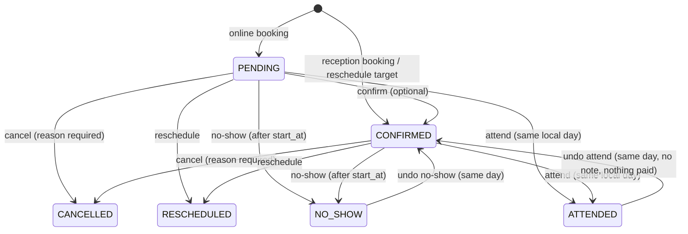
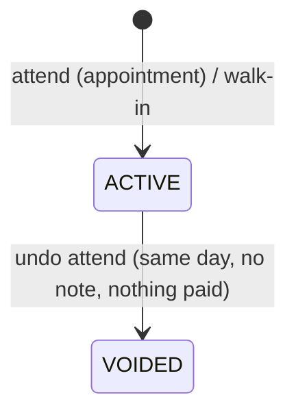
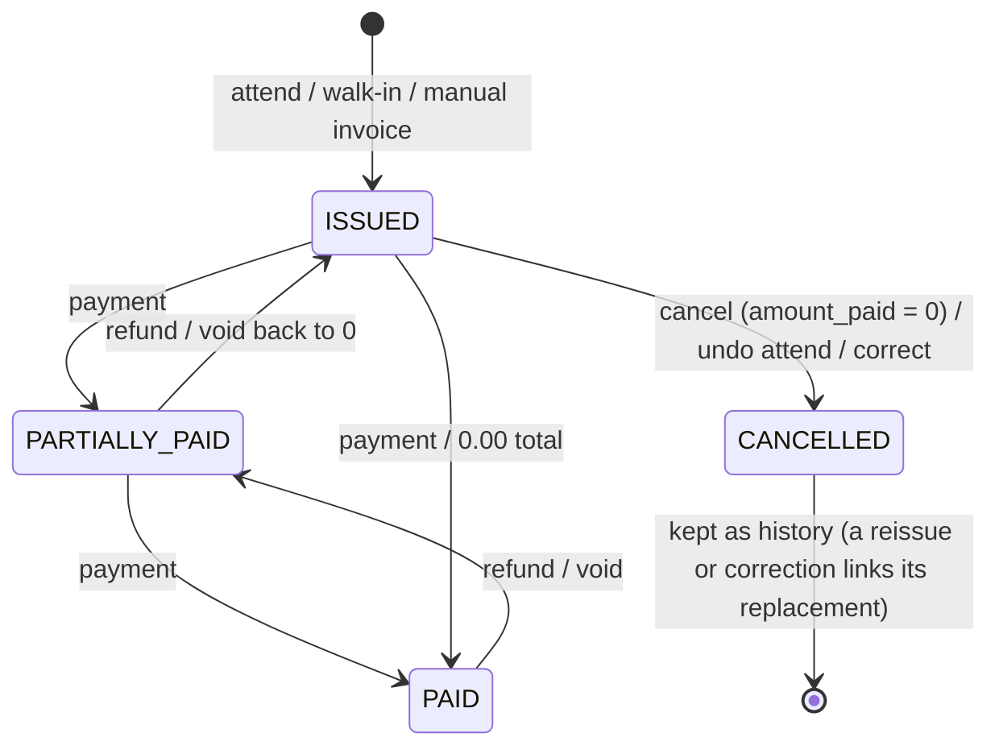

# Rehab Clinic — Backend

NestJS + PostgreSQL backend for a physiotherapy/medical clinic. It covers auth, staff users, the audit trail, patients, doctors, the services catalog, doctor schedules, availability, appointments (online and reception booking), visits (attend, walk-ins, undo, the day list), billing (invoices, discounts, payments, refunds, cash-desk summary), clinic expenses, clinical records (medical info, session notes, addenda, attachments), the patient history (overview and timeline), the owner reports, packages, patient acquisition (sources and campaign tags), doctor referrals (agreements, patient discounts, commissions on collected money, payouts) and the blog of the public website.

- **Who logs in:** `OWNER`, `DOCTOR` and `RECEPTIONIST` staff.
- **Patients never log in.** A patient is identified only by their phone number, which is unique.
- **No payment gateway, no online payments.** Every payment is a manual record the receptionist enters after receiving the money at the desk.
- **Every sensitive change is audited:** who did it, what changed (old and new values), when, and from which IP.

## Stack

| Concern | Choice |
|---|---|
| Framework | NestJS 12 (ESM, TypeScript strict) |
| Database | PostgreSQL 16 + TypeORM 1.x, migrations only (`synchronize: false` everywhere) |
| Naming | `snake_case` in the DB (`SnakeNamingStrategy`), camelCase in TS |
| Auth | argon2id passwords, 15 min JWT access token, 7 day rotating opaque refresh token |
| Validation | `class-validator` DTOs + global `ValidationPipe` (whitelist, forbid unknown, transform) |
| Config | `@nestjs/config` + Joi schema (`src/config/env.validation.ts`) |
| Logging | `nestjs-pino`, one request id per request (`X-Request-Id` in and out) |
| Rate limiting | `@nestjs/throttler`: per user when authenticated, per email + IP on login, per IP on public endpoints |
| Docs | Swagger UI at `/api/docs`, JSON at `/api/docs-json` |
| Tests | Vitest (Jest-compatible API) + supertest e2e against a real PostgreSQL |

## Run everything with Docker

The full guide (architecture, every command in PowerShell, configuration, backups, updates, troubleshooting) is
[docs/DOCKER.md](../docs/DOCKER.md). In short, from the repo root, after creating `database/.env` and `backend/.env`
from their `.env.example` (set `DB_PASSWORD`, `JWT_ACCESS_SECRET` and `SEED_OWNER_*`):

```bash
docker compose up -d --build --wait     # db + backend + frontend; returns when all three are healthy
```

| Service | Own files | What it does |
|---|---|---|
| `db` | `database/Dockerfile`, `database/docker-compose.yml` | PostgreSQL 16 on the volume `db_data`. No published port: only the backend reaches it |
| `backend` | `backend/Dockerfile`, `backend/docker-compose.yml` | This API (compiled, non-root) on `127.0.0.1:3000`. On every start it waits for the database, runs the pending migrations and creates the first OWNER only on a database without one. Uploads on the volume `storage` |
| `frontend` | `frontend/Dockerfile`, `frontend/docker-compose.yml` | nginx serving the production UI on <http://localhost:8080> and forwarding `/api/` to the backend (same origin, as the cookies need) |

The backend container reads `backend/.env`, takes `DB_DATABASE`/`DB_USERNAME`/`DB_PASSWORD` from `database/.env`, and
the Docker setup fixes `NODE_ENV=production`, `DB_HOST=db`, `TRUST_PROXY=true` and the storage path. The OWNER is the
only data created: staff, doctors, services and everything else are entered in the UI.

- Logs: `docker compose logs -f backend`.
- Stop: `docker compose down` (containers removed; the database and uploads are kept). Start again: `docker compose up -d`.
- After code changes: `docker compose up -d --build`.
- Never use `docker compose down -v`: it deletes the database and the uploaded files.

### Share it with a Cloudflare Quick Tunnel

The UI calls the API on its own address, so one tunnel to the frontend shares everything. No account, domain or config
file is needed; the `trycloudflare.com` address changes on every start. The production UI never has the quick-login
button.

```bash
docker compose up -d --build                         # 1. start (repo root); local UI: http://localhost:8080
cloudflared tunnel --url http://localhost:8080       # 2. share (prints https://<random>.trycloudflare.com)
# 3. stop: Ctrl+C in the cloudflared terminal, then `docker compose down` (keeps the data)
```

Without Docker, start the backend and the frontend as in "Getting started" and `frontend/README.md`, then share the
dev server instead (`cloudflared tunnel --url http://localhost:5173`, after `QUICK_LOGIN=false` in `backend/.env`).

## Getting started

Prerequisites: Node 24+, Docker.

```bash
npm install
cp .env.example .env          # then edit secrets (JWT_ACCESS_SECRET, DB_PASSWORD, SEED_OWNER_*)
docker compose -f docker-compose.dev.yml up -d   # development PostgreSQL 16 on localhost:${DB_PORT}
npm run migration:run         # create the schema
npm run seed                  # create the first OWNER from SEED_OWNER_* (only if there is no OWNER yet)
npm run start:dev             # http://localhost:3000/api/v1
```

- Swagger: <http://localhost:3000/api/docs>. Log in with `POST /auth/login`; the cookies it sets are used by every "Try it out" after that.
- Health check: `GET /api/v1/health` returns `{ "status": "ok", "database": "up" }`, or 503 when the database is unreachable.
- pgAdmin (optional): `docker compose -f docker-compose.dev.yml --profile tools up -d`, then open <http://localhost:5050>.
- `docker-compose.dev.yml` is only this development database (container `clinic-postgres`). `docker-compose.yml` in
  this folder is the backend's production container (see "Run everything with Docker").

## Environment variables

All variables are validated at startup; the app refuses to start on invalid config. See [.env.example](.env.example).

| Variable | Default | Description |
|---|---|---|
| `NODE_ENV` | `development` | `development` \| `production` \| `test` |
| `PORT` | `3000` | HTTP port |
| `LOG_LEVEL` | `info` | pino level (`silent` in e2e) |
| `CORS_ORIGINS` | *(empty)* | Comma separated allowed origins; empty disables CORS |
| `TRUST_PROXY` | `false` | Set `true` behind a reverse proxy so the audit log records the real client IP |
| `SWAGGER_ENABLED` | `true` | Serve `/api/docs` |
| `DB_HOST` / `DB_PORT` / `DB_USERNAME` / `DB_PASSWORD` / `DB_DATABASE` | — | PostgreSQL connection (also used by `docker-compose.dev.yml`). In Docker, `DB_HOST`/`DB_PORT` are fixed by the Compose file and the other three come from `database/.env` |
| `BACKEND_PORT` | `3000` | Docker only: host port of the API container, published on `127.0.0.1` |
| `DB_LOGGING` | `false` | Log SQL |
| `DB_TEST_DATABASE` | `<DB_DATABASE>_test` | Database used by e2e tests. **It is wiped on every run** and must differ from `DB_DATABASE` |
| `JWT_ACCESS_SECRET` | — | At least 32 characters |
| `THROTTLE_ENABLED` | `true` | Global switch (off in e2e). Fixed limits: 120/min by default, counted **per user** on authenticated routes (the whole clinic usually shares one IP) and per IP on public ones; login 5/min **per email + IP**; refresh 20/min; public reads 30/min; public booking 5 per 15 min (per IP) |
| `CLINIC_TIMEZONE` | `Africa/Cairo` | IANA zone of the clinic. Schedules are in this zone's wall-clock time; offsets (DST) are resolved per date |
| `SLOT_INTERVAL_MINUTES` | `15` | Candidate slot starts every N minutes inside a schedule range |
| `BOOKING_MIN_LEAD_MINUTES` | `60` | Earliest bookable start = now + N minutes (schedule-checked bookings) |
| `BOOKING_MAX_DAYS_AHEAD` | `30` | Latest bookable local date = today + N days, for every booking and reschedule (also with `allowOutsideSchedule`, also for the OWNER) |
| `BOOKING_MAX_ACTIVE_PER_PHONE` | `3` | Max active future appointments one phone can hold through public booking |
| `BACKDATE_MAX_DAYS` | `7` | With `allowOutsideSchedule`, a RECEPTIONIST may book up to N local days in the past; older is OWNER only |
| `RECEPTIONIST_MAX_DISCOUNT_PERCENT` | `100` | Highest effective discount (% of the subtotal) a RECEPTIONIST may give; OWNER has no limit. `100` means no cap, which is intended for now (the clinic didn't ask for one); the owner can lower it later |
| `BILLING_OVERDUE_DAYS` | `7` | Invoices with a balance issued more than N days ago appear in `GET /billing/attention` |
| `CLINIC_NAME` / `CLINIC_PHONE` | `Rehab Clinic` / *(empty)* | Printed on receipts |
| `STORAGE_LOCAL_PATH` | `./storage` | Root folder of the local-disk file storage (expense receipts, patient attachments, blog covers). Never served statically: files are streamed by endpoints (blog covers by a public one) |
| `SEED_OWNER_NAME` / `SEED_OWNER_EMAIL` / `SEED_OWNER_PASSWORD` | — | First OWNER created by `npm run seed` (and by the Docker backend on start) only while the database has no OWNER; not read after that. The email needs a real top-level domain (`.local` is rejected) |
| `QUICK_LOGIN`, `API_PROXY_TARGET`, `PGADMIN_EMAIL` / `PGADMIN_PASSWORD` | `true`, `http://localhost:3000`, — | Not read by the API: the frontend dev server (quick-login button, where `/api` goes) and pgAdmin of `docker-compose.dev.yml`. Every variable of every `.env` file: [docs/DOCKER.md](../docs/DOCKER.md), section 6.1 |

## Scripts

| Script | What it does |
|---|---|
| `npm run start:dev` | Run with watch mode |
| `npm run build` / `npm run start:prod` | Compile to `dist/` and run it |
| `npm run lint` | oxlint, warnings are errors |
| `npm run typecheck` | `tsc --noEmit` over source **and** tests |
| `npm test` | Unit tests (`src/**/*.spec.ts`) |
| `npm run test:e2e` | e2e tests (`test/**/*.e2e-spec.ts`). Creates or wipes the test DB, runs the real migrations, then runs the suites one after another |
| `npm run migration:generate -- src/database/migrations/<Name>` | Diff the entities against the DB and write a migration |
| `npm run migration:create -- src/database/migrations/<Name>` | Empty migration for hand-written SQL |
| `npm run migration:run` / `migration:revert` / `migration:show` | Apply, undo the last, or list migrations |
| `npm run seed` | Run seeds (currently: the first OWNER, only on a database without any OWNER). Idempotent |
| `npm run storage:orphans` | List stored files no row points to (dry run); add `-- --delete` to remove them. See "File storage" under `expenses` |

The migration scripts build first, because the TypeORM CLI loads the compiled `dist/database/data-source.js`.

### Migration workflow

1. Change or add an entity.
2. `npm run migration:generate -- src/database/migrations/DescribeTheChange`.
3. Review the SQL. Add anything TypeORM can't express by hand:
   - The `pg_trgm` GIN index on `patient_name_search_key(patients.name)` (and that SQL function) is declared with `@Index({ synchronize: false })` so that the generator ignores it.
   - Extensions are created by hand (`btree_gist`, needed by the exclusion constraints).
   - A Postgres enum shared by two tables (`appointment_status`) is emitted twice by the generator; remove the duplicate `CREATE TYPE`/`DROP TYPE`.
4. `npm run migration:run`, and check that `migration:revert` works.

## API overview

Every route is under `/api/v1` and needs an access token unless it is marked public: the HttpOnly `access_token`
cookie set by `POST /auth/login` (browsers, together with the `X-Requested-With` header), or
`Authorization: Bearer <token>` (scripts). See "auth".

| Group | OWNER | RECEPTIONIST | DOCTOR | Public |
|---|---|---|---|---|
| `GET /auth/me`, `PATCH /auth/me` (own account: UI language) | RW (own) | RW (own) | RW (own) | – |
| `/users` | RW | – | – | – |
| `/audit-logs` (also `?patientId=`) | R | – | – | – |
| `/patients` | RW | RW | R | – |
| `/doctors` | RW | R | R | – |
| `/clinic-services` | RW | R | R | – |
| `/public/doctors`, `/public/services` | – | – | – | R |
| `/doctors/:id/schedules`, `/doctors/:id/time-off` | RW | RW | R (own) | – |
| `/appointments/availability`, `/public/doctors/:id/slots` | R | R | R (own) | R |
| `/appointments` create / confirm / cancel / no-show / undo no-show / reschedule | W | W | – | create only (`POST /public/appointments`, PENDING) |
| `/appointments` list / view / history, `/patients/:id/appointments` | R | R | R (own only) | – |
| `/appointments/day` | R | R | R (own, no billing) | – |
| attend, undo attend, walk-in | W | W | – | – |
| `/visits/queue`, `/visits`, `/visits/:id`, `/visits/:id/history` | R | R | R (own) | – |
| `/patients/:id/visits` | R | R | R (patients they treat, all their doctors' visits; else 404) | – |
| invoices: create, edit items, cancel, view, `/patients/:id/invoices`, `/patients/:id/balance` | RW | RW | – | – |
| replacement invoices: `/invoices/:id/replacement` (preview), `/invoices/:id/correct`, `/invoices/:id/reissue` | RW | RW | – | – |
| discounts: apply / repeat / remove, `/patients/:id/last-discount`, `/patients/:id/discounts` (history) | RW | RW (limit) | – | – |
| payments: record, list (also `?patientId=`), receipt | RW | RW | – | – |
| payments: void | W | W (own, same day) | – | – |
| refunds | W | – | – | – |
| `/billing/attention` | R | R | – | – |
| `/billing/daily-summary` | R | R (today only) | – | – |
| expenses: create / edit / void / receipt upload | W | W (own, same day) | – | – |
| expenses: view, receipt file | R | R | – | – |
| `/expense-categories` | RW | R | – | – |
| clinical: medical info, notes, history, attachments (read) | R (drafts too) | – | R (patients they treat; drafts: own only) | – |
| `/clinical-notes/needs-attention` | R | – | R (own) | – |
| clinical: `PUT …/medical-info`, notes (write, sign), addenda | – | – | W (notes: own visits) | – |
| clinical: attachment upload | W | – | W (patients they treat) | – |
| `/patients/:id/overview`, `/patients/:id/timeline` | R | R (no clinical data) | R (patients they treat, no billing) | – |
| `/reports/*` | R | – | – | – |
| `/packages` (catalog) | RW | R | – | – |
| `/public/packages` | – | – | – | R |
| sell (`POST /patients/:id/packages`), restore a no-show session | W | W | – | – |
| `/patients/:id/packages`, `/patient-packages/:id` | R | R | R (patients they treat, no prices) | – |
| cancel a sold package | W | – | – | – |
| `/patients/:id/acquisition`, acquisition sources (add, edit, remove) | RW | RW | – | – |
| `/referring-doctors` list / view (with the current default agreement) | R | R | – | – |
| `/referring-doctors` create / edit / (de)activate, agreements, patients, commissions, adjustments, payouts; `/referral-payouts/:id/void` | RW | – | – | – |
| `/patients/:id/referrals` (assign, change terms, end: `/patient-referrals/:id/…`), `POST /invoices/:id/referral` | RW | RW | – | – |
| `/patients/:id/referral-statement` | R | – | – | – |
| `/reports/acquisition`, `/reports/campaigns`, `/reports/referrals` | R | – | – | – |
| `/blog-posts` (write, edit, delete, list, view) | RW | – | – | – |
| `/public/blog-posts` (list, view, cover image) | – | – | – | R |

Doctors have no access to billing or expenses. Receptionists have no access to clinical records. The OWNER reads everything about every patient (draft notes included) but never writes clinical documentation (notes, signatures, addenda, medical info); see `clinical`.

"Own" means a doctor sees only their own data. Asking for another doctor's schedule or appointment returns **404**, not 403, so the response doesn't reveal that it exists.

Errors always have this shape:

```json
{ "statusCode": 409, "error": "Conflict", "message": "A patient with this phone number already exists",
  "details": { "patientId": "…" }, "path": "/api/v1/patients", "timestamp": "2026-10-29T10:00:00.000Z" }
```

Validation errors have `message: "Validation failed"` and `details: [{ field, errors[], constraints[] }]`. `errors` are English messages (for developers and logs); `constraints` are the failed rules in the same order (`isNotEmpty`, `isEnum`, `matches`, `max`, `isPositiveMoney`, `whitelistValidation`, `endAfterStart`, …): stable keys a client translates. Clients translate business errors by `code` (never by `message`).

**Conventions every client can rely on:**
- *Who did it* is always `{ id, name }` (`receivedBy`, `appliedBy`, `createdBy`, `voidedBy`, `issuedBy`, `cancelledBy`, `attendedBy`, `bookedBy`, `updatedBy`, `uploadedBy`, `changedBy`; audit rows have `user: { id, name, role }`), so a RECEPTIONIST can show names without `/users`. Optional ones are `null` (online bookings, public or system actions, not voided yet).
- List date filters are clinic local dates: `from=YYYY-MM-DD&to=YYYY-MM-DD`, both inclusive (`CLINIC_TIMEZONE`, DST-aware). Single-day endpoints take `date=YYYY-MM-DD`.
- Every state-changing action is a `POST`.
- Optional text fields are trimmed, and a blank string becomes `null` (`TrimOrNull`), so clearing a textarea clears the field.
- A normal "nothing found" that clients branch on is either `200` with `null` (`GET /visits/:id/note`, `GET /patients/:id/last-discount`, `{ patient: null }` for `GET /patients/lookup`) or a 404 with a `code` (`REFERENCE_NOT_FOUND`, `NOTE_NOT_VISIBLE`).

Business errors also carry a stable machine-readable `code`:

| Code | Status | Meaning |
|---|---|---|
| `REFRESH_RACE` | 401 | `POST /auth/refresh` with a token rotated less than 30 s ago: another tab refreshed, retry with the newest cookie (the session is kept) |
| `SLOT_UNAVAILABLE` | 409 | The doctor already has an active appointment overlapping that time |
| `PATIENT_OVERLAP` | 409 | The patient already has an active appointment overlapping that time |
| `BOOKING_LIMIT_REACHED` | 409 | The phone already holds `BOOKING_MAX_ACTIVE_PER_PHONE` upcoming appointments (public booking) |
| `REFERENCE_NOT_FOUND` | 404 | No appointment with this reference code (or another doctor's) |
| `SCHEDULE_OVERLAP` | 409 | A schedule range overlaps another active range of the same doctor and day |
| `OUTSIDE_SCHEDULE` | 422 | The start is not a slot in the doctor's schedule: outside the ranges, off the slot grid, in time off, or inside the lead time |
| `DATE_OUT_OF_RANGE` | 422 | The date is before today or beyond `BOOKING_MAX_DAYS_AHEAD` |
| `SERVICE_NOT_OFFERED` | 422 | The doctor doesn't offer the service, or it is inactive |
| `INVALID_STATUS_TRANSITION` | 422 | The state machine doesn't allow the transition |
| `NO_SHOW_TOO_EARLY` | 422 | NO_SHOW before the appointment's start time |
| `ATTEND_WRONG_DAY` | 422 | Attend outside the appointment's local date |
| `ALREADY_ATTENDED` | 409 | The appointment already has an ACTIVE visit |
| `UNDO_WRONG_DAY` | 422 | Undo attend / undo no-show on another local day |
| `VISIT_HAS_NOTE` | 422 | Undo attend refused: the doctor has written a note for the visit |
| `VISIT_VOIDED` | 422 | The visit is already voided |
| `INVOICE_LOCKED` | 422 | Items/discount can't change: the invoice has (had) payments or is cancelled |
| `INVOICE_HAS_PAYMENTS` | 422 | Cancel or undo attend refused: money is still on the invoice (void or refund it first) |
| `INVOICE_CANCELLED` | 422 | The invoice is cancelled (no payments, no second cancel) |
| `INVOICE_NOT_REPLACEABLE` | 422 | Correct / reissue not allowed (`details.reason`: `NOT_A_SESSION_INVOICE`, `VISIT_VOIDED`, `HAS_PAYMENTS`, `NO_REFERRAL`, `REFERRAL_ACTIVE`, `CANCELLED`, `NOT_CANCELLED`) |
| `INVOICE_ALREADY_REPLACED` | 409 | The invoice already has its replacement (`details.replacementInvoiceId`, `replacementInvoiceNumber`) |
| `INVOICE_NEEDS_ITEMS` | 422 | Removing the last item (cancel the invoice instead) |
| `DISCOUNT_EXCEEDS_SUBTOTAL` | 422 | The discount would exceed the subtotal (also when items change) |
| `DISCOUNT_LIMIT_EXCEEDED` | 422 | RECEPTIONIST above `RECEPTIONIST_MAX_DISCOUNT_PERCENT` |
| `DISCOUNT_PATIENT_MISMATCH` | 422 | Repeating another patient's discount |
| `DISCOUNT_NOT_REPEATABLE` | 422 | Repeating a doctor referral discount or a discount on a cancelled invoice (`details.reason`: `REFERRAL_DISCOUNT`, `INVOICE_CANCELLED`) |
| `OVERPAYMENT` | 422 | The payment is more than the remaining balance |
| `VOID_NOT_ALLOWED` | 422 | Not the same local day, not your payment (RECEPTIONIST), already voided, refunds exist, or the invoice is cancelled |
| `REFUND_NOT_ALLOWED` | 422 | Refunding a voided payment or a refund |
| `REFUND_EXCEEDS_PAYMENT` | 422 | Refunds would exceed the payment (`details.refundable`) |
| `EXPENSE_DATE_IN_FUTURE` | 422 | Expense (or referral payout) dated after today |
| `EXPENSE_EDIT_NOT_ALLOWED` | 422 | Not the creator on the same local day (and not OWNER), the expense is voided, or it records a referral payout (change it through the payout) |
| `CATEGORY_INACTIVE` / `CATEGORY_NAME_TAKEN` | 422 / 409 | Expense category inactive / name already used |
| `CATEGORY_RESERVED` | 422 | A typed expense in (or moved to) a system category (referral commissions), or deactivating it |
| `NOTE_NOT_ALLOWED` | 422 | A note on a VOIDED visit |
| `NOTE_SIGNED` | 422 | Editing or re-signing a signed note (add an addendum instead) |
| `NOTE_INCOMPLETE` | 422 | Signing without an assessment or the treatment done |
| `NOTE_NOT_SIGNED` | 422 | An addendum on a draft |
| `NOTE_NOT_VISIBLE` | 404 | The visit's note is another doctor's draft |
| `ATTACHMENT_VISIT_MISMATCH` | 422 | The attachment's `visitId` belongs to another patient |
| `UNSUPPORTED_FILE_TYPE` | 422 | The upload's content isn't JPG/PNG/WEBP/PDF (blog covers: JPG/PNG/WEBP only), or doesn't match its extension (files over 5 MB get 413) |
| `BACKDATE_LIMIT_EXCEEDED` | 422 | A RECEPTIONIST tried to book (or reschedule) more than `BACKDATE_MAX_DAYS` local days in the past |
| `OFFER_EXCEEDS_PRICE` | 422 | A FIXED package offer above the package price |
| `PACKAGE_INACTIVE` | 422 | Selling a deactivated package (or one whose service is inactive) |
| `PACKAGE_NOT_USABLE` | 422 | The chosen `patientPackageId` can't pay this session: cancelled, no sessions left, other service, or the doctor isn't covered |
| `PACKAGE_NOT_OFFERED` | 422 | Online booking picked a package that isn't active, public, for that service, or offered by that doctor |
| `PACKAGE_CANCELLED` | 422 | Cancelling a package twice |
| `PACKAGE_INVOICE` | 422 | Editing the items of a package sale's invoice, or cancelling it while the package isn't cancelled |
| `SERVICE_HAS_PACKAGES` | 422 | Deleting a service that still has packages (delete them first) |
| `DOCTOR_HAS_APPOINTMENTS` | 422 | Deleting a doctor who still has PENDING/CONFIRMED appointments from today on (cancel or move them first) |
| `RESTORE_NOT_ALLOWED` | 422 | Restoring an ATTENDED usage (undo the attendance instead) or one already restored |
| `SOURCE_ALREADY_RECORDED` | 409 | The patient already has this acquisition channel (remove it first) |
| `SOURCE_IN_USE` | 422 | Removing the DOCTOR_REFERRAL source while the patient has an active referral |
| `REFERRING_DOCTOR_PHONE_TAKEN` | 409 | Another referring doctor has this phone (`details.referringDoctorId`) |
| `REFERRING_DOCTOR_INACTIVE` | 422 | Assigning a referral to an inactive referring doctor |
| `AGREEMENT_DATE_INVALID` | 422 | A new agreement version starting in the past or before the latest version (`details.minDate`) |
| `REFERRAL_ALREADY_ACTIVE` | 409 | The patient already has an active referral (end it first) |
| `REFERRAL_ENDED` | 422 | Changing the terms of, or ending, a referral that has ended |
| `OVERRIDE_REASON_REQUIRED` | 422 | The commission or discount differs from the doctor's default without a reason (`details` = the defaults) |
| `REFERRAL_NOT_APPLICABLE` | 422 | `POST /invoices/:id/referral` on an invoice the referral can't cover (`details.reason`: `ALREADY_APPLIED`, `MANUAL_INVOICE`, `PACKAGE_SESSION`, `NO_ACTIVE_REFERRAL`, `NOT_COVERED`) |
| `NOTHING_TO_PAY` | 422 | A payout while the doctor's owed commission is 0 or negative (`details.outstanding`) |
| `PAYOUT_EXCEEDS_OUTSTANDING` | 422 | A payout above what is owed now (`details.outstanding`) |
| `PAYOUT_VOIDED` | 422 | Voiding a payout twice |

## Modules

### `auth`
- `POST /auth/login` (email + password) sets an access JWT (`{ sub, role }`, 15 min) and an opaque refresh token as cookies, and returns `{ accessTokenExpiresIn, refreshTokenExpiresAt, user }`. Inactive users get 403. Wrong credentials get a generic 401, with equalized timing for unknown emails.
- `POST /auth/refresh` (no body, reads the `refresh_token` cookie) **rotates** the refresh token, sets both cookies again and returns `{ accessTokenExpiresIn, refreshTokenExpiresAt }`. The old token is revoked and points to its replacement (`replaced_by_id`). Presenting an already revoked token is treated as theft. All of that user's tokens are revoked and the event is audited (`REFRESH_TOKEN_REUSE_DETECTED`), except inside the grace window below.
- `POST /auth/logout` (no body) revokes the `refresh_token` cookie's token, clears both cookies and is idempotent. `GET /auth/me` returns the current user.
- `PATCH /auth/me { preferredLanguage }` changes the caller's **own** settings (any logged in role). The user id comes from the token; unknown fields (`id`, `userId`, `role`, …) are 400, so nobody can change another account. Audited as `USER_UPDATED` when the value changes. See "Languages".

#### Where the tokens live (cookies)
- The tokens never appear in a response body, so page scripts (and an XSS) can't read them. Both cookies are
  `HttpOnly; Secure; SameSite=Strict`. `access_token` has `Path=/api/v1` and `Max-Age=900`; `refresh_token` has
  `Path=/api/v1/auth` (only refresh and logout ever receive it) and expires with the token.
- `Secure` means https only, but browsers treat `http://localhost` as secure, so local use works. A Cloudflare tunnel
  is https. Opening the UI over plain http on another address (e.g. a LAN IP) does not keep the cookies.
- **CSRF:** a cookie only counts when the request also has an `X-Requested-With` header (any value). Another site can't
  add that header without a CORS preflight, and CORS never allows credentials. `SameSite=Strict` is the second layer.
- **Same origin:** the browser must reach the API on the UI's own address. The frontend calls `/api/v1` and Vite (dev
  server) or nginx (Docker frontend) forwards it to the backend, so the cookies belong to the UI's address
  (`localhost:5173`, `localhost:8080` or the tunnel address).
- Scripts and Swagger "Authorize" can still send `Authorization: Bearer <token>`, read from the login's
  `Set-Cookie`. Swagger UI adds `X-Requested-With` itself, so "Try it out" works after logging in there.

#### Sessions and staying logged in
- **Lifetimes:** the access token lives 15 minutes. Each refresh returns a *new* refresh token valid for 7 days from that moment (sliding expiry). A user who works every day never has to log in again. After 7 days without any request, the refresh token expires and they log in again.
- **Grace window for races:** a refresh token that was rotated less than **30 s** ago answers `401` with `code: REFRESH_RACE` and **does not** revoke anything. This happens when two requests (or two tabs sharing the cookies) refresh with the same token at once: one wins, the other gets `REFRESH_RACE`. Reusing a rotated token after 30 s, or a logged-out token, is still treated as theft.
- **What a client must do:**
  - Keep one refresh in flight at a time; other requests that get a 401 wait for it and then resend (the browser now has the new cookie).
  - If a request got a 401 but this tab refreshed since it was sent, just resend.
  - On `REFRESH_RACE`, another tab already refreshed and its response updates the shared cookies: wait a moment and retry once. Only a refresh 401 *without* that code means "log in again". A 429 or 5xx on refresh is not a logout.
- Why staff got logged out before this: an expired access token made every parallel request on a page get 401 at once, and each called refresh with the same token. The first rotated it, the second looked like a replay, and reuse detection revoked the whole session (the next requests then failed with 401). Two tabs sharing one token did the same.
- The user in the login response and in `/auth/me` has `doctorId`: the doctor profile id for DOCTOR accounts (for "my schedule" screens), `null` otherwise.
- Only the SHA-256 of a refresh token is stored.
- Global `JwtAuthGuard`: everything is protected unless marked `@Public()`. It re-reads the user from the DB on every request, so deactivations and role changes apply immediately.
- Global `ClinicThrottlerGuard` runs right after it, so limits count per user on authenticated routes and per IP on public ones. Login counts per email + IP: one mistyped password doesn't lock out the colleagues behind the same router.
- Global `RolesGuard` + `@Roles()`. `@Auth(...roles)` combines `@Roles` with the Swagger docs. `@CurrentUser()` and `@CurrentActor()` (user id + IP, for auditing) are the param decorators.

### Languages (Arabic default, English)

The backend is language-neutral: it never translates. Every UI text, status label and error message is translated by the frontend.

- **Supported:** `ar` (default) and `en` (`common/enums/language.enum.ts`).
- **Per account:** `users.preferred_language` (Postgres enum `user_language`, `NOT NULL DEFAULT 'ar'`). New accounts and every account that existed before the column get `ar`. It is returned as `preferredLanguage` in the login response, `GET /auth/me` and the `/users` responses, and changed only by the user with `PATCH /auth/me`. Because it lives on the account, every device gets the same language after login.
- **What the frontend translates by:** business errors by `code` (`ErrorCode`), validation errors by `details[].field` + `details[].constraints`, statuses by the enum value. Enum values, codes, ISO 8601 times and decimal money strings never change with the language.
- **Arabic text** is stored exactly as entered (UTF-8 database). Patient search ignores common Arabic spelling variants (see `patients`).
- **Frontend integration** (language bootstrap, RTL, locale formatting, adding translations): `docs/FRONTEND_LOCALIZATION.md`.

### `users` (OWNER only)
- Create OWNER/RECEPTIONIST accounts, list (paginated; filter by role, active state or name/email), get, update, activate/deactivate, reset password.
- DOCTOR accounts are created and managed through `/doctors`, which keeps the account and the profile in sync. Password reset works for every role.
- **Rules:**
  - You cannot deactivate yourself.
  - At least one active OWNER must always remain. This is enforced with row locks, so two owners deactivating each other at the same time can't both succeed.
  - Deactivation and password reset revoke all of that user's refresh tokens.
- Emails are stored lowercased and protected by a unique constraint (409 on conflict). Responses never include `password_hash`. They are built from response DTOs, and the column is `select: false`.

### `audit`
- `AuditService.log(entry, manager?)` takes the caller's `EntityManager`, so the entry is committed or rolled back together with the change it describes.
- Recorded actions:
  - Login success and failure, logout, and refresh-token reuse.
  - User create, update, (de)activate and password reset.
  - Every patient, doctor, doctor-service and clinic-service mutation.
- Updates store only the fields that changed, in `old_values` and `new_values` (arrays are compared by their items).
- `GET /audit-logs` (OWNER) filters by `entityType`, `entityId`, `userId`, `action` and `from`/`to` (local dates), newest first. `patientId` returns everything about one patient: the PATIENT row (incl. medical info) and their APPOINTMENT, VISIT, INVOICE (incl. discounts), PAYMENT, CLINICAL_NOTE, PATIENT_ATTACHMENT, PATIENT_PACKAGE, ACQUISITION_SOURCE, PATIENT_REFERRAL and REFERRAL_COMMISSION entries (each branch uses `idx_audit_logs_entity`; paginated like every list). Each row has `user: { id, name, role }`, or `null` for a public or system action.

### `patients`
- The phone number is the only unique business key. `normalizeEgyptianMobile()` (`src/common/utils/phone.util.ts`):
  - Accepts `01012345678`, `+201012345678`, `00201012345678` and `201012345678`, with spaces, dashes or Arabic-Indic digits.
  - Stores the number as `+201XXXXXXXXX`.
  - Only 010/011/012/015 mobiles are valid.
- Normalization happens in the DTO (before validation) **and again** in the service.
- Uniqueness is enforced by the DB constraint `uq_patients_phone`. A violation becomes `409` with `details.patientId` of the existing patient. This also applies when a PATCH changes the phone.
- `GET /patients?search=` matches part of the name or the phone in any format. Name matching goes through the SQL function `patient_name_search_key` on both sides (indexed by `idx_patients_name_search_trgm`): it ignores case, Arabic diacritics and tatweel, and treats أ/إ/آ/ٱ as ا, ى as ي and ة as ه, so "احمد" finds "أحمد" and "فاطمه" finds "فاطمة". Stored names are never changed. `GET /patients/lookup?phone=` finds an exact number: `{ patient }`, with `patient: null` when the phone is unknown (the normal case at the desk). `PATCH` changes are audited with old and new values.
- `PatientsService.findOrCreateByPhone({ name, phone, source, createdBy? }, manager?)` is used by public booking, reception booking and walk-ins:
  - Race-safe: `INSERT … ON CONFLICT (phone) DO NOTHING`, then `SELECT`.
  - Never renames an existing patient. It returns `nameMismatch: true` instead.
- There is **no public patient endpoint**. `notes` is for administrative notes only, never medical information.

### `doctors`
- `POST /doctors` (OWNER) creates the DOCTOR user and the doctor profile in **one transaction**.
- `PATCH` updates profile and account fields. Activate/deactivate changes both the profile and the login account, and deactivation signs the doctor out.
- **Deactivate vs delete:** deactivate hides a doctor for a while; `DELETE /doctors/:id` (OWNER, 204) removes them **for good**. `deleted_at` is set, the profile and the login account are deactivated and the doctor is signed out. They are out of every list, and GET / PATCH / activate / services / schedules / time-off answer 404. A deleted doctor can't be picked for a service or a package. Their service assignments and package links are removed (one `DOCTOR_DELETED` audit entry lists them). The rows stay, because appointments, visits and invoices point at them (CHECK: a deleted doctor is never active), and so the email stays taken. Refused with 422 `DOCTOR_HAS_APPOINTMENTS` while they have PENDING/CONFIRMED appointments starting today or later.
- `PUT/DELETE /doctors/:id/services/:serviceId` assigns or unassigns a service, with an optional `priceOverride`.
- Public endpoints:
  - `GET /public/doctors` and `GET /public/doctors/:id` return only active, public doctors whose account is active.
  - They expose only `id, name, specialty, bio, photoUrl, services[{id, name, description, durationMinutes, price}]`.

### `clinic-services`
- OWNER can create, update, activate and deactivate services. Staff can read them.
- **Deactivate vs delete:** `PATCH /clinic-services/:id/deactivate` hides a service for a while (not bookable, not public) and `activate` brings it back. `DELETE /clinic-services/:id` (204) removes it **for good**: `deleted_at` is set, it is out of every list, and GET / PATCH / activate answer 404. Its doctor assignments are removed (audited). The row itself stays, because visits and invoices point at it (CHECK: a deleted service is never active). Refused with 422 `SERVICE_HAS_PACKAGES` while it still has packages that aren't deleted.
- **Doctors offering a service:** `POST /clinic-services` and `PATCH /clinic-services/:id` accept `doctorIds: uuid[]` **or** `allDoctors: true` (every doctor active at that moment; doctors added later are not included). `PUT /clinic-services/:id/doctors { doctorIds | allDoctors }` replaces the list (exactly one of the two, 400 otherwise). These write the same `doctor_services` rows as `PUT/DELETE /doctors/:id/services/:serviceId`: doctors that stay keep their `priceOverride`, new ones get none, and each added or removed doctor is audited (`DOCTOR_SERVICE_ASSIGNED` / `_UNASSIGNED`). An unknown doctor id is 404, adding doctors to an inactive service is 409.
- Every service response has `doctors: [{ id, name }]` (doctor id, sorted by name).
- `GET /public/services` returns active services only.
- Prices are `numeric(12,2)` and travel as decimal strings (`"350.00"`) end to end, so there is no float math. These are **current** prices: future invoices must snapshot the price at billing time.

### Time-zone rules (`common/time`)
- Every timestamp is stored as `timestamptz` (UTC). APIs accept and return **ISO 8601 with an offset**, e.g. `2026-11-05T17:00:00+02:00`. Input without an offset is rejected; `Z` is accepted.
- List filters take clinic local dates instead (`from=2026-11-01&to=2026-11-30`, inclusive); `ClinicTimeService.dateRange` turns them into instants (start of `from`, start of the day after `to`).
- Responses are rendered in `CLINIC_TIMEZONE`. Egypt observes DST, so the same wall time is `+02:00` in winter and `+03:00` in summer. **Never hardcode an offset.**
- Doctor schedules are local wall-clock `time` values plus `day_of_week` (0 = Sunday), converted to UTC **per concrete date** with Luxon (`localToUtc`).
- **Spring forward** (last Friday of April, 00:00 → 01:00): a wall time inside the skipped hour moves forward with the clock (00:30 → 01:30 +03:00). A 00:00–02:00 range is therefore one real hour long.
- **Fall back** (last Thursday of October, 24:00 → 23:00): 23:00–23:59 happens twice. A range start uses the earlier occurrence and a range end the later one, so the repeated hour gets slots in both occurrences.
- Unit tests in `clinic-time.util.spec.ts` and `slot-generator.spec.ts` cover both 2026 transitions.
- "Now" comes from an injectable `CLOCK` (`ClinicTimeService`), so tests can freeze time.

### `schedules`
- `doctor_schedules` holds weekly ranges in clinic local time. A day can have several ranges (morning + evening) that must not overlap; touching ranges (09–13, 13–15) are allowed.
- Overlaps are decided by a `btree_gist` exclusion constraint on active rows (409 `SCHEDULE_OVERLAP`), which also holds under races. Deactivated ranges don't count.
- `doctor_time_off` holds absolute periods. Creating or updating time off that overlaps active appointments **still succeeds** and returns `conflictingAppointments`. Appointments are never cancelled automatically.
- OWNER and RECEPTIONIST manage schedules for every doctor; a DOCTOR can read only their own. Every change is audited.

### `appointments`

**Availability.** `AvailabilityService.getSlots(doctorId, serviceId, date)`:
- The slot length is the service duration. Candidate starts fall every `SLOT_INTERVAL_MINUTES` from each range start, and a slot must fit entirely inside one range.
- Slots that overlap time off or active appointments are excluded, as are past slots and slots within `BOOKING_MIN_LEAD_MINUTES`.
- Dates outside today..today+`BOOKING_MAX_DAYS_AHEAD` return 422.
- The doctor must be active and offer the service (otherwise 404/422).
- Reception can pass `includeOutsideSchedule` to see the whole local day, which ignores the schedule, time off and lead time but still excludes booked slots. It also allows past dates and times, to record an appointment that already happened: a RECEPTIONIST back to `BACKDATE_MAX_DAYS` local days, the OWNER any date.
- Availability is only a hint. **The exclusion constraints are the real guarantee.**

**Double-booking guarantee.** Two exclusion constraints cover the *active* statuses (PENDING, CONFIRMED, ATTENDED): one on `(doctor_id, tstzrange(start_at, end_at, '[)'))` and one on `(patient_id, …)`. A violation (Postgres `23P01`) becomes 409 `SLOT_UNAVAILABLE` or `PATIENT_OVERLAP`. Back-to-back appointments are fine, and CANCELLED, NO_SHOW and RESCHEDULED free the slot. `end_at` is always computed from the service duration; clients can't send it.

**Online booking** (`POST /public/appointments`, `@Public`). In one transaction:
1. Load the doctor (must be active and public) and the service (must be offered).
2. Check the start is a real slot: schedule, slot grid, time off, lead time, max days ahead. Otherwise 422.
3. `findOrCreateByPhone` (source ONLINE). An existing phone links to the existing patient, who is **never renamed**.
4. Lock the patient row and enforce `BOOKING_MAX_ACTIVE_PER_PHONE` (409 `BOOKING_LIMIT_REACHED`). A new phone simply has 0, so the response never reveals whether the phone existed.
5. Insert a **PENDING / ONLINE** appointment with `booked_name` = the submitted name and `booked_by` = NULL. A status-history row and an audit entry are written in the same transaction.

The response is exactly `{ referenceCode, doctorName, serviceName, startAt, endAt, status }`: no patient id or patient data.

The optional `utm: { source, medium, campaign, content, term }` (the `utm_*` of the link the patient came from, at most 100 characters each, blank = absent) is stored on the appointment (`appointments.utm_*`) for the campaign report, and a reschedule copies it. Nothing else about the visitor is stored. It never creates or changes the acquisition sources reception records (see `acquisition`).

Abuse protection:
- Throttling at 5 requests per 15 minutes per IP.
- A honeypot field `website` that must stay empty.
- The per-phone limit.

There is no public cancel or lookup endpoint: reception handles changes by phone, using the reference code.

**Reception booking** (`POST /appointments`):
- Identify the patient with `patientId`, or with `name` + `phone` (find-or-create, source RECEPTION). The appointment is created **CONFIRMED** with `booked_by` = the receptionist.
- `allowOutsideSchedule` skips the schedule, time-off and lead-time checks and writes an extra `APPOINTMENT_SCHEDULE_OVERRIDE` audit entry. It **never** skips the overlap constraints.
- It also allows recording past appointments. A RECEPTIONIST may go back at most `BACKDATE_MAX_DAYS` local days; anything older needs the OWNER (422 `BACKDATE_LIMIT_EXCEEDED`). The same rule applies to reschedule.
- It **never** lifts the upper limit: a start after today + `BOOKING_MAX_DAYS_AHEAD` is 422 `DATE_OUT_OF_RANGE` (`details.to` = the last bookable date) for every role, on create and on reschedule.

**How the desk works.** Online bookings start PENDING. Reception *may* call the patient and confirm, but it is optional: PENDING bookings show up everywhere CONFIRMED ones do and can be rescheduled, attended or marked no-show directly. Reception does everything about attendance; doctors never start or complete anything, they only write and sign the visit's note.

**Status machine.** The only definition is `appointment-state-machine.ts`; any other transition gets 422 `INVALID_STATUS_TRANSITION`.



Each transition also records **which operation** may perform it (the `AppointmentTrigger`): `ATTENDED → CONFIRMED` is only reachable through undo attend, and `NO_SHOW → CONFIRMED` only through undo no-show, so `POST /appointments/:id/confirm` returns 422 on both. CANCELLED and RESCHEDULED are final.

The time and undo rules on top of the transitions live in `appointment-actions.ts`. The same table answers the day list's `allowedActions` and rejects requests, so the two never disagree:

| Action (`allowedActions`) | Endpoint | From | Extra rule |
|---|---|---|---|
| `confirm` | `POST /appointments/:id/confirm` | PENDING | – |
| `cancel` | `POST /appointments/:id/cancel { reason }` | PENDING, CONFIRMED | – |
| `reschedule` | `POST /appointments/:id/reschedule` | PENDING, CONFIRMED | the new appointment is CONFIRMED |
| `noShow` | `POST /appointments/:id/no-show` | PENDING, CONFIRMED | start time passed (`NO_SHOW_TOO_EARLY`); uses a package session if one is usable |
| `undoNoShow` | `POST /appointments/:id/undo-no-show` | NO_SHOW | same local day (`UNDO_WRONG_DAY`); 409 if the freed slot was booked meanwhile; restores the session |
| `attend` | `POST /appointments/:id/attend` | PENDING, CONFIRMED | appointment's local day (`ATTEND_WRONG_DAY`) |
| `undoAttend` | `POST /appointments/:id/undo-attend { reason }` | ATTENDED | same local day, no note (`VISIT_HAS_NOTE`), invoice unpaid (`INVOICE_HAS_PAYMENTS`) |

- Each change locks the row, validates it, updates the status, appends `appointment_status_history` (from, to, changed_by, reason) and writes `audit_logs`, all in **one transaction**.
- **Reschedule** is one transaction. The old appointment becomes RESCHEDULED first, so it stops blocking. Then a new CONFIRMED appointment is inserted with `rescheduled_from_id`: same patient and service, optionally another doctor. If the new slot is taken, everything rolls back.

**Reading:**
- `GET /appointments` filters by local date range (`from`/`to`), doctor, patient, status and source; it is paginated and sorted by start time.
- `GET /appointments/day?date=&status=&doctorId=` is the day list: every appointment of the local day with its visit (if attended) plus the day's walk-ins (`isWalkIn: true`, appointment fields null), ordered by start time (attended time for walk-ins). Each row has patient name + phone, doctor, service, status, `bookedName`, a computed `nameMismatch`, `visitId`, `visitStatus`, `attendedAt`, `noteStatus` and **`allowedActions`**.
  - `status` takes several values (`?status=PENDING&status=CONFIRMED` or `?status=PENDING,CONFIRMED`); walk-ins count as ATTENDED.
  - OWNER / RECEPTIONIST rows also carry the billing columns (see Cashier views). A walk-in row's only action is `undoAttend`, done with `POST /visits/:visitId/undo-attend`.
  - Every row has `package: { usageId, patientPackageId, name, used, total }` when its visit (or, for a NO_SHOW row, its no-show) used a package session, else `null`. A NO_SHOW row with a session also gets `restoreSession` in `allowedActions` (`POST /package-usages/:usageId/restore`; no time limit, not a status change).
  - Billing columns also carry `invoiceStatus` (the live invoice's status) and `cancelledInvoiceId`. When an attended visit's invoice was cancelled and nothing replaced it, the row (appointment or walk-in) has `invoiceStatus: CANCELLED`, that invoice's id and `createInvoice` in `allowedActions`: `POST /invoices/:cancelledInvoiceId/reissue` (see "Replacement invoices"; no time limit, not a status change). After an undone attend there is no visit to bill, so neither appears.
  - A DOCTOR gets only their own rows (PENDING included; `doctorId` is ignored), **without** billing fields, and `allowedActions` is `writeNote` (ACTIVE visit whose note isn't signed) or `viewNote` (signed note).
- `GET /appointments/:id`, `GET /appointments/by-reference/:code` (case-insensitive, e.g. `APT-7K3Q9X`; 404 `REFERENCE_NOT_FOUND`) and `GET /appointments/:id/history`.
- `GET /patients/:id/appointments` lists a patient's appointments across all doctors.

### `visits`

An **appointment** is a booking; a **visit** is the patient actually attending. Reception creates visits; doctors only write the note.



**Attend** (`POST /appointments/:id/attend`, OWNER/RECEPTIONIST): "the patient entered the doctor".
- Only on the appointment's local date (`CLINIC_TIMEZONE`); late arrival the same day is fine. Otherwise 422 `ATTEND_WRONG_DAY`. Works from PENDING or CONFIRMED (one history row).
- One transaction locks the appointment, moves it to ATTENDED, inserts the ACTIVE visit (patient, doctor and service copied from the appointment), **creates the invoice**, and writes the histories and audit entries. The response is the visit plus `invoiceId`. If anything fails (the invoice included), nothing is written.
- A second attend returns 409 `ALREADY_ATTENDED`. The guarantee is the partial unique index `uq_visits_appointment_active` on `appointment_id WHERE status = 'ACTIVE'`; it is partial so that after an undo, the same appointment can attend again.
- **Packages:** the optional body `{ patientPackageId }` or `{ usePackage: false }` (not both, 400) chooses who pays. By default the patient's oldest usable package pays one session (see `packages`) and the response's `package` is `{ usageId, patientPackageId, name, used, total }` (null when billed normally). Walk-ins take the same two fields.

**Walk-ins** (`POST /visits/walk-in`):
- A visit with `appointment_id = NULL`, attended now, with its invoice in the same transaction (`invoiceId` in the response). The patient is identified by `patientId` or `name` + `phone` (find-or-create, source RECEPTION) and never renamed.
- The doctor must be active and offer the (active) service.
- Walk-ins **do not block booking slots**.

**Undo attend** (same local day only, OWNER/RECEPTIONIST, `{ reason }` required):
- `POST /appointments/:id/undo-attend`: the appointment goes back to CONFIRMED.
- `POST /visits/:id/undo-attend`: the way to undo a walk-in (for an appointment's visit it does the same as the appointment route).
- Refused while the doctor has a note for the visit (422 `VISIT_HAS_NOTE`) or the invoice holds money (422 `INVOICE_HAS_PAYMENTS`: void the payments first).
- Otherwise, in one transaction: the visit becomes VOIDED (`voided_at`, `voided_by`, `void_reason`; CHECK `chk_visits_voided`), its invoice is CANCELLED with the same reason, its package session (if any) is restored, and the appointment returns to CONFIRMED.

**Notes** are written by the visit's doctor on ACTIVE visits only, any day after the visit (see `clinical`).

**Reading:**
- `GET /visits/queue?date=&doctorId=`: the day's ACTIVE visits in the order they attended, with patient, service, booked start time (null for walk-ins), `attendedAt`, `hasNote` and `noteStatus` (`DRAFT` / `SIGNED` / null). Doctors always get their own queue.
- `GET /visits` filters by local attended date range (`from`/`to`), doctor, patient, status and `walkIn`; it is paginated, newest first. Doctors see only their own.
- `GET /visits/:id` and `/visits/:id/history`.
- `GET /patients/:id/visits` lists every doctor's visits for the patient: metadata only, no clinical data. OWNER and RECEPTIONIST: any patient. DOCTOR: only a patient they have an appointment or visit with (the clinical access rule; that doctor already sees the patient's signed notes from every doctor), otherwise 404 like an unknown patient.

### `billing`

#### Money rules (everywhere)
- Columns are `numeric(12,2)`. In TypeScript money is a string, and all arithmetic goes through `decimal.js` (`common/utils/money.util.ts`), never JS number math.
- The API accepts and returns money as strings; responses always have 2 decimals (`"320.00"`).
- Percent discount amount = `round_half_up(subtotal × percent / 100, 2)`. For example, 12.5% of 99.99 = 12.50.
- All totals are computed by the server; clients never send totals (unknown fields are rejected).
- DB CHECKs (they also reject hand-written SQL):
  - all amounts ≥ 0;
  - `total = subtotal − discount_total` and `amount_paid ≤ total`;
  - the status matches the amounts;
  - `line_total = unit_price × quantity`;
  - discount value ranges per type;
  - payment shape (refunds point to a payment and have a reason; voids are complete).
- Document numbers are gapless per year in clinic local time: `INV-2026-000123`, `RCP-…`, `EXP-…`. They come from `document_counters`, incremented inside the same transaction as the document, so a rollback releases the number.

#### Invoice lifecycle



- **Status is derived from the amounts**: nothing paid → ISSUED, part → PARTIALLY_PAID, everything (or a 0.00 total) → PAID. It is stored for querying.
- **Invoice per visit.**
  - Created by attend and walk-in **in the same transaction as the visit** (`invoiceId` in the response): there is no visit without its invoice.
  - Pricing comes from the `VisitBillingPolicy` hook. The default is `doctor_services.price_override ?? clinic_services.base_price`, snapshotted into the item, so later catalog changes never touch it.
  - A partial unique index on `visit_id` (non-cancelled) allows one live invoice per visit. A visit can also have cancelled invoices, each replaced at most once (see "Replacement invoices").
- **Undo attend** cancels the visit's live invoice with the same reason, and is refused while it holds money.
- **Manual invoices** (`POST /invoices`): service items take name and base price from the catalog (any client price is ignored); free-text items need a description and a price.
- **Locking.** Items and the discount change only while the invoice has never had a valid payment (`INVOICE_LOCKED`). `GET /invoices/:id` says so in `isLocked`, and `canCancel` is true while it is not cancelled and nothing is paid. Percent discounts are recalculated when items change. An invoice keeps at least one item.
- **Cancel** requires `amount_paid = 0`. After a full refund, a locked invoice can still be cancelled.
- **Packages:** `BillingModule` binds `PackageVisitBillingPolicy` to `VISIT_BILLING_POLICY`. A visit paid by a package session gets one 0.00 line `"<service> — package <name> (session 3/10)"` (total 0.00, so PAID); any other visit falls back to the default pricing. A package sale's invoice (no visit) can get a discount, but its items are fixed and it can be cancelled only after the package is cancelled (422 `PACKAGE_INVOICE`).

#### Replacement invoices (correct / reissue)
A session's invoice can be replaced by a **new invoice of the same visit**: same lines (the session price doesn't change), the patient's **current** referral and its discount, a new number, `replaces_invoice_id` pointing at the replaced invoice. The attendance never changes (same visit, appointment stays ATTENDED). The replaced invoice keeps everything: number, referral terms, discount, receipts (voided ones too) and commission rows; being CANCELLED it no longer counts in balances or reports and takes no payments.

- **Which applies** is one rule (`replacementOption` in `invoice-math.ts`), shown by `GET /invoices/:id` (`canCorrect`, `canReissue`, `replacesInvoice`, `replacedBy`) and the day list:
  - `POST /invoices/:id/correct { reason }` (**CORRECT**): a **live** session invoice billed with a referral that has since **ended** (reception recorded the wrong doctor: end that referral, record the right one, then correct), with **no money on it**: no valid payment or refund, i.e. every receipt voided (voiding a payment needs its refunds voided first). The invoice is CANCELLED with `reason`, then replaced.
  - `POST /invoices/:id/reissue` (**REISSUE**): a **cancelled** session invoice whose visit is still ACTIVE (not after undo attend) and that nothing replaced. Only the replacement is issued.
  - Refused with 422 `INVOICE_NOT_REPLACEABLE` and `details.reason`: `NOT_A_SESSION_INVOICE` (manual invoice, package sale), `VISIT_VOIDED`, `HAS_PAYMENTS` (a valid payment, also a refunded one: money moved, so it is left for the owner to review), `NO_REFERRAL` (cover it with `POST /invoices/:id/referral` instead), `REFERRAL_ACTIVE` (the referral was not ended), `CANCELLED` (correct on a cancelled invoice: reissue it), `NOT_CANCELLED` (reissue on a live one). An invoice already replaced is 409 `INVOICE_ALREADY_REPLACED` with `details.replacementInvoiceId` / `replacementInvoiceNumber`.
- `GET /invoices/:id/replacement` is the preview the desk confirms: `action` (`CORRECT`, `REISSUE` or null with `blockedBy`), `current` and `replacement` (`referral`, `discount`, `subtotal`, `discountTotal`, `total`, all computed by the server) and `replacementNotCovered` (`NO_ACTIVE_REFERRAL`, `NOT_COVERED`, `PACKAGE_SESSION`). It writes nothing.
- **Coverage** of the replacement is decided like any session (applicability, covered count without cancelled invoices, the referral row locked) **as of the session date** (the visit's attended day), so a DATE_RANGE referral covers a session corrected the next day. Desk discounts of the replaced invoice are not carried over (reception can apply one again).
- **Commissions** follow the replacement's referral: the replaced invoice's rows stay (e.g. Samaka +29.40, −29.40 for the voided receipt, net 0) and the replacement's payments earn for the new doctor (285.00 paid at 6% = 17.10).
- **Integrity:** one transaction, locking appointment, visit, then invoice (the order of attend / undo attend), so parallel requests are serialized. `uq_invoices_replaces` (each invoice replaced once) and `uq_invoices_visit_live` are the guarantee (a race answers 409); `chk_invoices_replaces` allows a replacement only for a session invoice, never itself.
- **Audit**, on the replaced invoice: `INVOICE_CORRECTED` / `INVOICE_REISSUED` with old values (number, status, referral, discount, amounts) and new values (`reason` for a correction, `visitId`, `replacementInvoiceId` / `Number`, referral, discount, amounts, `voidedReceipts`); plus the usual `INVOICE_CANCELLED` (correct), `INVOICE_CREATED` (with `replacesInvoiceId`), `REFERRAL_APPLIED` and `DISCOUNT_APPLIED`. Ending a referral or recording another never changes an invoice by itself.

#### Discounts and repeat
- `POST /invoices/:id/discount` takes `{ type, value, reason }` or `{ repeatFromDiscountId }`. Only one discount is active per invoice. Replacing or removing (`POST /invoices/:id/discount/remove { reason }`) keeps the old row, with `removed_at` and `removal_reason`.
- PERCENT: `0 < value ≤ 100`. FIXED: `0 < value ≤ subtotal` (`DISCOUNT_EXCEEDS_SUBTOTAL`).
- RECEPTIONIST cap: the effective percentage (the percent value, or fixed amount ÷ subtotal) must be ≤ `RECEPTIONIST_MAX_DISCOUNT_PERCENT`. The OWNER has no cap.
- **Repeat flow:**
  1. `GET /patients/:id/last-discount?excludeInvoiceId=` returns the patient's most recent **desk** discount (not a doctor referral's) that is still applied, on a non-cancelled invoice other than `excludeInvoiceId` (the invoice being edited), or `200 null` when there is none.
  2. `POST /invoices/:new/discount { repeatFromDiscountId }` copies type, value and reason, recomputes the amount on the new subtotal and sets `repeated_from_id`.
  - The source must belong to the same patient (`DISCOUNT_PATIENT_MISMATCH`), and the cap still applies. The old invoice never changes.
  - A doctor referral discount or a discount on a cancelled invoice is never repeated (422 `DISCOUNT_NOT_REPEATABLE`, `details.reason`: `REFERRAL_DISCOUNT`, `INVOICE_CANCELLED`). A referral discount follows its referral: a new session gets the discount of the patient's **current** referral when it is billed, so copying an older one would carry another doctor's (or a voided invoice's) values onto the new invoice.
- `GET /patients/:id/discounts?page=&limit=` is the patient's discount history, newest first: active, replaced (`removalReason: "Replaced"`) and removed ones, also on cancelled invoices (`invoiceStatus`), with `removedAt` / `removedBy`.

#### Payments: void vs refund
- `POST /invoices/:id/payments { amount, method, reference? }`. Partial payments are allowed; paying more than the balance gives `OVERPAYMENT` (there is no credit balance). Payments are manual desk records (there is no payment gateway): `reference` is optional free text for any method and is never validated against anything.
- Every payment, refund and void **locks the invoice row** (`SELECT … FOR UPDATE`), recomputes `amount_paid` (valid payments − valid refunds) and the status, and writes the audit entry in one transaction. Parallel payments can never overpay.
- A payment recorded twice by mistake is fixed with a **void** (same day).
- **VOID = a mistake.** Only on the local day it was recorded. A RECEPTIONIST can void only their own payments; the OWNER any. A reason is required. The row stays with status VOIDED.
- **REFUND = money returned.** OWNER only, as a new row pointing at a VALID payment of the invoice. Total refunds per payment are capped (`REFUND_EXCEEDS_PAYMENT`). The method defaults to the original payment's.
- Paid money is never edited or deleted.
- `GET /payments` filters by local date range, `method`, `type`, `status`, `receivedBy`, `invoiceId` and `patientId` (a patient's payments and refunds across all invoices; index `idx_payments_patient_received`).
- `GET /payments/:id/receipt` returns the printable data as JSON: clinic name and phone, receipt and invoice numbers, patient, items, discount with reason, total, this payment, total paid, remaining balance, received by, time.

#### Cashier views
- `GET /appointments/day` rows (OWNER / RECEPTIONIST) include `invoiceId`, `invoiceTotal`, `amountPaid`, `balance` and `paymentStatus` (`NOT_INVOICED | UNPAID | PARTIAL | PAID`).
- `GET /billing/attention?page=&limit=` lists invoices of voided visits that still hold money (`voidedVisitsWithPayments`, all of them; only data from before undo attend required an unpaid invoice), and invoices with a balance issued before the local day `BILLING_OVERDUE_DAYS` ago. The overdue invoices are paginated, oldest first, as `{ items, meta }` next to `overdueDays` and `voidedVisitsWithPayments` (the same shape as `GET /expenses` with its `totalAmount`).
- `GET /billing/daily-summary?date=` covers one clinic local day (23, 24 or 25 hours with DST): valid payments and refunds by method, voids made that day, active discounts applied that day (by user), and valid expenses dated that day by method. The OWNER can query any date; a RECEPTIONIST today only.

  ```
  expectedCash = cash payments − cash refunds − cash expenses
  ```

  A payout to a referring doctor **is an expense** (see `referrals`), so a cash payout is in `expenses.byMethod.CASH` and in `expectedCash`; other methods never touch the drawer. `commissionPayouts` (same shape) shows the part of `expenses` that are payouts: it is never subtracted again.

### `expenses`
- Clinic purchases (tea, supplies, maintenance) are **expenses, not patient invoices**. Six default categories are seeded by the migration.
- **Referral payouts are expenses too.** Each payout to a referring doctor writes one expense in the same transaction (`referral_payouts.expense_id`, NOT NULL and unique: one each, never two): same amount, method, date (`payoutDate`) and reference, `vendorName` = the doctor, in the **system category** `REFERRAL_COMMISSION` (`expense_categories.system_key`, seeded by the migration and created on demand if missing). Such an expense has `referralPayout: { id, referringDoctor, notes }` (null for typed expenses) and changes only with its payout: `PATCH` and `void` answer `EXPENSE_EDIT_NOT_ALLOWED` (void the payout instead, which voids its expense), a receipt (the transfer slip) can still be attached. Nobody types an expense into a system category or moves one there, and it can't be deactivated (`CATEGORY_RESERVED`); it can be renamed. Categories carry `systemKey` (null for the others).
- `POST /expenses`: the date can't be in the future (`EXPENSE_DATE_IN_FUTURE`). A RECEPTIONIST can backdate at most `BACKDATE_MAX_DAYS`.
- `PATCH /expenses/:id` and `POST /expenses/:id/void { reason }`: allowed for the creator on the same local day, or the OWNER any time (`EXPENSE_EDIT_NOT_ALLOWED`). Old and new values are audited, and there is no hard delete.
- `GET /expenses` filters by local date range (`from`/`to`), category, method, status, creator, `source` (`MANUAL` or `REFERRAL_PAYOUT`) and `referringDoctorId` (that doctor's payouts). It is paginated and returns `totalAmount`, the sum of VALID expenses across all pages (with `source=REFERRAL_PAYOUT`: what was paid in doctor commissions in the period).
- **Receipt files:**
  - `POST /expenses/:id/receipt` takes a multipart upload in the `file` field: JPG, PNG, WEBP or PDF, at most 5 MB (413 above that).
  - The type is decided by the file's **magic bytes**, and the name's extension must match (`UNSUPPORTED_FILE_TYPE`).
  - `GET /expenses/:id/receipt` streams the file to authorized users only.
  - Files are stored by `FileStorage` (`common/storage/file-storage.service.ts`) under `STORAGE_LOCAL_PATH`, with server-generated keys and path-traversal checks, and **nothing is served statically**. Add `FileStorage` to a module's providers to reuse it.
- **File storage and failed transactions** (receipts, patient attachments and blog covers):
  - Every upload gets a fresh random key, and the file is written before the transaction that records it. If that transaction fails (row, audit entry, constraint, connection), the service removes **only that new key** (`FileStorage.discard`) and the client gets the original error. A failed cleanup is logged as a warning and never hides the original error.
  - Replaced expense receipts are **kept** on purpose: the expense points to the newest one, and every earlier one is still referenced by its `EXPENSE_RECEIPT_UPLOADED` audit entry. Nothing ever deletes them. Replaced blog covers follow the same rule (`BLOG_POST_UPDATED` keeps the old `coverImageKey`).
  - A process crash between writing the file and committing can still leave an orphan. `npm run storage:orphans` lists files under `patients/`, `expenses/` and `blog/` that no row points to (attachments: `patient_attachments.file_key`; receipts: the expense or any receipt audit entry; covers: `blog_posts.cover_image_key`, deleted posts included, or a `BLOG_POST_UPDATED` entry) and that are older than 60 minutes (`-- --min-age-minutes=N`, at least 10, so running uploads are never touched). Other folders are ignored. It is a dry run unless you pass `-- --delete`.
- Categories: the OWNER creates, renames and (de)activates them; the RECEPTIONIST can read them.

### `clinical` (clinical records)

Doctors record what happened in each session. Any doctor treating a patient sees that patient's full clinical history, across all doctors.

**Access rules:**

| Who | Read | Write |
|---|---|---|
| RECEPTIONIST | nothing (403 on every clinical endpoint) | nothing |
| DOCTOR | patients they have **at least one appointment or visit** with (any status, any date); otherwise **404** | notes on **their own** visits; medical info, addenda and attachments for patients they can read |
| OWNER | everything, every patient, **draft notes included** | attachment upload only (read-only otherwise, 403: no note create, edit, save, sign, addendum or medical info) |
| Anonymous | nothing (401) | nothing |

A DRAFT note is visible to **its author** and, read-only, to the **OWNER** (review and supervision). Other doctors get 404 `NOTE_NOT_VISIBLE` until it is signed. Only the visit's doctor can write and sign it: the write, sign and addendum routes are DOCTOR-only (403 for the OWNER), and the service checks that the visit is the caller's own.

**Medical info** (`patient_medical_info`, one row per patient, created on the first save):
- `GET /patients/:id/medical-info` returns empty fields with `updatedAt: null` before the first save.
- `PUT /patients/:id/medical-info { allergies, chronicConditions, pastSurgeries, currentMedications, notes }` replaces the record: a field left out (or blank) becomes null. Any doctor with access may update it, and old and new values are audited (`PATIENT_MEDICAL_INFO_UPDATED`).

**Session notes** (`clinical_notes`, at most one per visit, enforced by `uq_clinical_notes_visit`):
- `PUT /visits/:id/note` saves the DRAFT: created on the first save (on an ACTIVE visit, any day after it; `NOTE_NOT_ALLOWED` on a VOIDED one), replaced after (a field left out or blank becomes null). Only the visit's doctor may do this (others get 404). The visit row lock makes parallel first saves create one note.
- Fields: `chiefComplaint`, `assessment`, `treatmentDone`, `progress`, `plan` (next steps and home exercises) and `painScore` (0–10, DB CHECK).
- `POST /visits/:id/note/sign` needs an assessment or the treatment done (`NOTE_INCOMPLETE`). Fields sent with it are saved first (like `PUT`), in the same transaction, so a client can save and sign in one call. A SIGNED note is **locked forever** (`NOTE_SIGNED`); the DB CHECK `chk_clinical_notes_signed` requires `signed_at`.
- `GET /visits/:id/note` returns the note with its addenda and `status` (`DRAFT` / `SIGNED`), or `200 null` when the visit has none yet. Another doctor's draft is 404 `NOTE_NOT_VISIBLE` (the OWNER reads it).
- `GET /clinical-notes/needs-attention?doctorId=&page=&limit=` lists ACTIVE visits without a SIGNED note (no note yet, or a DRAFT), oldest first, with patient, service, doctor, visit date and `noteStatus` (`DRAFT` or null). A DOCTOR sees only their own; the OWNER sees all, optionally filtered by `doctorId`.

**Addenda** (`clinical_note_addenda`, never edited or deleted):
- `POST /clinical-notes/:id/addenda { content }` adds to a SIGNED note (`NOTE_NOT_SIGNED` on a draft). Any doctor with access to the patient may add one, and the author is recorded.

**History:**
- `GET /patients/:id/clinical-history?page=&limit=` returns `{ medicalInfo, notes, attachments }`.
  - `notes` holds the patient's **SIGNED** notes from every doctor, newest visit first, paginated. Each has the doctor's name, visit date, service, `status` and addenda. For the **OWNER** it also holds the DRAFT notes (read-only).
  - `attachments` lists all of the patient's attachments, newest first; each has its `visitId`.
- `GET /patients/:id/clinical-notes?page=&limit=` returns the same `notes` page on its own (`{ items, meta }`), with the
  same visibility rules. The patient page pages through notes and attachments separately with it and the attachments list.

**Attachments** (`patient_attachments`):
- `POST /patients/:id/attachments` (multipart: `file`, `title`, optional `visitId` of one of the patient's visits) is allowed for doctors with access and the OWNER.
- Files follow the same rules as expense receipts: JPG, PNG, WEBP or PDF, at most 5 MB (413), and the type is checked by magic bytes (`UNSUPPORTED_FILE_TYPE`). They are stored by `FileStorage` and never served publicly. A failed transaction removes the uploaded file (see "File storage and failed transactions" under `expenses`).
- `GET /patients/:id/attachments?page=&limit=` lists them, newest first, paginated (`{ items, meta }`), and
  `GET /attachments/:id/file` streams one. Both follow the read rule above.

Every write is audited in the same transaction (`CLINICAL_NOTE_*`, `PATIENT_MEDICAL_INFO_UPDATED`, `PATIENT_ATTACHMENT_UPLOADED`).

### `patient-history` (patient page)

Read-only views over the other modules' tables (no tables of its own). Access is checked by `ClinicalAccessService`: an unknown patient is 404 for everyone, and a DOCTOR without an appointment or visit with the patient also gets **404**.

**`GET /patients/:id/overview`** is everything the patient page needs, in one request:

| Field | Meaning | OWNER | RECEPTIONIST | DOCTOR |
|---|---|---|---|---|
| `patient` | `id, name, phone, createdSource, createdAt` | ✓ | ✓ | ✓ |
| `nextAppointment` | earliest PENDING/CONFIRMED appointment starting from now (any doctor), or `null` | ✓ | ✓ | ✓ |
| `lastVisit` | most recent ACTIVE visit (walk-ins included), or `null` | ✓ | ✓ | ✓ |
| `counts` | `attended` (ACTIVE visits), `noShow` and `cancelled` (appointments in that status now) | ✓ | ✓ | ✓ |
| `doctors` | doctors with an ACTIVE visit: `{ id, name, lastVisitAt }`, most recent first | ✓ | ✓ | ✓ |
| `balance` | `{ totalInvoiced, totalPaid, balance }` over non-cancelled invoices (same as `/patients/:id/balance`) | ✓ | ✓ | `null` |
| `notesNeedingAttention` | ACTIVE visits without a signed note (`noteStatus` `DRAFT` or `null`), oldest first | all doctors' | `null` | their own |

**`GET /patients/:id/timeline?from=&to=&types=&cursor=&limit=`** lists everything that happened with the patient, newest first, across all modules. Every event has the same shape:

```json
{ "id": "PAYMENT_RECORDED:3f0c…", "type": "PAYMENT_RECORDED", "at": "2026-11-03T10:15:00+02:00",
  "actor": { "id": "…", "name": "Mona Adel" }, "doctor": { "id": "…", "name": "Dr. Sara" },
  "refs": { "visitId": "…", "invoiceId": "…", "paymentId": "…" },
  "data": { "receiptNumber": "RCP-2026-000045", "amount": "100.00", "method": "CASH", "reference": null } }
```

- `id` is the type plus the source row id: stable and unique (one payment row can give `PAYMENT_RECORDED` and `PAYMENT_VOIDED`).
- `actor` is who did it (`null` for an online booking). `doctor` is the doctor the event is about (`null` when there is none, e.g. a manual invoice). `refs` holds only the ids that apply.
- In `data`, money is a decimal string and every `…At` field is ISO with offset.

| Type | Source | `data` |
|---|---|---|
| `PATIENT_CREATED` | patients | `source` |
| `PATIENT_UPDATED` | audit log, only when the name or phone changed | `oldValues`, `newValues` (`name` and/or `phone`) |
| `APPOINTMENT_BOOKED` | appointments (not the new appointment of a reschedule) | `source`, `service`, `startAt`, `bookedName`, `referenceCode` |
| `APPOINTMENT_CONFIRMED` | status history PENDING → CONFIRMED | `startAt` |
| `APPOINTMENT_RESCHEDULED` | status history → RESCHEDULED; `refs.appointmentId` is the new appointment | `previousAppointmentId`, `oldStartAt`, `newStartAt`, `reason` |
| `APPOINTMENT_CANCELLED` | status history → CANCELLED | `startAt`, `reason` |
| `APPOINTMENT_NO_SHOW` | status history → NO_SHOW | `startAt` |
| `NO_SHOW_UNDONE` | status history NO_SHOW → CONFIRMED | `startAt` |
| `VISIT_ATTENDED` | visits (voided ones too) | `isWalkIn`, `service` |
| `ATTEND_UNDONE` | visits, `voided_at` | `isWalkIn`, `service`, `reason` |
| `INVOICE_ISSUED` | invoices; the actor of a visit's invoice is who attended the visit | `invoiceNumber`, `total` (current) |
| `INVOICE_CANCELLED` | invoices, `cancelled_at` | `invoiceNumber`, `reason` |
| `DISCOUNT_APPLIED` | invoice discounts | `invoiceNumber`, `type`, `value`, `amount`, `reason`, `isRepeat` |
| `DISCOUNT_REMOVED` | invoice discounts, `removed_at` (also when replaced) | `invoiceNumber`, `amount`, `reason` |
| `PAYMENT_RECORDED` | payments of type PAYMENT (voided ones too) | `receiptNumber`, `amount`, `method`, `reference` |
| `PAYMENT_VOIDED` | payments, `voided_at` (a payment or a refund) | `receiptNumber`, `paymentType`, `amount`, `method`, `reason` |
| `PAYMENT_REFUNDED` | payments of type REFUND | `receiptNumber`, `amount`, `method`, `reason`, `refundOfPaymentId` |
| `NOTE_SIGNED` | clinical notes, SIGNED only | `assessment` (first 200 characters) |
| `ADDENDUM_ADDED` | addenda | `content` (first 200 characters) |
| `MEDICAL_INFO_UPDATED` | audit log | `fields` (names of the changed fields) |
| `ATTACHMENT_UPLOADED` | attachments; `doctor` is the uploader when a doctor uploaded it | `attachmentId`, `title`, `mimeType` |
| `PACKAGE_SOLD` | patient packages, `sold_at` (`refs.invoiceId`) | `patientPackageId`, `name`, `service`, `totalSessions`, `listPrice`, `offerAmount`, `price` |
| `PACKAGE_SESSION_USED` | package usages (restored ones too); `doctor` is the visit's / appointment's doctor | `patientPackageId`, `name`, `reason` (ATTENDED / NO_SHOW), `totalSessions`, `restored` |
| `PACKAGE_SESSION_RESTORED` | package usages, `restored_at` | `patientPackageId`, `name`, `reason`, `totalSessions`, `restoreReason` |
| `PACKAGE_CANCELLED` | patient packages, `cancelled_at` | `patientPackageId`, `name`, `reason`, `usedSessions`, `totalSessions` |

**Visibility** is part of the query: only the event types the role may see are queried at all.

| Role | Sees |
|---|---|
| OWNER | everything |
| RECEPTIONIST | everything except `NOTE_SIGNED`, `ADDENDUM_ADDED`, `MEDICAL_INFO_UPDATED`, `ATTACHMENT_UPLOADED` |
| DOCTOR (with access) | everything except `INVOICE_*`, `DISCOUNT_*`, `PAYMENT_*` and `PACKAGE_SOLD` (the session and cancel events carry no prices) |

Draft notes never appear, for anyone (not even their author): a note shows up when it is signed.

**Filters and paging:**
- `types` takes several values (`?types=A&types=B` or `?types=A,B`). Types the role can't see are ignored (asking only for those gives an empty page).
- `from`/`to` are clinic local dates, inclusive, applied to `at`.
- Keyset pagination on `(at, id)`: `limit` defaults to 50 (max 200), and the response is `{ items, nextCursor }`. Pass `nextCursor` back as `cursor` for the next (older) page; it is `null` on the last page. The cursor is opaque and keeps the time to the microsecond, so events written in the same millisecond are never skipped or repeated. A malformed cursor is 400.
- It is one `UNION ALL` query, one branch per event type, each filtered by the patient through existing indexes. No index was added.

### `packages`

A package is **N sessions of one service for a total price**. Patients pay at the desk like any invoice (manual records; no online payments).

**Catalog** (`packages`, `package_doctors`; OWNER writes, RECEPTIONIST reads):
- `POST /packages { name, serviceId, sessionsCount, price, doctorIds | allDoctors: true, offer?, isPublic? }`, `PATCH /packages/:id` (same fields, all optional; `offer: null` removes it), `PATCH /packages/:id/activate|deactivate`, `DELETE /packages/:id`. Every change is audited (`PACKAGE_*`).
- **Deactivate vs delete:** deactivate stops sales for a while (and hides it from `/public/packages`); activate re-checks the package (service active, doctors offer it). `DELETE` (204) removes it **for good**: out of every list, never sold or activated again (404). Patients who bought it keep their sessions, and its doctor list keeps applying to them.
- **Doctors:** `allDoctors: true` means every doctor, including doctors added later. Otherwise every listed doctor must offer the package's service (422 `SERVICE_NOT_OFFERED`, `details.doctorIds`). The service must be active.
- **Offer:** `{ type: PERCENT | FIXED, value, startsOn?, endsOn? }` (local dates, inclusive, open-ended when null). While it is active, selling price = price − offer. PERCENT is at most 100 (400), FIXED at most the price (422 `OFFER_EXCEEDS_PRICE`); CHECK `chk_packages_offer` guards both.
- `GET /packages` (paginated, `isActive` filter) and `GET /packages/:id` return the doctors, the offer, `offerActive` and today's `sellingPrice`.
- `GET /public/packages`: active, public packages of an active service, with only `id, name, service { id, name }, sessionsCount, price, sellingPrice, offerEndsOn` (null without an active offer), `allDoctors` and `doctors [{ id, name }]` (only doctors the website shows), so the booking page can offer the packages of the chosen doctor and service. Packages are bought at the desk; there is no online sale.
- **Picking a package when booking online:** `POST /public/appointments` takes an optional `packageId`. It must be one `/public/packages` offers for that doctor and service (else 422 `PACKAGE_NOT_OFFERED`). It is only a **request**, stored as `appointments.requested_package_id`: nothing is sold, no invoice is created. Appointments and day-list rows show `requestedPackage: { id, name }`, and a reschedule keeps it. Reception sells it at the desk (`POST /patients/:id/packages`) and attends with that patient package, so the first session is covered.

**Selling** (`POST /patients/:id/packages { packageId }`, OWNER/RECEPTIONIST): one transaction creates the `patient_packages` row and its invoice (no visit, one line at today's selling price). Name, service, sessions, list price, offer amount and price are **snapshots**. The allowed doctors are **not**: a sold package follows the package's current doctor list. A deactivated package can't be sold (422 `PACKAGE_INACTIVE`).
- The patient pays all or part with the normal payments; the rest is their balance. Reception can add a normal invoice discount. The line itself is fixed, and the invoice can be cancelled only after the package is (`PACKAGE_INVOICE`).
- Sessions are usable before the package is paid. There is no expiry.

**Using sessions** (all in the transaction of the desk action):

| Desk action | Session |
|---|---|
| attend, walk-in | uses one (0.00 invoice line), unless `usePackage: false`; `patientPackageId` picks the package |
| no-show | uses one automatically |
| undo attend (appointment or walk-in) | restored |
| undo no-show | restored (reason "No-show undone") |
| `POST /package-usages/:id/restore { reason }` | restores a **no-show** session (422 `RESTORE_NOT_ALLOWED` for an attended one or twice) |
| cancel appointment | never uses one |

- **Usable package:** same service, the visit's doctor allowed by the package, status ACTIVE (sessions left, not cancelled). With several, the **oldest** (by `sold_at`) pays.
- **Concurrency:** using or restoring locks the `patient_packages` row (`FOR UPDATE`), which re-checks the conditions after waiting: of two parallel attends on the last session, one is covered and the other billed normally. CHECKs make the counts impossible to break: `0 ≤ used_sessions ≤ total_sessions`, ACTIVE ⇔ sessions left, FINISHED ⇔ none left, CANCELLED ⇔ `cancelled_*` set. Partial unique indexes allow one live usage per visit and per appointment.
- Used = total → FINISHED; a restore moves it back to ACTIVE. Every use and restore is audited (`PACKAGE_SESSION_USED` / `_RESTORED`).
- `package_usages` keeps the history: `reason` (ATTENDED with `visit_id`, NO_SHOW with `appointment_id`), `used_at/by`, `restored_at/by`, `restore_reason`.

**Cancelling** (`POST /patient-packages/:id/cancel { reason }`, OWNER): remaining sessions can't be used. The invoice is untouched; money goes back, if at all, with `POST /payments/:id/refund`.

**Reading:**
- `GET /patients/:id/packages` (newest first) and `GET /patient-packages/:id` (plus `usages`: date, reason, doctor, who, restored or not). Each has the sessions (`totalSessions`, `usedSessions`, `sessionsLeft`), `status` and the current doctors. OWNER/RECEPTIONIST also get `listPrice`, `offerAmount`, `price`, `invoiceId`, `invoiceTotal`, `amountPaid` and `balance`.
- A DOCTOR sees a patient's packages **without prices**, only for patients they treat (404 otherwise, like clinical data).
- Day list: the `package` column and `restoreSession` (see `appointments`). Timeline: `PACKAGE_*` events (see `patient-history`).

**Not covered on purpose:** removing a doctor from a service (`/clinic-services`) does not edit package doctor lists; that doctor can't be booked for the service any more anyway.

### `acquisition` (how patients find the clinic)

Two separate inputs that never overwrite each other:

- **Sources reception records** (`patient_acquisition_sources`), on the patient page: one row per channel the patient names (`FACEBOOK`, `INSTAGRAM`, `OTHER_SOCIAL_MEDIA`, `GOOGLE`, `GOOGLE_ADS`, `ADVERTISEMENT`, `FRIENDS_FAMILY`, `EXISTING_PATIENT`, `WEBSITE`, `DOCTOR_REFERRAL`, `OTHER`), with free-text `details`. The category (`SOCIAL_MEDIA`, `SEARCH`, `ADVERTISING`, `WORD_OF_MOUTH`, `WEBSITE`, `REFERRAL`, `OTHER`) is derived from the channel. Channels are a fixed list (the frontend translates them like every enum).
  - A patient can have several. Exactly one current source is **primary**: the first one is, `isPrimary: true` moves it, and removing the primary hands over to the oldest remaining one (`uq_patient_acquisition_sources_primary`). A channel is recorded once at a time (`uq_patient_acquisition_sources_channel`, 409 `SOURCE_ALREADY_RECORDED`).
  - `POST /patients/:id/acquisition-sources { channel, details?, isPrimary? }`, `PATCH /acquisition-sources/:id { details?, isPrimary: true }`, `POST /acquisition-sources/:id/remove { reason }`. Removing keeps the row (`removed_at/by`, `removal_reason`). Every change is audited (`ACQUISITION_SOURCE_*`, old and new values; also under `/audit-logs?patientId=`). Writes lock the patient row.
  - Assigning a doctor referral records the `DOCTOR_REFERRAL` source (if missing); it can't be removed while that referral is active (422 `SOURCE_IN_USE`).
- **Campaign tags** of online bookings (`appointments.utm_*`, see "Online booking"): automatic, read-only.

`GET /patients/:id/acquisition` returns `{ sources (primary first), removed, campaignBookings }` (OWNER, RECEPTIONIST).

### `referrals` (doctors who refer patients, commissions)

**Referring doctors** (`referring_doctors`) are doctors **outside** the clinic: no login, never bookable, not the staff `doctors`. The OWNER creates, edits and (de)activates them; reception reads them to pick one. A phone, when given, is unique (409 `REFERRING_DOCTOR_PHONE_TAKEN`). Deactivating stops new referrals; patients already referred keep their terms until their referral is ended.

**Default agreement** (`referring_doctor_agreements`, OWNER): commission and patient discount, each `NONE`, `PERCENT` (0–100) or `FIXED` (EGP), set independently. Rows are never edited: `POST /referring-doctors/:id/agreements` adds a version effective today or a later local date, never before the latest version (422 `AGREEMENT_DATE_INVALID`). The current agreement is the highest version already in effect; responses show `currentAgreement` and `upcomingAgreement`. Version 1 is created with the doctor.

**Patient referral** (`patient_referrals` + `patient_referral_terms`, OWNER or RECEPTIONIST):
- `POST /patients/:id/referrals { referringDoctorId, commission, discount, applicability, overrideReason?, primarySource? }`. The doctor is picked from `GET /referring-doctors` (OWNER and RECEPTIONIST), never typed; `primarySource: true` also makes DOCTOR_REFERRAL the patient's primary source. The doctor's current default is loaded and stored with the terms (`defaults` in responses, `doctor_agreement_id`). Applied values that differ are an **override**: `overrideReason` (3+ characters) is required (422 `OVERRIDE_REASON_REQUIRED`, CHECK `chk_patient_referral_terms_override`). A RECEPTIONIST's own percent discount is capped by `RECEPTIONIST_MAX_DISCOUNT_PERCENT` (the OWNER's default is not). One active referral per patient (409 `REFERRAL_ALREADY_ACTIVE`, `uq_patient_referrals_active`); an inactive doctor is 422 `REFERRING_DOCTOR_INACTIVE`.
- `applicability` has no default: `FIRST_SESSION`, `ALL_SESSIONS`, `SESSION_COUNT` (`maxSessions`) or `DATE_RANGE` (`validFrom`/`validTo`, local dates, inclusive).
- `POST /patient-referrals/:id/terms` adds a terms version (identical values add nothing). `POST /patient-referrals/:id/end { reason }`. Neither touches what was already billed. Every step is audited with the defaults, the applied values and the reason.
- `GET /patients/:id/referrals`: every referral with all its terms versions and `coveredSessions`.

**Which sessions are covered.** A *session* is a billed visit (attend or walk-in) or a **package sale** (one each). A visit paid by a package session (0.00) and a manual invoice are never covered.
- When the session is billed (attend, walk-in, package sale), in the same transaction: if the patient's active referral covers one more session (applicability, counted over every terms version of the referral, cancelled invoices excluded; the referral row is locked), its latest terms are pinned on the invoice (`invoices.referral_terms_id`, audited `REFERRAL_APPLIED`) and the referral discount is applied as the invoice's discount (`invoice_discounts.referral_terms_id`, reason `Doctor referral: <name>`; PERCENT, or FIXED capped at the subtotal). Reception can replace or remove it like any discount (history kept), but it is never repeated onto another invoice (`DISCOUNT_NOT_REPEATABLE`): each new session takes the discount of the referral active when it is billed. A cancelled (voided) invoice keeps its terms and discount unchanged as history. A session billed with a referral recorded by mistake is fixed with a **replacement invoice** (end the referral, record the right one, void the receipts, `POST /invoices/:id/correct`; see billing).
- Undo attend cancels the invoice, so its place is free again.
- `POST /invoices/:id/referral`: covers an invoice issued before the referral was recorded, only while nothing is paid (`INVOICE_LOCKED`); otherwise 422 `REFERRAL_NOT_APPLICABLE` with `details.reason`.
- `GET /invoices/:id` has `referral: { referralId, termsId, termsVersion, referringDoctor, isOverride }` (or null).

**Commissions** (`referral_commissions`, a ledger). Commission is on **money actually collected**, never on the invoice amount:
- Every payment, refund and void on a covered invoice writes, in the same transaction (invoice row locked by billing), one row: the change of the invoice's commission target. PERCENT target = rate × (valid payments − valid refunds). FIXED target = the fixed amount per session × collected ÷ invoice total. Rows: `EARNED` (payment), `REFUND_REVERSAL` (refund, negative), `VOID_REVERSAL` (voided payment, negative), `REFUND_VOIDED` (voided refund, positive). Example: a 1,000 session, 10% discount (total 900), 10% commission, paid 300 three times: three rows of 30.00. A full refund brings the invoice back to 0.00 exactly (cumulative, no rounding residue).
- Each row keeps the patient, doctor, referral, terms version (and through it the agreement version), invoice, visit, the payment it is about, the payment/refund that caused it, the rate and the base amount. Rows are never recalculated; a later agreement or terms change never affects them.
- Idempotent: replaying an event writes nothing, and `uq_referral_commissions_event (source_payment_id, kind)` forbids a second row for the same event.
- Status: `PENDING` (a package paid before any of its sessions was attended), `ELIGIBLE` (owed), `PAID` (valid payouts settled the whole row; `payoutId` = the payout that completed it). A package's rows become ELIGIBLE when one of its sessions is attended, and go back to PENDING if that attendance is undone (rows a valid payout paid, even in part, stay owed). A session's invoice exists only once attended, so its rows are ELIGIBLE at once. Undo attend is refused while money is on the invoice, so a cancelled paid session goes through a void or refund first (reversal rows).
- `POST /referring-doctors/:id/commission-adjustments { amount (signed), reason, patientId? }`: an OWNER adjustment, ELIGIBLE at once.
- `GET /referring-doctors/:id/commissions?status=&patientId=&from=&to=` (each row has `paidAmount`: what valid payouts settled of it), `GET /referring-doctors/:id/patients?page=&limit=` (the referred patients with their money, newest assignment first, paginated `{ items, meta }`).
- `GET /referring-doctors/:id/commission-balance?asOf=` returns `earned`, `reversed`, `adjustments`, `pending`, `paid` and `outstanding = earned − reversed + adjustments − pending − paid`, at the end of the local day `asOf` (default today): rows recorded by then (owed if eligible by then) and valid payouts dated up to then.

**Payouts** (`referral_payouts`, OWNER): money paid to a referring doctor, any amount up to what is owed (partial payouts).
- `POST /referring-doctors/:id/payouts { amount, payoutDate?, method, reference?, notes? }`. `payoutDate` is the local day the money was paid (default today, never in the future: `EXPENSE_DATE_IN_FUTURE`). More than is owed now is 422 `PAYOUT_EXCEEDS_OUTSTANDING`, nothing owed is 422 `NOTHING_TO_PAY` (both with `details.outstanding`).
- It settles rows oldest first (`referral_payout_allocations`: payout, row, amount): money owed back (negative rows, e.g. a refund after a payout) is deducted first, then the oldest owed rows, the last one possibly in part. A row is PAID once its valid allocations reach its amount.
- In the same transaction it writes its **expense** (see `expenses`), so it counts once in the daily cash summary (CASH only), the owner summary and the expense report. The response has `payoutDate`, `expense { id, expenseNumber }` and `commissionCount` (rows it settled, fully or in part); `paidAt` is when it was recorded.
- The doctor row is locked for the whole payout, so two payouts at once can never pay the same money twice (the second sees the first).
- `POST /referral-payouts/:id/void { reason }` (a payout recorded by mistake): what it paid is owed again (its allocations stay as history but stop counting), and its expense is voided with the same reason.
- Payouts recorded before partial payouts existed were migrated: one allocation per row they settled, `payoutDate` = the local day of `paid_at`, and one expense each (VOIDED for a voided payout).

**Statement** (`GET /patients/:id/referral-statement`, OWNER): the referrals with every terms version, the covered invoices (discount, payments and refunds), every commission row and the payouts that settled them (voided ones too).

**Audit**: `REFERRING_DOCTOR_*`, `REFERRAL_AGREEMENT_CREATED`, `PATIENT_REFERRAL_ASSIGNED` / `_TERMS_CHANGED` / `_ENDED`, `REFERRAL_APPLIED` (on the invoice), `DISCOUNT_APPLIED` (with `referralTermsId`), `REFERRAL_COMMISSION_RECORDED` / `_ADJUSTED`, `REFERRAL_PAYOUT_RECORDED` (amount, date, method, outstanding before, expense, allocations) / `_VOIDED`, and on the payout's expense `EXPENSE_CREATED` (with `referralPayoutId`) / `EXPENSE_VOIDED`. Referral and commission entries are included in `/audit-logs?patientId=`.

Money is EGP like everywhere else (no currency column).

### `blog` (public website)

Articles the OWNER writes in the staff UI and the public website shows (`blog_posts`). There are no drafts: a post is **published as soon as it is added**.

**OWNER** (`@Auth(OWNER)`):
- `POST /blog-posts` (multipart): `title` (≤ 200), `description` (≤ 500), `keywords` (repeat the field once per keyword), `category`, `content` (HTML) and the cover image in the `image` file field. Returns the post with `author: { id, name }`.
- `PATCH /blog-posts/:id` (multipart, or JSON without an image): only the fields sent change; a new `image` replaces the cover, without one it stays.
- `GET /blog-posts?category=&page=&limit=` (newest first, without the content) and `GET /blog-posts/:id` (with the content).
- `DELETE /blog-posts/:id` (204) removes it **for good**: `deleted_at` is set (the row and its cover stay), it is gone from every list, and every endpoint (staff and public) answers 404 for it.

**Public** (`@Public`, no login):
- `GET /public/blog-posts?category=&page=&limit=`: newest first, paginated like every list, `{ id, title, description, category, createdAt, updatedAt }` per card.
- `GET /public/blog-posts/:id`: plus `keywords` and `content`.
- `GET /public/blog-posts/:id/cover` streams the cover with its Content-Type. List and post use the public rate limit (30/min per IP); the cover uses the default one (120/min), because a list page loads one cover per card.

**Rules:**
- `category`: `NEUROLOGICAL`, `ORTHOPEDIC_SPINE`, `SPORTS_INJURIES`, `NUTRITION_BODY_SHAPING`, `CHEST`, `OBSTETRICS_GYNECOLOGY`, `CARDIAC`, `INTERNAL_GERIATRIC`, `OTHER` (Postgres enum `blog_category`, in the website's order; the frontend translates them).
- `keywords`: 5 to 20, each trimmed, non-empty, at most 50 characters and unique ignoring case (400 otherwise; CHECK `chk_blog_posts_keywords_count` guards the count).
- `content` is **sanitized on every write** (`sanitize-html`, `blog/blog-html.ts`) with an allowlist matching the Quill editor: `p, br, h1, h2, h3, strong, b, em, i, u, s, ol, ul, li, a`; `class` on `p`/`h1`–`h3`/`li` only for `ql-align-*`, `ql-direction-rtl` and `ql-indent-*`; links keep an `http`, `https` or `mailto` `href` and always get `rel="noopener noreferrer" target="_blank"`. Scripts, styles, event handlers, images and other attributes are removed. Content with nothing readable left after that (e.g. `<p><br></p>`) is a 400 on `content`. Responses always carry the sanitized HTML, so clients can render it as is.
- The cover is **required** on create (400 on `image`): JPG, PNG or WEBP, at most 5 MB (413), checked by magic bytes (422 `UNSUPPORTED_FILE_TYPE`, also for a PDF). It is stored by `FileStorage` under `blog/`, with its key and type on the row; see "File storage and failed transactions" under `expenses`.
- Times are ISO 8601 in clinic time (`createdAt` = published at).
- Audit: `BLOG_POST_CREATED` / `_UPDATED` (changed fields, old and new) / `_DELETED`, entity type `BLOG_POST`.

### `reports` (OWNER only)

Read-only aggregate queries; no tables of their own. Every report takes `from=YYYY-MM-DD&to=YYYY-MM-DD` (both **required**, clinic local dates, inclusive, DST-aware; `from` after `to` is 400) and echoes them back. Money is a decimal string.

**Revenue means money actually collected:** valid payments minus valid refunds, by the time they were received. Voided payments and voided refunds never count. Invoiced amounts are shown next to it for comparison.

Which rows count, everywhere:

| Thing | Counted when | Excluded |
|---|---|---|
| Payment / refund | `received_at` in the range | VOIDED |
| Invoice | `issued_at` in the range | CANCELLED (also those of undone visits) |
| Discount | `applied_at` in the range | removed or replaced, or on a cancelled invoice |
| Visit | `attended_at` in the range | VOIDED (undone) |
| Appointment | `start_at` in the range | RESCHEDULED (the new appointment counts instead, if it is in the range) |
| Expense | `expense_date` in the range | VOIDED |
| Patient | `created_at` in the range | – |

**`GET /reports/summary`**

| Field | Definition |
|---|---|
| `collected` | Sum of valid payments |
| `refunded` | Sum of valid refunds (whenever the original payment was made) |
| `netCollected` | `collected − refunded` |
| `expenses` | Sum of valid expenses (referral payouts included: each is an expense) |
| `commissionPayouts` | The part of `expenses` paid to referring doctors (never subtracted again) |
| `netAfterExpenses` | `netCollected − expenses` |
| `invoiced` | Sum of `total` (after discounts) of the invoices issued in the range |
| `outstanding` | Sum of `total − amount_paid` (as of now) of those same invoices |
| `discountsGiven` | Sum of the discount amounts |
| `attendedVisits` | Visits, walk-ins included |
| `noShows` / `cancellations` | Appointments now in NO_SHOW / CANCELLED |
| `newPatients` | Patients created |
| `unsignedNotes` | Visits of the range without a SIGNED note (no note yet, or a draft) |

**`GET /reports/revenue?groupBy=day|month|doctor|service|method`** (default `day`) returns `rows` of `{ key, label, collected, invoiced, visits }` plus `totals` (which match the summary's `netCollected`, `invoiced` and `attendedVisits`).
- `collected` = payments − refunds, `invoiced` = invoice totals, `visits` = visits, each grouped by its own time column.
- `day` (`YYYY-MM-DD`) and `month` (`YYYY-MM`) are clinic local dates, sorted by date. Only days or months with data appear.
- `doctor` and `service`: a payment or invoice belongs to the doctor and service of its invoice's visit. Manual invoices (no visit) are one row with `key: null`, last. The other rows are sorted by `collected`, highest first.
- `method`: `collected` per payment method (a refund counts against its own method). `invoiced` and `visits` are `null`.

**`GET /reports/attendance?doctorId=`** returns one row per doctor with activity in the range (sorted by name), plus `totals`.
- `booked` = appointments (any source, any status except RESCHEDULED). `attended`, `noShow` and `cancelled` are those of them now in that status, and `onlineBookings` + `receptionBookings` = `booked`.
- `noShowRate` = `noShow / (attended + noShow) × 100`, 2 decimals, or `null` when both are 0.
- `walkIns` = walk-in visits.

**`GET /reports/discounts`** returns `count`, `totalAmount` and `repeats` (applied with "repeat last discount"), plus:
- `byUser`: `{ user, count, amount }`, largest amount first.
- `byReason`: the top 10 reasons, `{ reason, count, amount }`, most used first. Case and surrounding spaces are ignored ("Student" = " student ").

**`GET /reports/expenses`** returns `count`, `total`, `commissionPayouts` (the part of `total` paid to referring doctors), `byCategory` (`{ category, count, total }`, largest first; the payouts are the referral-commission category's row) and `byMethod` (all four methods).

**`GET /reports/outstanding?page=&limit=`** lists patients with an unpaid balance on invoices issued in the range, largest balance first, paginated like other lists.
- Each row is `{ patient: { id, name, phone }, balance, oldestUnpaidInvoiceDate }` (a clinic local date).
- The balances add up to the summary's `outstanding` for the same range. For everything owed regardless of date, use a wide range.

**`GET /reports/acquisition?from=&to=&channel=`**: patients **created** in the range by their **primary** source (`patients`), every source they named (`mentions`), and of them how many attended a visit and paid (net of refunds), with the money collected from them so far; `newPatients`, `withoutSource`, `categories` and `byMonth` (clinic local month × primary channel, `null` = no source).

**`GET /reports/campaigns?from=&to=`**: online appointments with `utm_*` tags starting in the range (RESCHEDULED excluded, the new one counts), grouped by `utm_source / utm_medium / utm_campaign`: `bookings`, `attended` (now ATTENDED), `patients`, `newPatients` (created by an online booking whose first appointment carried these tags), `payingPatients` and `collected` (net, on those visits' invoices). A booking is not a patient: the counts are kept apart.

**`GET /reports/referrals?from=&to=&referringDoctorId=`**: one row per referring doctor (by name): `referredPatients` (assigned in the range), `bookings` and `attendedSessions` of referred patients while referred, `coveredSessions`, `collected` and `discounts` on covered invoices, `commissionEarned`, `commissionReversed` and `adjustments` recorded in the range, `commissionPaid` (valid payouts whose **payout date** is in the range; it equals that doctor's share of the expense report's `commissionPayouts`), and `outstanding` / `pending` as of now.

Tests: `test/reports.e2e-spec.ts` builds one dataset through the API around Egypt's fall-back night (2026-10-29 lasts 25 hours). It has voided payments, a refund, cancelled invoices, an undone walk-in, a replaced discount and a rescheduled appointment, and checks every number.

## Project layout

```
src/
  app.module.ts, app.setup.ts (shared by main.ts and e2e), main.ts
  common/      decorators, guards, filters, pipes, dto, errors, utils (money, phone...), time (clinic time zone), storage, base entity, enums
  config/      env validation (Joi), logger config
  database/    data-source.ts (TypeORM CLI), typeorm.options.ts, migrations/, seeds/, storage-orphans.ts, wait-for-db.ts (Docker start-up)
  modules/     auth, users, audit, patients, doctors, clinic-services, schedules, appointments, visits, billing, expenses, clinical, patient-history, reports, packages, acquisition, referrals, blog, health
test/          e2e suites + global setup (test DB reset + migrations) + helpers
```

## Conventions for new modules

The full list (and the testing policy) is in [CLAUDE.md](../CLAUDE.md) at the repo root.

- Entities extend `BaseEntity` (uuid `id`, `created_at` / `updated_at` as `timestamptz`). Business data is never hard deleted: use `is_active` or a status column.
- Name constraints explicitly (`uq_…`, `fk_…`, `chk_…`, `idx_…`). Services catch specific unique violations by name and turn them into 409s.
- Do multi-step writes in `dataSource.transaction(...)`, pass the `manager` to `AuditService.logAction`, and throw 409s from a `catch` **outside** the transaction (a failed transaction is aborted).
- Controllers only route. Business logic lives in services, and every input and output is a DTO.
- Wrap cross-referencing entity relations in `Relation<>` (required for ESM circular imports).
- Business errors that clients branch on: throw `conflict(...)` / `unprocessable(...)` with an `ErrorCode` (`common/errors/app.exception.ts`).
- Dates and times: accept and return ISO with offset; convert through `ClinicTimeService`, never with a fixed offset.
- The appointment state machine lives in one file (`appointment-state-machine.ts`), and the desk rules on top of it in `appointment-actions.ts`. Every status change writes its history row and audit entry in the same transaction.
- Cross-module writes that must succeed together (visit + invoice) run in the same transaction, by passing the `EntityManager`.
- Status-history tables default `changed_at` to `clock_timestamp()` (not `now()`), so several rows written in one transaction keep their order.
- Money: strings + `decimal.js` helpers only; totals computed server-side; DB CHECKs for every amount invariant.
- Listeners of domain events run their own transaction and must be idempotent (events can be replayed).
