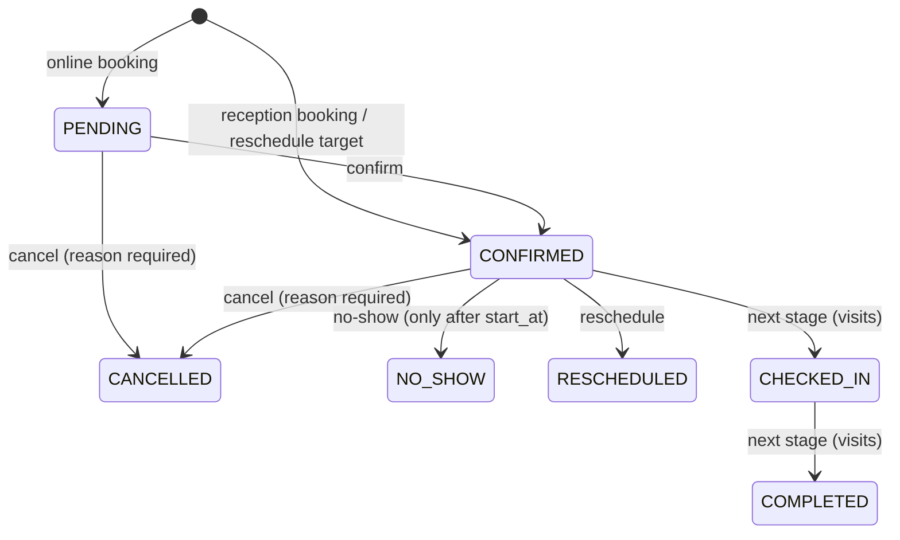

# Rehab Clinic — Backend

NestJS + PostgreSQL backend for a physiotherapy/medical clinic. It covers auth, staff users, the audit trail, patients, doctors, the services catalog, doctor schedules, availability and appointments (online and reception booking). Visits/check-in, billing and clinical records will come later as new modules.

- **Who logs in:** `OWNER`, `DOCTOR` and `RECEPTIONIST` staff.
- **Patients never log in.** A patient is identified only by their phone number, which is unique.
- **Every sensitive change is audited:** who did it, what changed (old and new values), when, and from which IP.

## Stack

| Concern | Choice |
|---|---|
| Framework | NestJS 12 (ESM, TypeScript strict) |
| Database | PostgreSQL 16 + TypeORM 1.x, migrations only (`synchronize: false` everywhere) |
| Naming | `snake_case` in the DB (`SnakeNamingStrategy`), camelCase in TS |
| Auth | argon2id passwords, 15 min JWT access token, 7 day rotating opaque refresh token |
| Validation | `class-validator` DTOs + global `ValidationPipe` (whitelist, forbid unknown, transform) |
| Config | `@nestjs/config` + Joi schema (`src/config/env.validation.ts`) |
| Logging | `nestjs-pino`, one request id per request (`X-Request-Id` in and out) |
| Rate limiting | `@nestjs/throttler` (stricter on login and public endpoints) |
| Docs | Swagger UI at `/api/docs`, JSON at `/api/docs-json` |
| Tests | Vitest (Jest-compatible API) + supertest e2e against a real PostgreSQL |

## Getting started

Prerequisites: Node 24+, Docker.

```bash
npm install
cp .env.example .env          # then edit secrets (JWT_ACCESS_SECRET, DB_PASSWORD, SEED_OWNER_*)
docker compose up -d          # PostgreSQL 16 on localhost:5432
npm run migration:run         # create the schema
npm run seed                  # create the first OWNER from SEED_OWNER_* (safe to re-run)
npm run start:dev             # http://localhost:3000/api/v1
```

- Swagger: <http://localhost:3000/api/docs>. Log in with `POST /auth/login`, then click **Authorize** and paste the `accessToken`.
- Health check: `GET /api/v1/health`, which also checks the database connection.
- pgAdmin (optional): `docker compose --profile tools up -d`, then open <http://localhost:5050>.

## Environment variables

All variables are validated at startup; the app refuses to start on invalid config. See [.env.example](.env.example).

| Variable | Default | Description |
|---|---|---|
| `NODE_ENV` | `development` | `development` \| `production` \| `test` |
| `PORT` | `3000` | HTTP port |
| `LOG_LEVEL` | `info` | pino level (`silent` in e2e) |
| `CORS_ORIGINS` | *(empty)* | Comma separated allowed origins; empty disables CORS |
| `TRUST_PROXY` | `false` | Set `true` behind a reverse proxy so the audit log records the real client IP |
| `SWAGGER_ENABLED` | `true` | Serve `/api/docs` |
| `DB_HOST` / `DB_PORT` / `DB_USERNAME` / `DB_PASSWORD` / `DB_DATABASE` | — | PostgreSQL connection (also used by `docker-compose.yml`) |
| `DB_LOGGING` | `false` | Log SQL |
| `DB_TEST_DATABASE` | `<DB_DATABASE>_test` | Database used by e2e tests. **It is wiped on every run** and must differ from `DB_DATABASE` |
| `JWT_ACCESS_SECRET` | — | At least 32 characters |
| `JWT_ACCESS_TTL_SECONDS` | `900` | Access token lifetime |
| `JWT_REFRESH_TTL_DAYS` | `7` | Refresh token lifetime |
| `THROTTLE_ENABLED` | `true` | Global switch (off in e2e) |
| `THROTTLE_TTL_MS` / `THROTTLE_LIMIT` | `60000` / `120` | Default limit per IP. Login: 5/min; refresh: 20/min; public reads: 30/min; public booking: 5 per 15 min |
| `CLINIC_TIMEZONE` | `Africa/Cairo` | IANA zone of the clinic. Schedules are in this zone's wall-clock time; offsets (DST) are resolved per date |
| `SLOT_INTERVAL_MINUTES` | `15` | Candidate slot starts every N minutes inside a schedule range |
| `BOOKING_MIN_LEAD_MINUTES` | `60` | Earliest bookable start = now + N minutes (schedule-checked bookings) |
| `BOOKING_MAX_DAYS_AHEAD` | `30` | Latest bookable local date = today + N days |
| `BOOKING_MAX_ACTIVE_PER_PHONE` | `3` | Max active future appointments one phone can hold through public booking |
| `BACKDATE_MAX_DAYS` | `7` | With `allowOutsideSchedule`, a RECEPTIONIST may book up to N local days in the past; older is OWNER only |
| `SEED_OWNER_NAME` / `SEED_OWNER_EMAIL` / `SEED_OWNER_PASSWORD` | — | First OWNER created by `npm run seed` |

## Scripts

| Script | What it does |
|---|---|
| `npm run start:dev` | Run with watch mode |
| `npm run build` / `npm run start:prod` | Compile to `dist/` and run it |
| `npm run lint` | oxlint, warnings are errors |
| `npm run typecheck` | `tsc --noEmit` over source **and** tests |
| `npm test` | Unit tests (`src/**/*.spec.ts`) |
| `npm run test:e2e` | e2e tests (`test/**/*.e2e-spec.ts`). Creates or wipes the test DB, runs the real migrations, then runs the suites one after another |
| `npm run migration:generate -- src/database/migrations/<Name>` | Diff the entities against the DB and write a migration |
| `npm run migration:create -- src/database/migrations/<Name>` | Empty migration for hand-written SQL |
| `npm run migration:run` / `migration:revert` / `migration:show` | Apply, undo the last, or list migrations |
| `npm run seed` | Run seeds (currently: first OWNER). Idempotent |

The migration scripts build first, because the TypeORM CLI loads the compiled `dist/database/data-source.js`.

### Migration workflow

1. Change or add an entity.
2. `npm run migration:generate -- src/database/migrations/DescribeTheChange`.
3. Review the SQL. Add anything TypeORM can't express by hand:
   - The `pg_trgm` GIN index on `patients.name` is declared with `@Index({ synchronize: false })` so that the generator ignores it.
   - Extensions are created by hand (`btree_gist`, needed by the exclusion constraints).
   - A Postgres enum shared by two tables (`appointment_status`) is emitted twice by the generator; remove the duplicate `CREATE TYPE`/`DROP TYPE`.
4. `npm run migration:run`, and check that `migration:revert` works.

## API overview

Every route is under `/api/v1` and needs `Authorization: Bearer <accessToken>` unless it is marked public.

| Group | OWNER | RECEPTIONIST | DOCTOR | Public |
|---|---|---|---|---|
| `/users` | RW | – | – | – |
| `/audit-logs` | R | – | – | – |
| `/patients` | RW | RW | R | – |
| `/doctors` | RW | R | R | – |
| `/clinic-services` | RW | R | R | – |
| `/public/doctors`, `/public/services` | – | – | – | R |
| `/doctors/:id/schedules`, `/doctors/:id/time-off` | RW | RW | R (own) | – |
| `/appointments/availability`, `/public/doctors/:id/slots` | R | R | R (own) | R |
| `/appointments` create / confirm / cancel / no-show / reschedule | W | W | – | create only (`POST /public/appointments`, PENDING) |
| `/appointments` list / view / history, `/patients/:id/appointments` | R | R | R (own only) | – |
| `/appointments/day` | R | R | – | – |

"Own" means a doctor sees only their own data. Asking for another doctor's schedule or appointment returns **404**, not 403, so the response doesn't reveal that it exists.

Errors always have this shape:

```json
{ "statusCode": 409, "error": "Conflict", "message": "A patient with this phone number already exists",
  "details": { "patientId": "…" }, "path": "/api/v1/patients", "timestamp": "2026-10-29T10:00:00.000Z" }
```

Validation errors have `message: "Validation failed"` and `details: [{ field, errors[] }]`.

Business errors also carry a stable machine-readable `code`:

| Code | Status | Meaning |
|---|---|---|
| `SLOT_UNAVAILABLE` | 409 | The doctor already has an active appointment overlapping that time |
| `PATIENT_OVERLAP` | 409 | The patient already has an active appointment overlapping that time |
| `BOOKING_LIMIT_REACHED` | 409 | The phone already holds `BOOKING_MAX_ACTIVE_PER_PHONE` upcoming appointments (public booking) |
| `SCHEDULE_OVERLAP` | 409 | A schedule range overlaps another active range of the same doctor and day |
| `OUTSIDE_SCHEDULE` | 422 | The start is not a slot in the doctor's schedule: outside the ranges, off the slot grid, in time off, or inside the lead time |
| `DATE_OUT_OF_RANGE` | 422 | The date is before today or beyond `BOOKING_MAX_DAYS_AHEAD` |
| `SERVICE_NOT_OFFERED` | 422 | The doctor doesn't offer the service, or it is inactive |
| `INVALID_STATUS_TRANSITION` | 422 | The state machine doesn't allow the transition |
| `NO_SHOW_TOO_EARLY` | 422 | NO_SHOW before the appointment's start time |
| `BACKDATE_LIMIT_EXCEEDED` | 422 | A RECEPTIONIST tried to book (or reschedule) more than `BACKDATE_MAX_DAYS` local days in the past |

## Modules

### `auth`
- `POST /auth/login` (email + password) returns an access JWT (`{ sub, role }`, 15 min), an opaque refresh token and the user. Inactive users get 403. Wrong credentials get a generic 401, with equalized timing for unknown emails.
- `POST /auth/refresh` **rotates** the refresh token: the old one is revoked and points to its replacement (`replaced_by_id`). Presenting an already revoked token is treated as theft. All of that user's tokens are revoked and the event is audited (`REFRESH_TOKEN_REUSE_DETECTED`).
- `POST /auth/logout` revokes a refresh token and is idempotent. `GET /auth/me` returns the current user.
- Only the SHA-256 of a refresh token is stored.
- Global `JwtAuthGuard`: everything is protected unless marked `@Public()`. It re-reads the user from the DB on every request, so deactivations and role changes apply immediately.
- Global `RolesGuard` + `@Roles()`. `@Auth(...roles)` combines `@Roles` with the Swagger docs. `@CurrentUser()` and `@CurrentActor()` (user id + IP, for auditing) are the param decorators.

### `users` (OWNER only)
- Create OWNER/RECEPTIONIST accounts, list (paginated; filter by role, active state or name/email), get, update, activate/deactivate, reset password.
- DOCTOR accounts are created and managed through `/doctors`, which keeps the account and the profile in sync. Password reset works for every role.
- **Rules:**
  - You cannot deactivate yourself.
  - At least one active OWNER must always remain. This is enforced with row locks, so two owners deactivating each other at the same time can't both succeed.
  - Deactivation and password reset revoke all of that user's refresh tokens.
- Emails are stored lowercased and protected by a unique constraint (409 on conflict). Responses never include `password_hash`. They are built from response DTOs, and the column is `select: false`.

### `audit`
- `AuditService.log(entry, manager?)` takes the caller's `EntityManager`, so the entry is committed or rolled back together with the change it describes.
- Recorded actions:
  - Login success and failure, logout, and refresh-token reuse.
  - User create, update, (de)activate and password reset.
  - Every patient, doctor, doctor-service and clinic-service mutation.
- Updates store only the fields that changed, in `old_values` and `new_values`.
- `GET /audit-logs` (OWNER) filters by `entityType`, `entityId`, `userId`, `action` and `from`/`to`, newest first. `user_id = NULL` means a public or system action.

### `patients`
- The phone number is the only unique business key. `normalizeEgyptianMobile()` (`src/common/utils/phone.util.ts`):
  - Accepts `01012345678`, `+201012345678`, `00201012345678` and `201012345678`, with spaces, dashes or Arabic-Indic digits.
  - Stores the number as `+201XXXXXXXXX`.
  - Only 010/011/012/015 mobiles are valid.
- Normalization happens in the DTO (before validation) **and again** in the service.
- Uniqueness is enforced by the DB constraint `uq_patients_phone`. A violation becomes `409` with `details.patientId` of the existing patient. This also applies when a PATCH changes the phone.
- `GET /patients?search=` matches part of the name (trigram index) or the phone in any format. `GET /patients/lookup?phone=` finds an exact number. `PATCH` changes are audited with old and new values.
- `PatientsService.findOrCreateByPhone({ name, phone, source, createdBy? }, manager?)` is for the future public booking flow:
  - Race-safe: `INSERT … ON CONFLICT (phone) DO NOTHING`, then `SELECT`.
  - Never renames an existing patient. It returns `nameMismatch: true` instead.
- There is **no public patient endpoint**. `notes` is for administrative notes only, never medical information.

### `doctors`
- `POST /doctors` (OWNER) creates the DOCTOR user and the doctor profile in **one transaction**.
- `PATCH` updates profile and account fields. Activate/deactivate changes both the profile and the login account, and deactivation signs the doctor out.
- `PUT/DELETE /doctors/:id/services/:serviceId` assigns or unassigns a service, with an optional `priceOverride`.
- Public endpoints:
  - `GET /public/doctors` and `GET /public/doctors/:id` return only active, public doctors whose account is active.
  - They expose only `id, name, specialty, bio, photoUrl, services[{id, name, description, durationMinutes, price}]`.

### `clinic-services`
- OWNER can create, update, activate and deactivate services; there is no hard delete. Staff can read them.
- `GET /public/services` returns active services only.
- Prices are `numeric(12,2)` and travel as decimal strings (`"350.00"`) end to end, so there is no float math. These are **current** prices: future invoices must snapshot the price at billing time.

### Time-zone rules (`common/time`)
- Every timestamp is stored as `timestamptz` (UTC). APIs accept and return **ISO 8601 with an offset**, e.g. `2026-11-05T17:00:00+02:00`. Input without an offset is rejected; `Z` is accepted.
- Responses are rendered in `CLINIC_TIMEZONE`. Egypt observes DST, so the same wall time is `+02:00` in winter and `+03:00` in summer. **Never hardcode an offset.**
- Doctor schedules are local wall-clock `time` values plus `day_of_week` (0 = Sunday), converted to UTC **per concrete date** with Luxon (`localToUtc`).
- **Spring forward** (last Friday of April, 00:00 → 01:00): a wall time inside the skipped hour moves forward with the clock (00:30 → 01:30 +03:00). A 00:00–02:00 range is therefore one real hour long.
- **Fall back** (last Thursday of October, 24:00 → 23:00): 23:00–23:59 happens twice. A range start uses the earlier occurrence and a range end the later one, so the repeated hour gets slots in both occurrences.
- Unit tests in `clinic-time.util.spec.ts` and `slot-generator.spec.ts` cover both 2026 transitions.
- "Now" comes from an injectable `CLOCK` (`ClinicTimeService`), so tests can freeze time.

### `schedules`
- `doctor_schedules` holds weekly ranges in clinic local time. A day can have several ranges (morning + evening) that must not overlap; touching ranges (09–13, 13–15) are allowed.
- Overlaps are checked in the service (409 `SCHEDULE_OVERLAP`) **and** by a `btree_gist` exclusion constraint on active rows. Deactivated ranges don't count.
- `doctor_time_off` holds absolute periods. Creating or updating time off that overlaps active appointments **still succeeds** and returns `conflictingAppointments`. Appointments are never cancelled automatically.
- OWNER and RECEPTIONIST manage schedules for every doctor; a DOCTOR can read only their own. Every change is audited.

### `appointments`

**Availability.** `AvailabilityService.getSlots(doctorId, serviceId, date)`:
- The slot length is the service duration. Candidate starts fall every `SLOT_INTERVAL_MINUTES` from each range start, and a slot must fit entirely inside one range.
- Slots that overlap time off or active appointments are excluded, as are past slots and slots within `BOOKING_MIN_LEAD_MINUTES`.
- Dates outside today..today+`BOOKING_MAX_DAYS_AHEAD` return 422.
- The doctor must be active and offer the service (otherwise 404/422).
- Reception can pass `includeOutsideSchedule` to see the whole local day, which ignores the schedule, time off and lead time but still excludes booked slots.
- Availability is only a hint. **The exclusion constraints are the real guarantee.**

**Double-booking guarantee.** Two exclusion constraints cover the *active* statuses (PENDING, CONFIRMED, CHECKED_IN, COMPLETED): one on `(doctor_id, tstzrange(start_at, end_at, '[)'))` and one on `(patient_id, …)`. A violation (Postgres `23P01`) becomes 409 `SLOT_UNAVAILABLE` or `PATIENT_OVERLAP`. Back-to-back appointments are fine, and CANCELLED, NO_SHOW and RESCHEDULED free the slot. `end_at` is always computed from the service duration; clients can't send it.

**Online booking** (`POST /public/appointments`, `@Public`). In one transaction:
1. Run the booking verifier: the CAPTCHA hook, a no-op for now.
2. Load the doctor (must be active and public) and the service (must be offered).
3. Check the start is a real slot: schedule, slot grid, time off, lead time, max days ahead. Otherwise 422.
4. `findOrCreateByPhone` (source ONLINE). An existing phone links to the existing patient, who is **never renamed**.
5. Lock the patient row and enforce `BOOKING_MAX_ACTIVE_PER_PHONE` (409 `BOOKING_LIMIT_REACHED`). A new phone simply has 0, so the response never reveals whether the phone existed.
6. Insert a **PENDING / ONLINE** appointment with `booked_name` = the submitted name and `booked_by` = NULL. A status-history row and an audit entry are written in the same transaction.

The response is exactly `{ referenceCode, doctorName, serviceName, startAt, endAt, status }`: no patient id or patient data.

Abuse protection:
- Throttling at 5 requests per 15 minutes per IP.
- A honeypot field `website` that must stay empty.
- The per-phone limit.
- `BookingVerifier` (`booking-verifier.ts`), an interface to bind a CAPTCHA implementation to later.

There is no public cancel or lookup endpoint: reception handles changes by phone, using the reference code.

**Reception booking** (`POST /appointments`):
- Identify the patient with `patientId`, or with `name` + `phone` (find-or-create, source RECEPTION). The appointment is created **CONFIRMED** with `booked_by` = the receptionist.
- `allowOutsideSchedule` skips the schedule, time-off and lead-time checks and writes an extra `APPOINTMENT_SCHEDULE_OVERRIDE` audit entry. It **never** skips the overlap constraints.
- It also allows recording past appointments. A RECEPTIONIST may go back at most `BACKDATE_MAX_DAYS` local days; anything older needs the OWNER (422 `BACKDATE_LIMIT_EXCEEDED`). The same rule applies to reschedule.

**Status machine.** The only definition is `appointment-state-machine.ts`; any other transition gets 422 `INVALID_STATUS_TRANSITION`.



- Each change locks the row, validates it with the state machine, updates the status, appends `appointment_status_history` (from, to, changed_by, reason) and writes `audit_logs`, all in **one transaction**.
- **Reschedule** (`POST /appointments/:id/reschedule`) is one transaction. The old appointment becomes RESCHEDULED first, so it stops blocking. Then a new CONFIRMED appointment is inserted with `rescheduled_from_id`: same patient and service, optionally another doctor. If the new slot is taken, everything rolls back.

**Reading:**
- `GET /appointments` filters by date range, doctor, patient, status and source; it is paginated and sorted by start time.
- `GET /appointments/day?date=` is the reception day list: patient name + phone, doctor, service, status, `bookedName` and a computed `nameMismatch`.
- `GET /appointments/:id`, `GET /appointments/by-reference/:code` (case-insensitive, e.g. `APT-7K3Q9X`) and `GET /appointments/:id/history`.
- `GET /patients/:id/appointments` lists a patient's appointments across all doctors.

## Project layout

```
src/
  app.module.ts, app.setup.ts (shared by main.ts and e2e), main.ts
  common/      decorators, guards, filters, pipes, dto, errors, utils, time (clinic time zone), base entity, enums
  config/      env validation (Joi), logger config
  database/    data-source.ts (TypeORM CLI), typeorm.options.ts, migrations/, seeds/
  modules/     auth, users, audit, patients, doctors, clinic-services, schedules, appointments, health
test/          e2e suites + global setup (test DB reset + migrations) + helpers
```

## Conventions for new modules

- Entities extend `BaseEntity` (uuid `id`, `created_at` / `updated_at` as `timestamptz`). Business data is never hard deleted: use `is_active` or a status column.
- Name constraints explicitly (`uq_…`, `fk_…`, `chk_…`, `idx_…`). Services catch specific unique violations by name and turn them into 409s.
- Do multi-step writes in `dataSource.transaction(...)`, pass the `manager` to `AuditService.log`, and throw 409s from a `catch` **outside** the transaction (a failed transaction is aborted).
- Controllers only route. Business logic lives in services, and every input and output is a DTO.
- Wrap cross-referencing entity relations in `Relation<>` (required for ESM circular imports).
- Business errors that clients branch on: throw `conflict(...)` / `unprocessable(...)` with an `ErrorCode` (`common/errors/app.exception.ts`).
- Dates and times: accept and return ISO with offset; convert through `ClinicTimeService`, never with a fixed offset.
